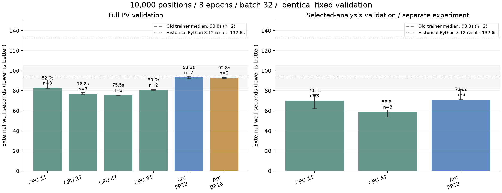
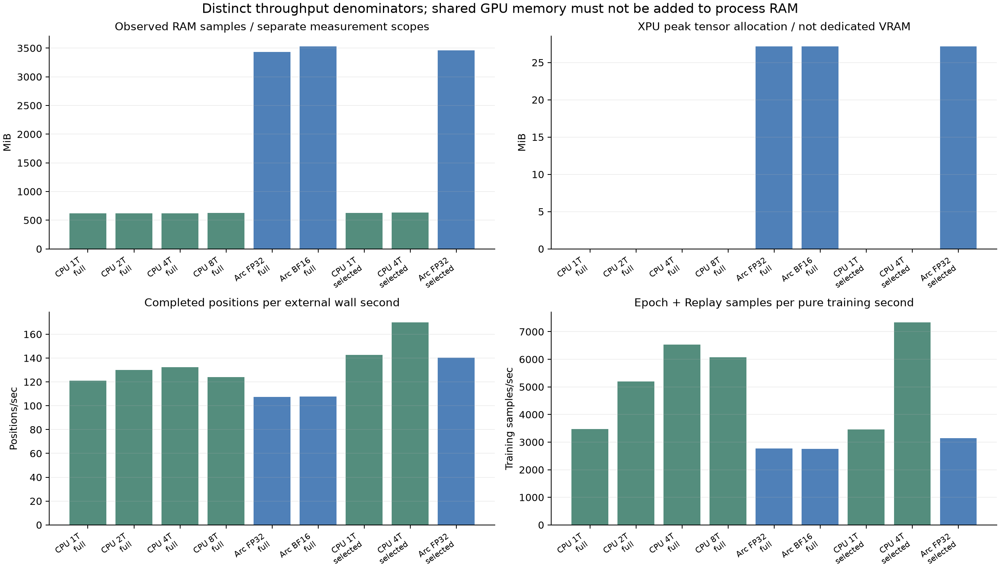
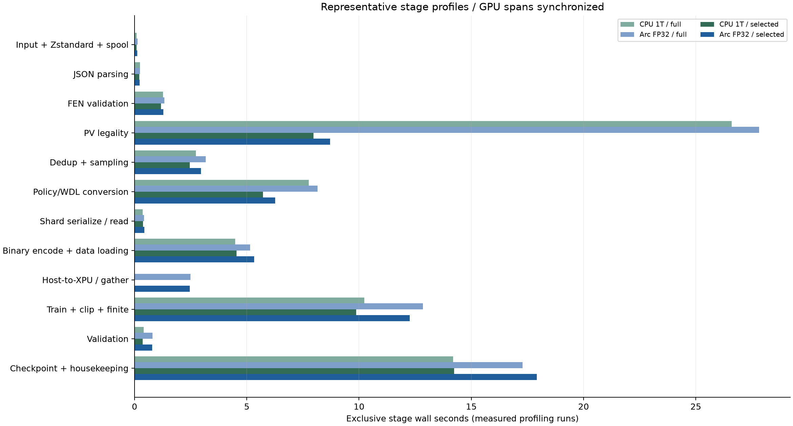

# CHROMATIC ARC — 전체 학습 처리량과 검증 결과

이 보고서는 이미 저장된 실행 로그만 읽어 생성한다. 장치 연산이나 추가 학습·다운로드를 실행하지 않는다. 실제 Arc XPU FP32/BF16 학습은 동작했지만 이 작은 MLP·batch 32에서는 GPU가 전체 처리량의 최선이라는 결과는 나오지 않았다. 반복 FEN/합법수 인코딩 캐시와 데이터 검증 병목이 중요했고, CPU 스레드 수를 함께 비교했다.

생성 시점에 기록된 파이프라인 실행은 44개다. 상태는 ok 41개, error 2개, timeout 1개다. 표의 n은 성공 완료한 실제 반복 수이며, 오류·deadline 중단은 중앙값에 넣지 않는다. 진행 중인 그룹은 나중에 같은 생성기로 다시 집계할 수 있다.

## 환경과 비교 계약

Windows x64 / Python 3.11.9 / PyTorch 2.14.1+xpu / NumPy 2.4.6, Intel Arc 140T 통합 GPU와 기존 width 64·blocks 2 MLP를 사용했다. 입력 1,280·Policy 4,672·WDL 3 구조와 챔피언 가중치는 유지했다. GPU의 표시 16GB는 공유 시스템 메모리를 포함할 수 있으며 독립 전용 VRAM으로 해석하지 않는다. [환경 원시 기록](reports/environment.json)

주요 10,000개 조건은 같은 챔피언에서 독립 시작, 3에폭, seed 2026, shard 1,000, batch 32, LR 0.001, Replay 256, 32업데이트마다 저장, 관리 디스크 1GiB·메모리 4GiB다. validation/test는 동일한 고정 1,000개를 사용한다. 입력은 로컬 공식 CC0 60,000행 fixture이며 다운로드 시간과 원격 다운로드는 없다. 새 ledger·spool·binary cache로 시작했지만 OS 파일 캐시·온도·다른 프로세스 부하는 완전히 통제하지 않았다. full과 selected 검증 그룹은 별도 시점의 실행이다.

전체 시간은 외부 wall clock이며 Python 시작·데이터 준비·학습·독립 validation·내보내기·체크포인트 저장을 포함한다. 순수 학습 시간은 forward/backward/Optimizer·gradient clip·finite 검사 구간이다. XPU 전송·학습 경계는 synchronize로 실제 완료를 잰다. 체크포인트 경로의 Trainer process_seconds는 시작 범위가 다르므로 외부 wall과 혼용하지 않는다.

## 보존한 과거 기록과 같은 환경의 재현

|포지션|보존된 Python 3.12 CPU1 기록|현재 Python 3.11 재현 중앙값 [범위] 초|현재 재현 n|
|---:|---:|---:|---:|
|100|15.4초|11.84 [11.84–11.84]|1|
|1,000|24.8초|17.05 [17.05–17.05]|1|
|10,000|132.6초|93.77 [82.25–105.29]|2|

두 기준선은 Python·패키지 환경과 실행 시점이 다르다. 초기 재현 105.29초와 개선된 process-tree monitor로 재실행한 82.25초를 모두 보존해 10,000개 기준은 두 값의 중앙값으로 사용했다. 빠른 한 번이나 느린 한 번만 골라 기준으로 삼지 않았다. 구현 최적화 가속 배율은 현재 환경의 기존 학습기 재현을 기준으로 따로 계산하며, 과거 132.6초와의 단순 차이를 모두 새 코드 효과라고 주장하지 않는다. 재현이 1회인 항목은 3회 중앙값이라고 표시하지 않는다.

**현재 조건의 가장 빠른 검증된 selected 설정은 CPU 4T, 3회 중앙값 58.84초다. 같은 Python 환경의 기존 학습기 중앙값 93.77초 대비 1.59×다.** 과거 132.6초 대비 2.25×는 환경이 다른 참고 비교이며 주 가속 배율과 구분한다.

## 10,000개 전체 파이프라인 — full PV 검증

|조건|성공 n|전체 중앙값 [최소–최대] 초|순수 학습 초|전송 초|Positions/s|Training samples/s|재현 기준 가속|Policy / WDL val|
|---|---:|---:|---:|---:|---:|---:|---:|---:|
|CPU 1T|3|82.64 [82.24–90.87]|10.47|0.000|121.0|3,470|1.13×|2.883164 / 0.723687|
|CPU 2T|3|76.83 [76.63–78.22]|6.98|0.000|130.2|5,201|1.22×|2.883164 / 0.723687|
|CPU 4T|2|75.52 [75.23–75.82]|5.56|0.000|132.4|6,535|1.24×|2.883164 / 0.723687|
|CPU 8T|2|80.63 [80.03–81.23]|5.99|0.000|124.0|6,066|1.16×|2.883230 / 0.723690|
|Arc FP32|2|93.28 [92.07–94.48]|13.11|2.361|107.2|2,771|1.01×|2.883164 / 0.723686|
|Arc BF16|2|92.77 [92.27–93.27]|13.20|2.211|107.8|2,752|1.01×|2.884028 / 0.723992|

완료된 반복이 2회인 조건은 n=2의 중앙값이다. timeout 반복을 완료로 간주하거나 임의 보간하지 않았다. 위 batch 32 실행은 같은 신규 포지션 10,000개를 3에폭 학습하며, Replay를 합친 실제 학습 샘플은 **36,318개**, Optimizer 단계는 **1,149개**였다. **Positions/sec는 완료 포지션/전체 시간**, **Training samples/sec는 Epoch+Replay 샘플/순수 학습 시간**이므로 서로 다른 분모·분자다.

## 선택된 평가부터 검증하는 데이터 경로 — 별도 실험

공식 fixture 60,000행을 full과 selected 정규화로 비교했다. 수용 행은 59,069개이며 의미 비교 mismatch는 0개였다. 선택된 평가·정책·WDL·confidence·FEN/history·분할 identity·provenance의 canonical 결과를 비교했고, 명시적으로 달라진 낮은 평가의 rejection-audit 범위는 제외했다. [독립 정규화 감사](reports/quality-selected/validation.json)

정규화 구성요소의 시간은 full 73.65초, selected 35.31초로 2.086×였다. 이는 압축 해제·JSON 파싱·학습·저장을 제외한 **구성요소 가속**이며 전체 학습 가속으로 바꾸어 쓰지 않는다. selected도 실제 사용한 PV 전체의 합법성을 검증하며, 사용하지 않는 낮은 분석의 세부 거부 목록까지 같은 범위로 수집하는 모드는 아니다.

|조건|성공 n|전체 중앙값 [최소–최대] 초|순수 학습 초|전송 초|재현 기준 가속|Policy / WDL val|
|---|---:|---:|---:|---:|---:|---:|
|CPU 1T|3|70.08 [62.22–76.31]|10.52|0.000|1.34×|2.883164 / 0.723687|
|CPU 4T|3|58.84 [53.93–60.67]|4.95|0.000|1.59×|2.883164 / 0.723687|
|Arc FP32|3|71.28 [71.16–81.34]|11.56|2.139|1.32×|2.883164 / 0.723686|

보고서 생성 시 코드의 기본 validation mode는 **selected**다. 표본 전체의 의미 일치와 별도 파이프라인 결과를 근거로 판단하되, 한 소규모 fixture의 결과를 모든 미래 데이터에 대한 증명으로 해석하지 않는다. full/selected 실행 시점과 측정 driver 변경도 있으므로 전체 시간 차이를 전부 한 함수의 효과로 단정하지 않는다.



## RAM·GPU·CPU·I/O 관측

|검증/조건|관측 RAM 최고 MiB|XPU 할당 최고 MiB|XPU 예약 최고 MiB|CPU process 평균 %|GPU busiest engine 평균 %|읽기 / 쓰기 MiB|
|---|---:|---:|---:|---:|---:|---:|
|full / CPU 1T|618.4|0.0|0.0|89.4|NA|3,659.8 / 1,394.2|
|full / CPU 2T|621.1|0.0|0.0|125.0|NA|3,659.8 / 1,394.1|
|full / CPU 4T|619.8|0.0|0.0|193.2|NA|3,659.8 / 1,394.1|
|full / CPU 8T|623.7|0.0|0.0|349.4|NA|3,659.8 / 1,394.2|
|full / Arc FP32|3,431.2|27.2|46.0|90.5|18.3|3,661.2 / 1,394.2|
|full / Arc BF16|3,530.7|27.2|46.0|89.9|18.3|3,661.2 / 1,394.3|
|selected / CPU 1T|626.9|0.0|0.0|86.7|NA|4,081.3 / 1,484.0|
|selected / CPU 4T|631.7|0.0|0.0|216.0|NA|4,081.3 / 1,484.0|
|selected / Arc FP32|3,461.1|27.2|46.0|88.2|21.5|4,082.8 / 1,484.1|

RAM은 연속 모든 순간을 계측한 물리 최고점이 아니라 표본·allocator의 관측값이다. 초기 Windows venv python.exe 외부 sampler가 실제 interpreter 대신 redirector를 측정한 문제가 발견됐다. 해당 원시 로그·wall time은 보존하고, ARC 자원은 실제 프로세스 내부 resource-summary로 보정한 combined-corrected를 사용했다. 기존 v1 기준선은 커밋 RSS 표본만 회수할 수 있어 CPU/I/O는 NA다. 이후 selected driver는 process-tree와 실제 내부 자원을 함께 기록한다. 이 측정 범위 차이를 작은 RAM 차이의 개선 근거로 사용하지 않는다. [보정 근거](reports/benchmarks/resource-correction.json)

GPU%는 현재 PID의 가장 바쁜 Windows GPU engine이며 EU occupancy가 아니다. 유효한 관측값이 없으면 NA와 이유를 보존했고 0%로 대체하지 않았다. CPU process%는 여러 코어에서 100%를 넘을 수 있다. I/O는 프로세스 카운터이며 물리 드라이브 전체 트래픽이 아니다. 통합 GPU의 allocator와 프로세스 RSS는 겹칠 수 있으므로 합산하지 않는다.



## 12단계 대표 프로파일

다음은 별도의 Profile 실행에서 얻은 exclusive wall seconds다. GPU stage는 전후 synchronize를 사용한다. CPU source worker는 GPU를 동기화하지 않는다. 부모 inclusive stage와 child를 중복 합산하지 않으며 다른 스레드의 동시 실행 합계는 wall time보다 커질 수 있다. Profile-off인 나머지 반복의 세부 단계는 NA이며 대표값을 복사해 채우지 않았다.

|단계|CPU1 full|Arc FP32 full|CPU1 selected|Arc FP32 selected|
|---|---:|---:|---:|---:|
|압축 읽기·Zstandard·spool|0.091|0.135|0.094|0.123|
|JSONL 파싱|0.235|0.249|0.209|0.232|
|FEN 검증|1.261|1.326|1.170|1.282|
|PV·합법수 검증|26.592|27.824|7.969|8.704|
|중복 제거·균형 샘플링|2.739|3.177|2.457|2.962|
|Policy/WDL 라벨 변환|7.759|8.153|5.725|6.258|
|샤드 직렬화·역직렬화|0.370|0.425|0.382|0.437|
|binary 인코딩·PyTorch 배치 로딩|4.489|5.149|4.549|5.330|
|CPU→XPU·상주 batch gather|0.000|2.489|0.000|2.457|
|Forward/Backward/Optimizer·안전 검사|10.234|12.849|9.865|12.258|
|Validation|0.406|0.801|0.369|0.782|
|Checkpoint 저장·정리|14.196|17.276|14.238|17.923|

학습 구간 안의 세부 초는 다음과 같다. 위 10번째 행의 부분 항목이므로 다시 더하지 않는다.

|학습 부분|CPU1 full|Arc FP32 full|CPU1 selected|Arc FP32 selected|
|---|---:|---:|---:|---:|
|forward|1.282|2.770|1.247|2.475|
|backward|1.465|2.940|1.418|2.819|
|optimizer|2.366|2.093|2.283|2.026|
|gradient_clip|0.427|2.098|0.420|2.020|
|finite_check|4.694|2.949|4.497|2.918|

복구 단계는 새 실행에서 호출하지 않으므로 위 저장 시간에 섞지 않는다. `checkpoint_recovery`는 별도 실제 Resume Profile의 다음 표로 보고한다. 원본 decode/JSON과 선택 평가·PV 비용, 캐시 생성/배치 로딩을 분리했다. 표에 없는 data_preparation exclusive bookkeeping, Python 시작, 오프닝 앵커 준비, 장치 초기화와 계측 자체 비용도 전체 wall에는 포함될 수 있어 12행 합계가 전체 시간과 일치할 필요는 없다.

|별도 selected Resume 장치|실제 복구 span n|중앙값 초|최소–최대 초|
|---|---:|---:|---:|
|cpu|6|0.025374|0.014387–0.044786|
|xpu|6|0.027653|0.013299–0.033251|

완료 재개·세 강제 종료·미러 및 이전 checkpoint 복구의 실제 load/검증 구간이다. Python/장치 초기화와 남은 학습·고정 validation을 포함한 재개 프로세스 전체 시간은 수초 이상이며 이 0.0x초와 다르다. [각 복구 Profile·SHA·전체 재개 시간 CSV](reports/checkpoint-recovery-timings.csv)

|Profile 조건|Profile 전체 초|동일 조건 정상 중앙값 초|관측 비율 차이|Checkpoint recovery 초|
|---|---:|---:|---:|---:|
|CPU1 full|85.85|82.64|3.9%|NA|
|Arc FP32 full|103.09|93.28|10.5%|NA|
|CPU1 selected|64.62|70.08|-7.8%|NA|
|Arc FP32 selected|81.82|71.28|14.8%|NA|

이 비율 차이는 별도 실행의 관측값으로 순수 profiler 오버헤드만 분리한 통제 실험은 아니다. Profile은 동기화와 많은 이벤트 기록을 추가하므로 주요 처리량은 Profile-off 반복을 기준으로 한다.



## 작은 데이터와 배치 크기 해석

|포지션 / 조건|batch|성공 n|전체 초|순수 학습 초|Optimizer 단계|Policy / WDL val|
|---|---:|---:|---:|---:|---:|---:|
|100 / CPU 1T|32|1|11.05|0.266|12|3.743299 / 1.320863|
|100 / Arc FP32|32|1|14.85|2.141|12|3.743299 / 1.320863|
|1,000 / CPU 1T|32|1|17.47|1.357|114|3.065276 / 0.788022|
|1,000 / CPU 8T B256|256|1|14.85|0.306|21|3.153299 / 0.869355|
|1,000 / CPU 8T B512|512|1|14.85|0.276|12|3.301801 / 0.975376|
|1,000 / Arc BF16|32|1|20.66|3.296|114|3.068112 / 0.794712|
|1,000 / Arc FP32|32|1|20.88|3.126|114|3.065276 / 0.788022|
|1,000 / Arc FP32 B256|256|1|18.47|2.721|21|3.153299 / 0.869355|
|1,000 / Arc FP32 B512|512|1|18.86|2.806|12|3.301800 / 0.975376|

배치 32/64/128/256/512와 BF16·상주·사전 할당·누적·Optimizer의 이미 인코딩된 배치 행렬은 [MICROBENCHMARK](docs/MICROBENCHMARK.md)와 [원시 57조건](reports/benchmarks/microbenchmark.json)에 있다. 큰 배치는 같은 3에폭에서도 Optimizer 업데이트 수를 바꾸므로, 작은 데이터의 loss/속도만 보고 batch 확대를 품질 보존 최적화로 채택하지 않았다. 상주 미니배치 마이크로벤치마크와 전체 샤드 상주는 서로 다른 메모리 실험이다.

## 수치 문제를 발견하고 제외한 경로

실제 Arc 환경에서 기본 foreach gradient clip이 norm을 약 2.163705로 반환했지만 CPU float64 기준은 약 1.901946이었다. gradient 자체의 최대 오차는 약 1.27e−7이어서 clip 경로의 문제를 분리할 수 있었다. XPU clip을 foreach=False로 고정한 뒤 norm·clipped gradient·한 단계 업데이트를 다시 검증했다. 수정 전 자료는 진단용 pre-clip-fix에 보존하고 정규 결과로 사용하지 않았다. [clip 진단](reports/clip-diagnostic.json) / [측정 코드 근거](reports/benchmarks/measurement-code.json)

수정 후 FP32 CPU/XPU 오차: Policy logits 4.768e-06, WDL 확률 2.384e-07, gradient 1.043e-07, 업데이트 가중치 1.565e-07. 판정은 True이며, 이는 같은 입력 한 배치의 수치 검사다. 긴 학습의 모든 가중치가 비트 단위로 같다는 뜻은 아니다. [FP32 원시 검증](reports/numeric-xpu-fp32.json)

BF16은 FP32 master weights와 FP32 loss/softmax를 유지하고 비정상 손실/gradient 또는 사전 정의된 loss 악화 시 Optimizer 전에 FP32로 복귀한다. 짧은 BF16 통과만으로 기본 정밀도를 변경하지 않았다. fused/foreach Optimizer, gradient accumulation, 사전 할당 전송의 효과는 장치·배치에 따라 달랐고 일관된 전체 파이프라인 근거 없이 기본값으로 채택하지 않았다.

전체 샤드 XPU 상주 모드는 4GiB 프로세스 한도에서 bad allocation을 만나 두 번 실패했다. 실패한 실행의 중간 처리량은 완료 처리량으로 사용하지 않았고 해당 샤드·체크포인트를 보존했다. 6GiB 한도의 추가 상주 실험은 별도 조건으로 다음에 표시한다. 메모리 한도와 검증 경로가 다르고 1회뿐이므로 기본 copy/auto 경로보다 공정하게 우수하다는 근거로 쓰지 않는다. 완료되지 않은 실행을 CPU로 조용히 이어 붙이지 않았다.

|상주 실험 검증 모드|메모리 한도 GiB|완료 / 시도|완료 wall 중앙값 초|관측 RAM 최고 MiB|XPU 할당 최고 MiB|
|---|---:|---:|---:|---:|---:|
|full|4|0 / 2|NA|3,695.3|NA|
|selected|6.0|1 / 1|69.88|3,779.0|62.3|

`torch.compile`은 Windows XPU 전체가 미지원인 것은 아니지만 현재 환경의 격리 시험에서 cp949/UnicodeDecodeError 및 종료 상한 문제가 발생해 활성화하지 않았다. [격리 compile 기록](reports/benchmarks/compile-probe.json)

|미완료 조건|상태|반복|관측 종료 시간 초|원시 로그|
|---|---|---:|---:|---|
|arc-xpu-resident-10000|error|1|41.52|[로그](runs/benchmark-arc-final/arc-xpu-resident-10000-rep1/training.stdout.log)|
|arc-xpu-resident-10000|error|2|44.74|[로그](runs/benchmark-arc-final/arc-xpu-resident-10000-rep2/training.stdout.log)|
|arc-cpu4-10000|timeout|3|65.38|[로그](runs/benchmark-arc-final/arc-cpu4-10000-rep3/training.stdout.log)|

## 최종 정확성·복구·기존 상태 보존

혼합 입력 32개에서 Policy와 WDL 양쪽의 유효 라벨·gradient·업데이트를 실제로 확인했다. 양쪽 헤드 gradient 검사 판정은 True이며 FP32 한 단계 가중치 최대 오차는 1.565e-07였다. 예전 Value 가중치 0인 입력만으로 두 헤드 검사를 통과했다고 판단하지 않는다.

독립 C++ SIMD/sparse-policy 추론은 CPU4-selected·XPU-FP32-selected·XPU-BF16 후보 각 10개, 총 **30개**가 통과했다. 동일 PT에서 내보낸 FP32 `.zero`와 PyTorch를 비교했고 엔진·챔피언은 수정하지 않았다. [C++ 추론 전체 결과](reports/native-summary.json)

selected CPU/XPU 각각 5개 실제 중단·손상 복구 시나리오에서 모델·Optimizer·Scheduler·모든 RNG·Replay·진행 상태가 중단 없는 같은 장치 기준과 정확히 같았다. selected와 full의 기준 내보내기 SHA도 같은 장치에서 일치했다. [selected 복구 원시 요약](reports/recovery-selected-summary.json)

기존 완료 100개 실행을 원본 읽기 전용으로 복사해 새 ARC head로 이행했다. step 12→12, 신규 학습 업데이트 0회, 의미 상태 10개와 `.zero` 일치를 확인했다. [실제 기존 실행 import](reports/legacy-import-validation.json)

Python 3.11 최종 일반 검사 151개와 24개 subtest가 통과했다. 일반 실행에서 생략한 6개 선택 실행 시험은 별도 실제 장치·복구 검증과 구분한다. [검사 로그](reports/unit-tests-final.log)

## 채택 범위와 남은 한계

현재 기본은 Device auto, CpuThreads 1, BatchSize 32, FP32, cache auto, Prefetch 0, 기본 AdamW, accumulation 1이다. validation mode는 selected다. selected는 의미 비교·고정 검증·동일 장치 실제 복구가 확인된 범위에서 채택했다. mode가 없던 이전 ARC Resume는 full로 복원해 이전 의미·서명을 보존한다. CPU 스레드나 배치·정밀도·상주 모드를 측정 한 번만으로 자동 확대하지 않는다.

auto는 등록된 전체 파이프라인 추천을 먼저 검토한다. 하드웨어/모델 구현·초기 가중치·source·규모·Epochs·seed·Replay·샤드·업데이트 수·배치·스레드·검증 모드 제약과 품질 gate가 맞아야 사용한다. 현재 등록 결과는 CPU4/B32가 전체 처리량 추천이고, 같은 CPU1 제약에서 CPU와 XPU를 3회씩 비교한 auto 장치는 CPU다. 제약이 다르면 이 속도를 외삽하지 않고 마이크로벤치마크/짧은 실측으로 돌아간다. [실측 등록·제약·품질 gate](reports/benchmarks/pipeline-recommendation.json)

고정 holdout·confidence 라벨·Replay·성공 샤드 삭제 조건과 기존 `.zero` 형식을 유지한다. 기존 CPU/XPU 체크포인트 이동·같은 장치 강제 종료/Resume는 별도 [검증 계약](docs/VALIDATION.md) 및 [복구 결과](reports/recovery-validation-summary.json)로 확인한다. 기존 전체 학습 상태를 원본 보존하며 복사하는 경로는 [Legacy import](docs/LEGACY_IMPORT.md)다. 엔진·Muyeong·챔피언·이전 실험 자료를 덮어쓰지 않는다.

이번 결과는 100·1,000·10,000개 로컬 데이터 실험이다. 100,000개 학습이나 대규모 다운로드는 실행하지 않았다. 학습 loss·속도 개선은 Elo나 체스 기력의 증명이 아니며 새 모델은 후보로만 저장한다. 데이터 처리·저장·안전 검사 비용 때문에 미니배치 peak samples/sec를 전체 처리량으로 외삽할 수 없다.

## 원시 자료와 재생성

- [모든 조건·반복·stage JSON](reports/performance/summary.json) / [집계 CSV](reports/performance/summary.csv) / [출처 경로가 붙은 파생 JSONL](reports/performance/runs-derived.jsonl)
- [최종 44개 합본 JSONL](reports/benchmarks/all-runs.jsonl) / [전체 그룹 메타데이터](reports/benchmarks/all-metadata.json)
- [초기 전체 그룹의 자원 보정 JSONL](reports/benchmarks/combined-corrected.jsonl) / [초기 전체 계획](reports/benchmarks/pipeline-arc-final/plan.json)
- [selected 그룹 원시 JSONL](reports/benchmarks/pipeline-arc-selected/pipeline-runs.jsonl) / [selected 계획](reports/benchmarks/pipeline-arc-selected/plan.json)
- 각 실행의 command.json, training.stdout.log, candidate/logs/training.csv·JSONL, candidate/resources·profile 아래 원시 기록
- [60,000행 의미 일치 감사](reports/quality-selected/validation.json) / [인코딩 배치 행렬](reports/benchmarks/microbenchmark.json)

최종 합본이 준비되면 다음과 같이 같은 보고서를 다시 생성한다. 이 명령은 로그 읽기와 표·그래프 생성만 하며 PyTorch/XPU를 import하지 않는다. Matplotlib이 없는 환경에서는 --no-charts를 지정할 수 있다.

```powershell
python .\tools\report_performance.py `
  --runs .\reports\benchmarks\all-runs.jsonl `
  --metadata .\reports\benchmarks\all-metadata.json
```
