# CHROMATIC MCTS 깊이 정밀 계측

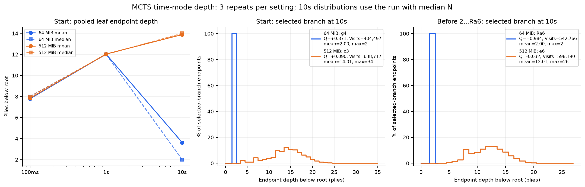

## 측정 범위와 정의

분석한 실행은 총 104개(시간 기준 72개, 동일 시뮬레이션 수 기준 32개)다. 배포 엔진과 모델을 보존한 별도 계측 버전의 로그를 읽어 표와 그래프를 생성했다.

- 모든 깊이는 현재 루트 아래 **플라이**다. 최대 깊이는 가장 깊은 한 번의 시뮬레이션 경로이며 미니맥스 완전 탐색 깊이가 아니다.
- 잎 깊이는 완료된 시뮬레이션당 도착점 하나를 센다. 신규 보존 노드, 캐시된 종료 노드, 메모리 부족으로 보존되지 못한 잎, 경로 제한에 도착한 경우를 포함한다. 루트 초기 평가와 별도 메이트 증명은 잎 표본에 포함하지 않는다.
- 깊이별 경로 방문은 해당 깊이까지 도달한 시뮬레이션 수다. 깊이 0은 전체 N이며, 깊이 d의 방문수는 잎 깊이 히스토그램에서 깊이≥d인 횟수의 합이다. 보존되지 못한 잎도 해당 위치까지 이동해 평가했으므로 경로 도달에 포함한다. 이는 고유 보존 노드 수나 잎 도착점 분포와 구분한다.
- 새 노드는 실제 보존 노드 생성(루트 제외)이며, 합법 수 목록 확장 성공은 별도 카운터다. 실패는 child 노드 수 한도, child 바이트 한도, 간선 목록 바이트 한도별로 기록한다. 최대 메모리 예약 도달과 실제 첫 할당 실패는 별도 사건이다.
- Policy는 루트 합법 수 사이의 사전 확률, Q는 그 수의 역관점 백업 W−L 평균, Visits는 선택 횟수다. **Q는 객관적 승률·센티폰이 아니다.**
- `5.Rg1`은 100ms 기보의 9번째 플라이 위치다. 이전 1초 기보의 `4.Rg1`은 별도 보조 위치로 측정했다.

시간 모드에서는 같은 100ms/1초/10초를 주어 실제 완료 N을 측정했다. 반복의 N 중앙값·범위와 최대 깊이 중앙값·범위를 표시한다. 평균·중앙값 잎 깊이는 반복의 모든 잎을 합친 분포에서 계산한다. 그래프의 대표 실행은 해당 조건의 N 중앙값에 가장 가까운 실행이다. 시간 모드에서는 N이 달라지므로 메모리 효과와 처리량 효과를 함께 받는다.

동일 N 모드는 같은 위치·같은 모델·시드·스레드·요청 N을 고정하여 메모리 상한의 영향을 비교한다. 같은 벽시계 시간의 강도 비교로 해석하지 않는다. 조건 값: `{"seed": ["2026"], "threads": ["1"], "max_nodes": ["1000000"]}`. 구체적 설정·해시·명령은 원시 JSONL과 실행 로그에 기록되어 있다.

## 시간 기준 비교

| 위치 | 시간 | MiB | N 중앙값 | 잎 평균 / 중앙값 | 최대 깊이 중앙값 [범위] | 새 노드 / 수 목록 확장 | 확장 실패 | 최초 실패(ms) | 선택 수 |
|---|---:|---:|---:|---|---|---:|---:|---:|---|
| 1.g4 직전 · 시작 위치 | 0.1s | 64 | 6,586 | 7.79 / 8 | 16 [16–16] | 6,586 / 6,586 | 0 | — | c3 / c3 / c3 |
| 1.g4 직전 · 시작 위치 | 0.1s | 512 | 6,224 | 7.84 / 8 | 16 [16–16] | 6,224 / 6,224 | 0 | — | c3 / c3 / c3 |
| 1.g4 직전 · 시작 위치 | 1s | 64 | 65,180 | 12.02 / 12 | 26 [26–26] | 64,202 / 64,036 | 0 | 992.45 | c3 / c3 / c3 |
| 1.g4 직전 · 시작 위치 | 1s | 512 | 66,477 | 12.04 / 12 | 26 [26–26] | 65,440 / 65,268 | 0 | — | c3 / c3 / c3 |
| 1.g4 직전 · 시작 위치 | 10s | 64 | 781,622 | 3.62 / 2 | 26 [26–26] | 65,535 / 65,363 | 715,017 | 1,007.18 | g4 / g4 / g4 |
| 1.g4 직전 · 시작 위치 | 10s | 512 | 650,044 | 13.89 / 14 | 34 [34–34] | 524,287 / 523,502 | 121,308 | 8,271.70 | c3 / c3 / c3 |
| 5.Rg1 직전 · 100ms 기보 | 0.1s | 64 | 6,360 | 6.85 / 7 | 14 [14–14] | 6,275 / 6,254 | 0 | — | Rg1 / Rg1 / Rg1 |
| 5.Rg1 직전 · 100ms 기보 | 0.1s | 512 | 6,518 | 6.86 / 7 | 14 [14–14] | 6,433 / 6,412 | 0 | — | Rg1 / Rg1 / Rg1 |
| 5.Rg1 직전 · 100ms 기보 | 1s | 64 | 65,793 | 9.53 / 9 | 24 [24–24] | 65,206 / 65,098 | 0 | 992.92 | Rg1 / Rg1 / Rg1 |
| 5.Rg1 직전 · 100ms 기보 | 1s | 512 | 64,741 | 9.53 / 9 | 24 [24–24] | 64,175 / 64,071 | 0 | — | Rg1 / Rg1 / Rg1 |
| 5.Rg1 직전 · 100ms 기보 | 10s | 64 | 788,239 | 2.66 / 2 | 24 [24–24] | 65,535 / 65,229 | 722,299 | 1,006.94 | e4e5 / e4e5 / e4e5 |
| 5.Rg1 직전 · 100ms 기보 | 10s | 512 | 642,933 | 10.31 / 11 | 25 [25–25] | 522,544 / 519,310 | 117,389 | 8,298.02 | Rg1 / Rg1 / Rg1 |
| 4.Rg1 직전 · 1초 기보 | 0.1s | 64 | 6,712 | 7.92 / 8 | 16 [16–16] | 6,577 / 6,552 | 0 | — | e4 / e4 / e4 |
| 4.Rg1 직전 · 1초 기보 | 0.1s | 512 | 6,143 | 7.83 / 8 | 16 [16–16] | 6,046 / 6,025 | 0 | — | e4 / e4 / e4 |
| 4.Rg1 직전 · 1초 기보 | 1s | 64 | 62,675 | 9.02 / 9 | 20 [20–20] | 61,938 / 61,810 | 0 | — | Rg1 / Rg1 / Rg1 |
| 4.Rg1 직전 · 1초 기보 | 1s | 512 | 64,886 | 9.05 / 9 | 20 [20–20] | 64,149 / 64,021 | 0 | — | Rg1 / Rg1 / Rg1 |
| 4.Rg1 직전 · 1초 기보 | 10s | 64 | 779,510 | 3.01 / 2 | 20 [20–20] | 65,535 / 65,407 | 713,227 | 996.63 | g4 / g4 / g4 |
| 4.Rg1 직전 · 1초 기보 | 10s | 512 | 660,108 | 9.56 / 10 | 25 [25–25] | 524,287 / 523,663 | 132,730 | 8,355.15 | Rg1 / Rg1 / Rg1 |
| 2...Ra6 직전 · 10초 기보 | 0.1s | 64 | 6,702 | 7.14 / 7 | 16 [16–16] | 6,702 / 6,702 | 0 | — | e6 / e6 / e6 |
| 2...Ra6 직전 · 10초 기보 | 0.1s | 512 | 6,317 | 7.10 / 7 | 16 [16–16] | 6,317 / 6,317 | 0 | — | e6 / e6 / e6 |
| 2...Ra6 직전 · 10초 기보 | 1s | 64 | 59,351 | 9.45 / 9 | 21 [21–21] | 59,336 / 59,331 | 0 | — | e6 / e6 / e6 |
| 2...Ra6 직전 · 10초 기보 | 1s | 512 | 66,001 | 9.39 / 9 | 21 [21–21] | 65,986 / 65,981 | 0 | — | e6 / e6 / e6 |
| 2...Ra6 직전 · 10초 기보 | 10s | 64 | 751,040 | 3.24 / 2 | 21 [21–21] | 65,535 / 65,530 | 685,490 | 991.53 | Ra6 / Ra6 / Ra6 |
| 2...Ra6 직전 · 10초 기보 | 10s | 512 | 628,308 | 11.75 / 12 | 26 [26–26] | 524,287 / 524,168 | 103,487 | 8,480.79 | e6 / e6 / e6 |

확장 실패는 세 실패 카운터의 합이다. 같은 시뮬레이션에서 child 실패 뒤 NN 평가가 발생할 수 있으므로 실패 횟수를 서로 다른 위치 수로 부르지 않는다. 전용 CSV에는 실패 원인과 미보존 NN 평가를 따로 기록했다.

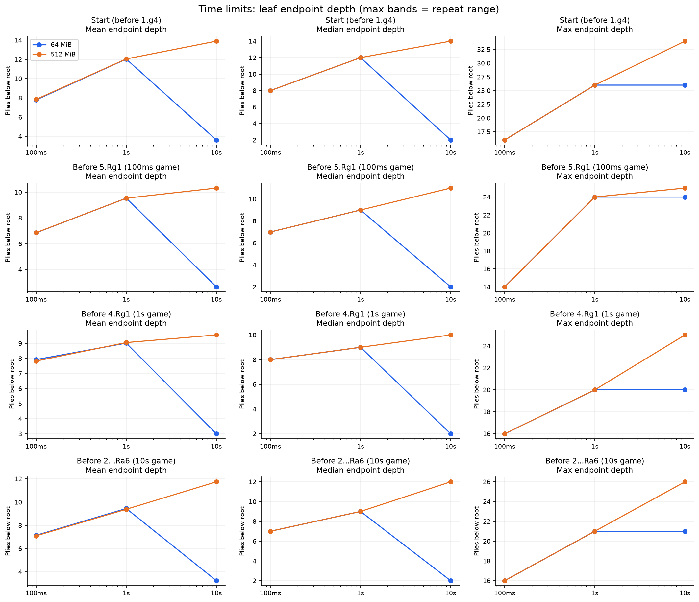

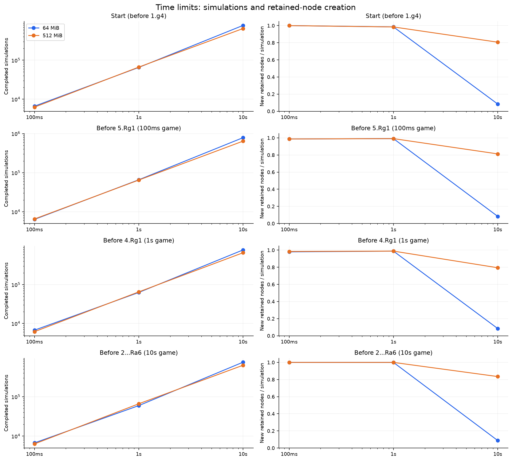

## 동일 시뮬레이션 수 비교

| 위치 | 고정 N | MiB | N 중앙값 | 잎 평균 / 중앙값 | 최대 깊이 중앙값 [범위] | 새 노드 / 수 목록 확장 | 확장 실패 | 최초 실패(ms) | 선택 수 |
|---|---:|---:|---:|---|---|---:|---:|---:|---|
| 1.g4 직전 · 시작 위치 | 6,586 | 64 | 6,586 | 7.82 / 8 | 16 [16–16] | 6,586 / 6,586 | 0 | — | c3 |
| 1.g4 직전 · 시작 위치 | 6,586 | 512 | 6,586 | 7.82 / 8 | 16 [16–16] | 6,586 / 6,586 | 0 | — | c3 |
| 1.g4 직전 · 시작 위치 | 65,180 | 64 | 65,180 | 12.01 / 12 | 26 [26–26] | 64,202 / 64,036 | 0 | — | c3 |
| 1.g4 직전 · 시작 위치 | 65,180 | 512 | 65,180 | 12.01 / 12 | 26 [26–26] | 64,202 / 64,036 | 0 | — | c3 |
| 1.g4 직전 · 시작 위치 | 722,781 | 64 | 722,781 | 3.76 / 3 | 26 [26–26] | 65,535 / 65,363 | 656,176 | 1,140.31 | g4 |
| 1.g4 직전 · 시작 위치 | 722,781 | 512 | 722,781 | 13.44 / 14 | 34 [34–34] | 524,287 / 523,502 | 194,043 | 8,588.20 | c3 |
| 1.g4 직전 · 시작 위치 | 781,622 | 64 | 781,622 | 3.63 / 2 | 26 [26–26] | 65,535 / 65,363 | 715,017 | 1,018.42 | g4 |
| 1.g4 직전 · 시작 위치 | 781,622 | 512 | 781,622 | 12.95 / 14 | 34 [34–34] | 524,287 / 523,502 | 252,884 | 8,624.72 | c3 |
| 5.Rg1 직전 · 100ms 기보 | 6,360 | 64 | 6,360 | 6.88 / 7 | 14 [14–14] | 6,275 / 6,254 | 0 | — | Rg1 |
| 5.Rg1 직전 · 100ms 기보 | 6,360 | 512 | 6,360 | 6.88 / 7 | 14 [14–14] | 6,275 / 6,254 | 0 | — | Rg1 |
| 5.Rg1 직전 · 100ms 기보 | 6,363 | 64 | 6,363 | 6.88 / 7 | 14 [14–14] | 6,278 / 6,257 | 0 | — | Rg1 |
| 5.Rg1 직전 · 100ms 기보 | 6,363 | 512 | 6,363 | 6.88 / 7 | 14 [14–14] | 6,278 / 6,257 | 0 | — | Rg1 |
| 5.Rg1 직전 · 100ms 기보 | 65,793 | 64 | 65,793 | 9.54 / 9 | 24 [24–24] | 65,206 / 65,098 | 0 | — | Rg1 |
| 5.Rg1 직전 · 100ms 기보 | 65,793 | 512 | 65,793 | 9.54 / 9 | 24 [24–24] | 65,206 / 65,098 | 0 | — | Rg1 |
| 5.Rg1 직전 · 100ms 기보 | 788,239 | 64 | 788,239 | 2.66 / 2 | 24 [24–24] | 65,535 / 65,229 | 722,299 | 1,017.88 | e4e5 |
| 5.Rg1 직전 · 100ms 기보 | 788,239 | 512 | 788,239 | 8.99 / 10 | 25 [25–25] | 522,564 / 519,310 | 262,695 | 8,422.53 | f3h4 |
| 4.Rg1 직전 · 1초 기보 | 6,712 | 64 | 6,712 | 7.92 / 8 | 16 [16–16] | 6,577 / 6,552 | 0 | — | e4 |
| 4.Rg1 직전 · 1초 기보 | 6,712 | 512 | 6,712 | 7.92 / 8 | 16 [16–16] | 6,577 / 6,552 | 0 | — | e4 |
| 4.Rg1 직전 · 1초 기보 | 52,995 | 64 | 52,995 | 8.85 / 9 | 20 [20–20] | 52,265 / 52,139 | 0 | — | Rg1 |
| 4.Rg1 직전 · 1초 기보 | 52,995 | 512 | 52,995 | 8.85 / 9 | 20 [20–20] | 52,265 / 52,139 | 0 | — | Rg1 |
| 4.Rg1 직전 · 1초 기보 | 62,675 | 64 | 62,675 | 9.01 / 9 | 20 [20–20] | 61,938 / 61,810 | 0 | — | Rg1 |
| 4.Rg1 직전 · 1초 기보 | 62,675 | 512 | 62,675 | 9.01 / 9 | 20 [20–20] | 61,938 / 61,810 | 0 | — | Rg1 |
| 4.Rg1 직전 · 1초 기보 | 779,510 | 64 | 779,510 | 3.01 / 2 | 20 [20–20] | 65,535 / 65,407 | 713,227 | 1,000.36 | g4 |
| 4.Rg1 직전 · 1초 기보 | 779,510 | 512 | 779,510 | 8.31 / 9 | 25 [25–25] | 524,287 / 523,663 | 252,132 | 8,490.25 | Rg1 |
| 2...Ra6 직전 · 10초 기보 | 6,702 | 64 | 6,702 | 7.19 / 7 | 16 [16–16] | 6,702 / 6,702 | 0 | — | e6 |
| 2...Ra6 직전 · 10초 기보 | 6,702 | 512 | 6,702 | 7.19 / 7 | 16 [16–16] | 6,702 / 6,702 | 0 | — | e6 |
| 2...Ra6 직전 · 10초 기보 | 59,351 | 64 | 59,351 | 9.46 / 9 | 21 [21–21] | 59,336 / 59,331 | 0 | — | e6 |
| 2...Ra6 직전 · 10초 기보 | 59,351 | 512 | 59,351 | 9.46 / 9 | 21 [21–21] | 59,336 / 59,331 | 0 | — | e6 |
| 2...Ra6 직전 · 10초 기보 | 717,076 | 64 | 717,076 | 3.30 / 2 | 21 [21–21] | 65,535 / 65,530 | 651,526 | 1,040.37 | Ra6 |
| 2...Ra6 직전 · 10초 기보 | 717,076 | 512 | 717,076 | 10.93 / 11 | 26 [26–26] | 524,287 / 524,168 | 192,255 | 8,589.25 | e6 |
| 2...Ra6 직전 · 10초 기보 | 751,040 | 64 | 751,040 | 3.24 / 2 | 21 [21–21] | 65,535 / 65,530 | 685,490 | 1,101.80 | Ra6 |
| 2...Ra6 직전 · 10초 기보 | 751,040 | 512 | 751,040 | 10.62 / 11 | 26 [26–26] | 524,287 / 524,168 | 226,219 | 8,636.22 | e6 |

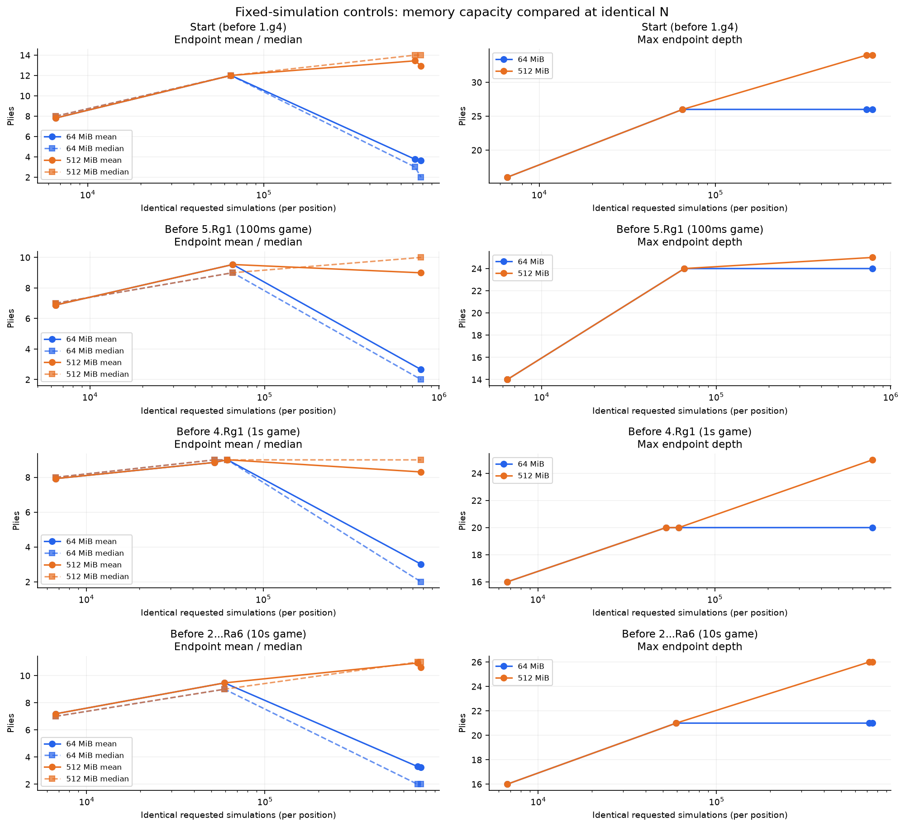

## 깊이 분포와 포화 전후

평균·중앙값과 분포의 대부분이 얕은데 극소수 경로만 깊으면 최대 깊이는 대표적인 수읽기 양을 과장할 수 있다. 다음 그림은 개별 최대값 대신 모든 잎 도착점의 분포, 그 누적분포, 각 깊이까지 도달한 실제 경로 방문 비중을 보여준다.

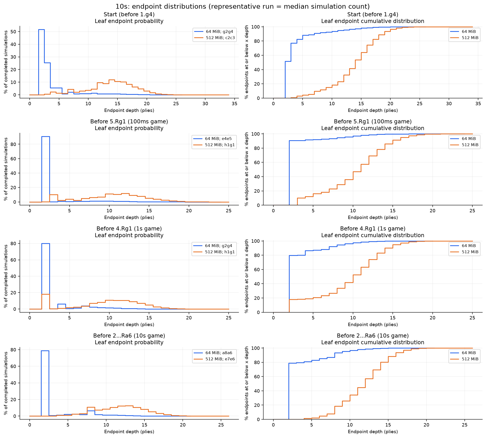

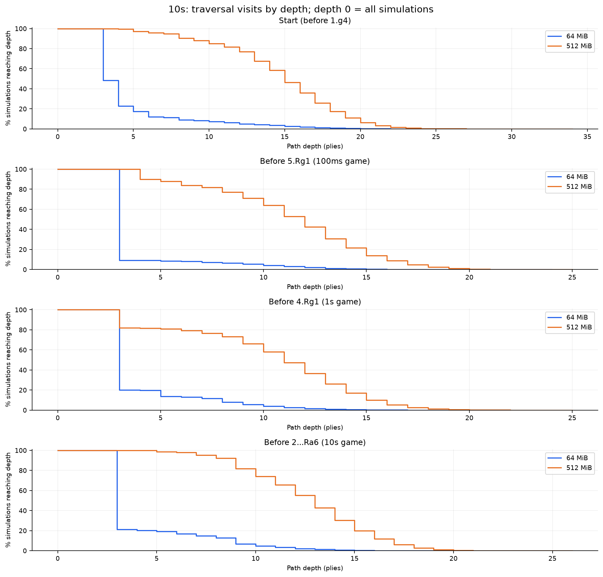

포화 전후는 **실제 첫 할당 실패**를 경계로 나눈다. 실패한 시뮬레이션부터 후반에 포함한다. 메모리 예약이 상한에 도달해도 남은 예약 슬롯을 사용하여 실패 없이 확장할 수 있으므로 예약 도달 시간을 포화 실패 시간으로 대체하지 않는다. 예약 도달 사건은 예약 바이트가 정확히 상한과 같을 때만 발생한다. 자료형 크기/반올림으로 소량의 공간이 남은 상태에서도 다음 할당이 실패할 수 있으므로 이 사건이 false라고 포화 실패가 없었다고 해석하지 않는다. 실패가 없으면 후반 분포는 비어 있다.

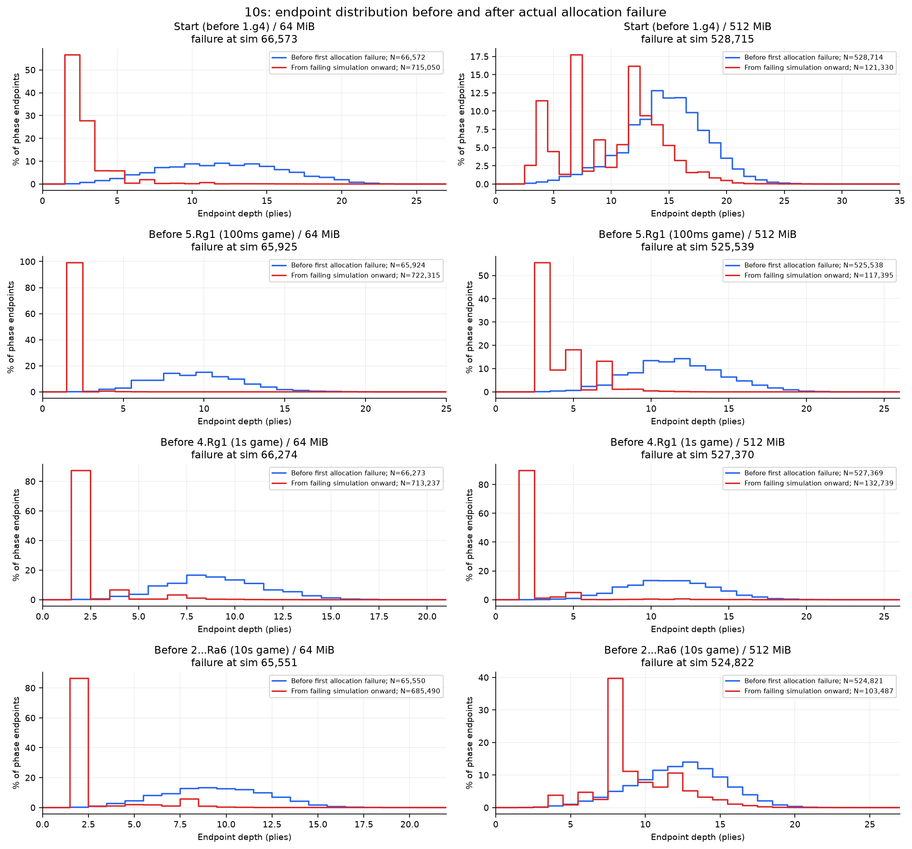

시간 창 그래프는 마지막 스냅샷 이후 새로 완료된 잎들로 계산한다. 누적 평균과 달리 포화 뒤 깊이 변화가 드러나며, 첫 실패는 정확한 사건 시점으로 표시한다. 후보 추이·리더 전환은 스냅샷 해상도에서 관찰한 것이므로 매 시뮬레이션의 정확한 전환 시점으로 해석하지 않는다.

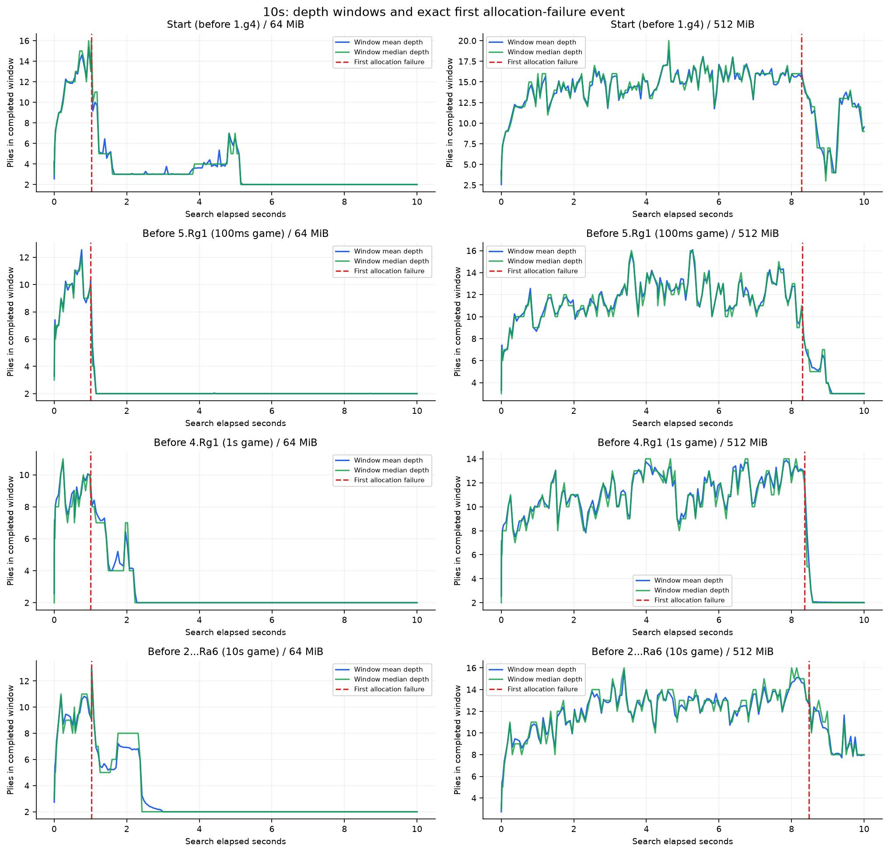

## 관심 수가 선택된 과정

다음은 과거 탐색 횟수를 고정한 대조를 우선 사용한다. 관심 수가 이번 예산에서 선택되지 않았으면 그 사실을 그대로 표시한다. 높은 Q와 방문 집중은 모델 가치에 따른 탐색 선택의 근거이며 수 자체가 좋다는 증거가 아니다. 반대로 Policy가 작더라도 반복 백업 Q가 높으면 PUCT가 해당 가지로 방문을 집중할 수 있다.

**전체 트리의 최대 깊이와 최종 선택 가지의 실제 잎 깊이는 다를 수 있다.** 아래 수치는 시간 모드 10초 대표 실행이며, 뒤의 동일 N 대조와 구분한다.

- 1.g4 직전 · 시작 위치 64MiB 10초 대표 실행: 전체 최대 깊이는 **26**였지만 선택된 `g2g4` 가지의 잎 평균/중앙값/최대는 **2.000/2/2**, 깊이 2 이하 비중은 **100.0000%**였다. 이 가지의 방문수는 404,497, Q는 +0.37132다.
- 2...Ra6 직전 · 10초 기보 64MiB 10초 대표 실행: 전체 최대 깊이는 **21**였지만 선택된 `a8a6` 가지의 잎 평균/중앙값/최대는 **2.000/2/2**, 깊이 2 이하 비중은 **100.0000%**였다. 이 가지의 방문수는 542,766, Q는 +0.98386다.

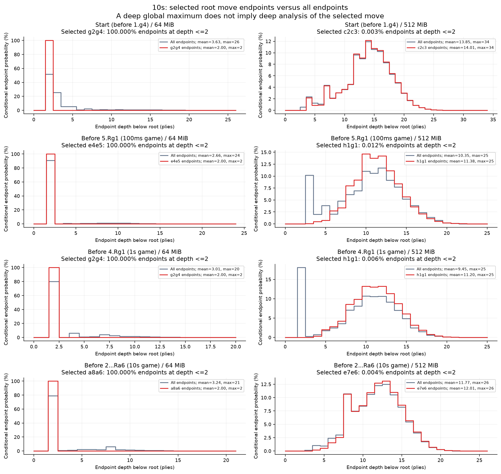

### 1.g4 직전 · 시작 위치
- 64MiB, 동일 N 과거 예산 대조, N=722,781: 선택 `g2g4`(방문 345,656, Q=+0.37145, Policy=0.18569%). 관심 수 `g2g4`의 Policy 순위는 10/20, Policy=0.18569%, 방문 345,656(47.82%), Q=+0.37145다.
  잎 깊이 평균 3.76, 중앙값 3, 90백분위 7, 최대 26. 최대 깊이의 잎은 2회(0.0003%)다. 최초 할당 실패는 66,573회/1140.31ms이며 전/후 평균 깊이는 12.05/2.92다.
  최종 선택 수의 조건부 잎 깊이는 평균 2.0000, 중앙값 2, 최대 2이며, 깊이 2 이하에서 끝난 비중은 100.0000%다. 전체 트리 최대 깊이와 이 가지의 실제 평가 깊이를 구분해야 한다.
  스냅샷에서 관심 수의 최초 방문 관측: N=128, Visits=1, Q=-0.77095. 두 번 이상 방문 후 양의 Q가 처음 관측된 스냅샷은 N=380,928, Q=+0.38654. 방문수 공동/단독 1위로 처음 관측된 스냅샷은 N=696,320, Visits=319,195, Q=+0.37153. 이는 샘플링된 관측 시점이며 최초 전환의 정확한 시뮬레이션 번호가 아니다.
- 512MiB, 동일 N 과거 예산 대조, N=722,781: 선택 `c2c3`(방문 711,453, Q=+0.10532, Policy=4.49670%). 관심 수 `g2g4`의 Policy 순위는 10/20, Policy=0.18569%, 방문 12(0.00%), Q=-0.12653다.
  잎 깊이 평균 13.44, 중앙값 14, 90백분위 19, 최대 34. 최대 깊이의 잎은 1회(0.0001%)다. 최초 할당 실패는 528,715회/8588.20ms이며 전/후 평균 깊이는 14.72/9.97다.
  최종 선택 수의 조건부 잎 깊이는 평균 13.5765, 중앙값 14, 최대 34이며, 깊이 2 이하에서 끝난 비중은 0.0030%다. 전체 트리 최대 깊이와 이 가지의 실제 평가 깊이를 구분해야 한다.
  스냅샷에서 관심 수의 최초 방문 관측: N=128, Visits=1, Q=-0.77095. 저장된 스냅샷에서는 관심 수가 방문수 1위가 된 적이 없다. 이는 샘플링된 관측 시점이며 최초 전환의 정확한 시뮬레이션 번호가 아니다.
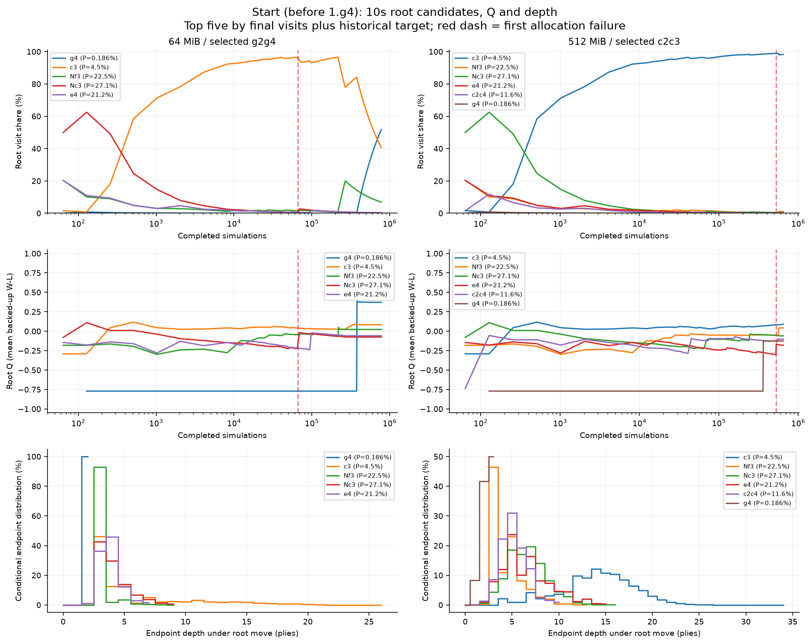
### 5.Rg1 직전 · 100ms 기보
- 64MiB, 동일 N 과거 예산 대조, N=6,363: 선택 `h1g1`(방문 5,859, Q=+0.14081, Policy=0.00139%). 관심 수 `h1g1`의 Policy 순위는 21/28, Policy=0.00139%, 방문 5,859(92.08%), Q=+0.14081다.
  잎 깊이 평균 6.88, 중앙값 7, 90백분위 10, 최대 14. 최대 깊이의 잎은 18회(0.2829%)다. 할당 실패는 없었다.
  최종 선택 수의 조건부 잎 깊이는 평균 7.0317, 중앙값 7, 최대 14이며, 깊이 2 이하에서 끝난 비중은 0.5120%다. 전체 트리 최대 깊이와 이 가지의 실제 평가 깊이를 구분해야 한다.
  스냅샷에서 관심 수의 최초 방문 관측: N=64, Visits=13, Q=+0.26800. 두 번 이상 방문 후 양의 Q가 처음 관측된 스냅샷은 N=64, Q=+0.26800. 방문수 공동/단독 1위로 처음 관측된 스냅샷은 N=128, Visits=77, Q=+0.25578. 이는 샘플링된 관측 시점이며 최초 전환의 정확한 시뮬레이션 번호가 아니다.
- 512MiB, 동일 N 과거 예산 대조, N=6,363: 선택 `h1g1`(방문 5,859, Q=+0.14081, Policy=0.00139%). 관심 수 `h1g1`의 Policy 순위는 21/28, Policy=0.00139%, 방문 5,859(92.08%), Q=+0.14081다.
  잎 깊이 평균 6.88, 중앙값 7, 90백분위 10, 최대 14. 최대 깊이의 잎은 18회(0.2829%)다. 할당 실패는 없었다.
  최종 선택 수의 조건부 잎 깊이는 평균 7.0317, 중앙값 7, 최대 14이며, 깊이 2 이하에서 끝난 비중은 0.5120%다. 전체 트리 최대 깊이와 이 가지의 실제 평가 깊이를 구분해야 한다.
  스냅샷에서 관심 수의 최초 방문 관측: N=64, Visits=13, Q=+0.26800. 두 번 이상 방문 후 양의 Q가 처음 관측된 스냅샷은 N=64, Q=+0.26800. 방문수 공동/단독 1위로 처음 관측된 스냅샷은 N=128, Visits=77, Q=+0.25578. 이는 샘플링된 관측 시점이며 최초 전환의 정확한 시뮬레이션 번호가 아니다.
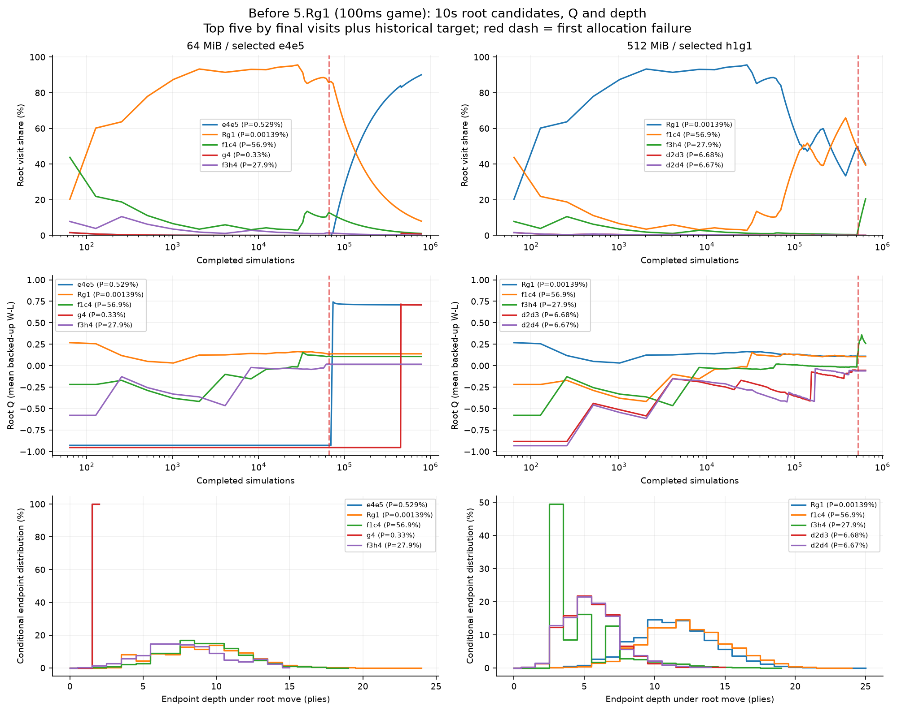
### 4.Rg1 직전 · 1초 기보
- 64MiB, 동일 N 과거 예산 대조, N=52,995: 선택 `h1g1`(방문 34,784, Q=+0.10718, Policy=0.00185%). 관심 수 `h1g1`의 Policy 순위는 18/22, Policy=0.00185%, 방문 34,784(65.64%), Q=+0.10718다.
  잎 깊이 평균 8.85, 중앙값 9, 90백분위 12, 최대 20. 최대 깊이의 잎은 3회(0.0057%)다. 할당 실패는 없었다.
  최종 선택 수의 조건부 잎 깊이는 평균 8.5252, 중앙값 8, 최대 18이며, 깊이 2 이하에서 끝난 비중은 0.0834%다. 전체 트리 최대 깊이와 이 가지의 실제 평가 깊이를 구분해야 한다.
  스냅샷에서 관심 수의 최초 방문 관측: N=20,480, Visits=2,293, Q=+0.12285. 두 번 이상 방문 후 양의 Q가 처음 관측된 스냅샷은 N=20,480, Q=+0.12285. 방문수 공동/단독 1위로 처음 관측된 스냅샷은 N=32,768, Visits=14,574, Q=+0.10487. 이는 샘플링된 관측 시점이며 최초 전환의 정확한 시뮬레이션 번호가 아니다.
- 512MiB, 동일 N 과거 예산 대조, N=52,995: 선택 `h1g1`(방문 34,784, Q=+0.10718, Policy=0.00185%). 관심 수 `h1g1`의 Policy 순위는 18/22, Policy=0.00185%, 방문 34,784(65.64%), Q=+0.10718다.
  잎 깊이 평균 8.85, 중앙값 9, 90백분위 12, 최대 20. 최대 깊이의 잎은 3회(0.0057%)다. 할당 실패는 없었다.
  최종 선택 수의 조건부 잎 깊이는 평균 8.5252, 중앙값 8, 최대 18이며, 깊이 2 이하에서 끝난 비중은 0.0834%다. 전체 트리 최대 깊이와 이 가지의 실제 평가 깊이를 구분해야 한다.
  스냅샷에서 관심 수의 최초 방문 관측: N=20,480, Visits=2,293, Q=+0.12285. 두 번 이상 방문 후 양의 Q가 처음 관측된 스냅샷은 N=20,480, Q=+0.12285. 방문수 공동/단독 1위로 처음 관측된 스냅샷은 N=32,768, Visits=14,574, Q=+0.10487. 이는 샘플링된 관측 시점이며 최초 전환의 정확한 시뮬레이션 번호가 아니다.
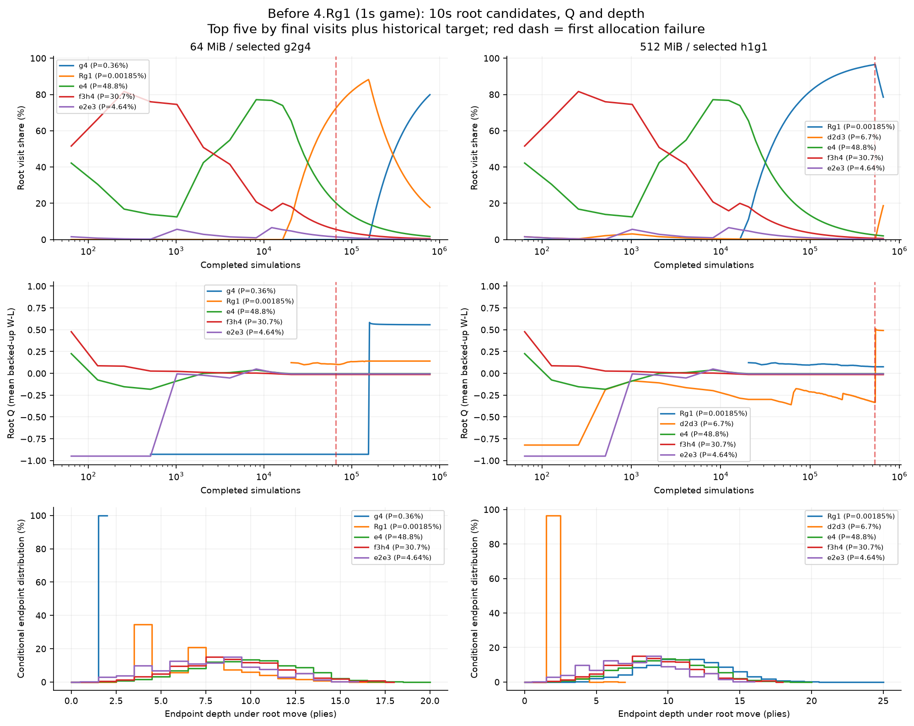
### 2...Ra6 직전 · 10초 기보
- 64MiB, 동일 N 과거 예산 대조, N=717,076: 선택 `a8a6`(방문 508,802, Q=+0.98393, Policy=0.23906%). 관심 수 `a8a6`의 Policy 순위는 12/21, Policy=0.23906%, 방문 508,802(70.96%), Q=+0.98393다.
  잎 깊이 평균 3.30, 중앙값 2, 90백분위 8, 최대 21. 최대 깊이의 잎은 2회(0.0003%)다. 최초 할당 실패는 65,551회/1040.37ms이며 전/후 평균 깊이는 9.39/2.69다.
  최종 선택 수의 조건부 잎 깊이는 평균 2.0000, 중앙값 2, 최대 2이며, 깊이 2 이하에서 끝난 비중은 100.0000%다. 전체 트리 최대 깊이와 이 가지의 실제 평가 깊이를 구분해야 한다.
  스냅샷에서 관심 수의 최초 방문 관측: N=2,048, Visits=1, Q=-0.98176. 두 번 이상 방문 후 양의 Q가 처음 관측된 스냅샷은 N=208,896, Q=+0.99055. 방문수 공동/단독 1위로 처음 관측된 스냅샷은 N=344,064, Visits=135,790, Q=+0.98589. 이는 샘플링된 관측 시점이며 최초 전환의 정확한 시뮬레이션 번호가 아니다.
- 512MiB, 동일 N 과거 예산 대조, N=717,076: 선택 `e7e6`(방문 617,315, Q=-0.03488, Policy=16.41637%). 관심 수 `a8a6`의 Policy 순위는 12/21, Policy=0.23906%, 방문 18(0.00%), Q=-0.21655다.
  잎 깊이 평균 10.93, 중앙값 11, 90백분위 16, 최대 26. 최대 깊이의 잎은 6회(0.0008%)다. 최초 할당 실패는 524,822회/8589.25ms이며 전/후 평균 깊이는 12.24/7.35다.
  최종 선택 수의 조건부 잎 깊이는 평균 11.8985, 중앙값 12, 최대 26이며, 깊이 2 이하에서 끝난 비중은 0.0037%다. 전체 트리 최대 깊이와 이 가지의 실제 평가 깊이를 구분해야 한다.
  스냅샷에서 관심 수의 최초 방문 관측: N=2,048, Visits=1, Q=-0.98176. 저장된 스냅샷에서는 관심 수가 방문수 1위가 된 적이 없다. 이는 샘플링된 관측 시점이며 최초 전환의 정확한 시뮬레이션 번호가 아니다.
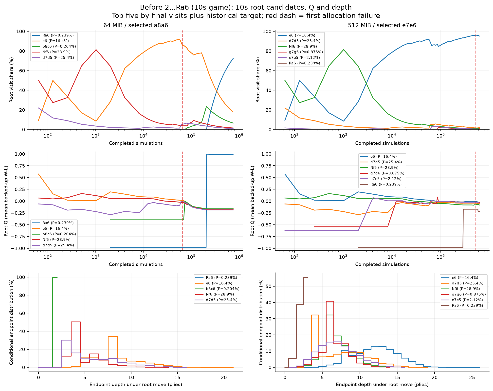

## 상위 5개 후보 · Policy/Q/Visits

각 조건의 모든 실행에 대한 상위 5개 후보는 [top5-candidates.csv](top5-candidates.csv)에 있다. 아래는 10초 대표 실행이다. ★는 최종 선택이다. 해당 수의 깊이는 그 루트 수를 선택한 시뮬레이션들만 조건부로 집계했다.

### 1.g4 직전 · 시작 위치 · 10초 대표 실행
| MiB | 순위 | 수(UCI) | Policy | Q | Visits | 방문 비중 | 해당 수 잎 평균/중앙값/최대 |
|---:|---:|---|---:|---:|---:|---:|---|
| 64 | 1 | `g2g4` ★ | 0.18569% | +0.37132 | 404,497 | 51.75% | 2.00/2.0/2 |
| 64 | 2 | `c2c3`  | 4.49670% | +0.08415 | 317,407 | 40.61% | 5.79/4.0/26 |
| 64 | 3 | `g1f3`  | 22.48018% | +0.02260 | 53,911 | 6.90% | 3.15/3.0/9 |
| 64 | 4 | `b1c3`  | 27.12535% | -0.07511 | 2,098 | 0.27% | 4.04/4.0/9 |
| 64 | 5 | `e2e4`  | 21.15616% | -0.05809 | 1,969 | 0.25% | 3.84/4.0/7 |
| 512 | 1 | `c2c3` ★ | 4.49670% | +0.09030 | 638,717 | 98.26% | 14.01/14.0/34 |
| 512 | 2 | `g1f3`  | 22.48018% | +0.04222 | 6,769 | 1.04% | 4.36/4.0/13 |
| 512 | 3 | `b1c3`  | 27.12535% | -0.06015 | 2,217 | 0.34% | 6.61/7.0/16 |
| 512 | 4 | `e2e4`  | 21.15616% | -0.18052 | 944 | 0.15% | 6.48/6.0/15 |
| 512 | 5 | `c2c4`  | 11.56475% | -0.10309 | 724 | 0.11% | 5.19/5.0/10 |
### 5.Rg1 직전 · 100ms 기보 · 10초 대표 실행
| MiB | 순위 | 수(UCI) | Policy | Q | Visits | 방문 비중 | 해당 수 잎 평균/중앙값/최대 |
|---:|---:|---|---:|---:|---:|---:|---|
| 64 | 1 | `e4e5` ★ | 0.52856% | +0.70804 | 709,798 | 90.05% | 2.00/2.0/2 |
| 64 | 2 | `h1g1`  | 0.00139% | +0.13796 | 62,841 | 7.97% | 9.15/9.0/24 |
| 64 | 3 | `f1c4`  | 56.90378% | +0.10738 | 8,503 | 1.08% | 9.21/9.0/19 |
| 64 | 4 | `g2g4`  | 0.32970% | +0.70729 | 5,783 | 0.73% | 2.00/2.0/2 |
| 64 | 5 | `f3h4`  | 27.92290% | +0.01631 | 931 | 0.12% | 7.92/8.0/15 |
| 512 | 1 | `h1g1` ★ | 0.00139% | +0.10956 | 257,146 | 40.00% | 11.38/11.0/25 |
| 512 | 2 | `f1c4`  | 56.90378% | +0.10567 | 253,124 | 39.37% | 12.21/12.0/24 |
| 512 | 3 | `f3h4`  | 27.92290% | +0.26025 | 131,751 | 20.49% | 4.78/4.0/19 |
| 512 | 4 | `d2d3`  | 6.67953% | -0.05400 | 442 | 0.07% | 5.60/5.0/15 |
| 512 | 5 | `d2d4`  | 6.67477% | -0.06129 | 420 | 0.07% | 5.61/5.0/14 |
### 4.Rg1 직전 · 1초 기보 · 10초 대표 실행
| MiB | 순위 | 수(UCI) | Policy | Q | Visits | 방문 비중 | 해당 수 잎 평균/중앙값/최대 |
|---:|---:|---|---:|---:|---:|---:|---|
| 64 | 1 | `g2g4` ★ | 0.35977% | +0.55732 | 622,646 | 79.88% | 2.00/2.0/2 |
| 64 | 2 | `h1g1`  | 0.00185% | +0.14090 | 138,538 | 17.77% | 6.72/7.0/18 |
| 64 | 3 | `e2e4`  | 48.76870% | -0.00363 | 13,403 | 1.72% | 9.80/10.0/20 |
| 64 | 4 | `f3h4`  | 30.73626% | -0.01306 | 3,702 | 0.47% | 9.00/9.0/18 |
| 64 | 5 | `e2e3`  | 4.64367% | -0.00613 | 969 | 0.12% | 7.72/8.0/16 |
| 512 | 1 | `h1g1` ★ | 0.00185% | +0.07557 | 518,296 | 78.52% | 11.20/11.0/25 |
| 512 | 2 | `d2d3`  | 6.69565% | +0.49131 | 123,333 | 18.68% | 2.06/2.0/7 |
| 512 | 3 | `e2e4`  | 48.76870% | -0.00363 | 13,403 | 2.03% | 9.80/10.0/20 |
| 512 | 4 | `f3h4`  | 30.73626% | -0.01405 | 3,778 | 0.57% | 9.00/9.0/18 |
| 512 | 5 | `e2e3`  | 4.64367% | -0.00613 | 969 | 0.15% | 7.72/8.0/16 |
### 2...Ra6 직전 · 10초 기보 · 10초 대표 실행
| MiB | 순위 | 수(UCI) | Policy | Q | Visits | 방문 비중 | 해당 수 잎 평균/중앙값/최대 |
|---:|---:|---|---:|---:|---:|---:|---|
| 64 | 1 | `a8a6` ★ | 0.23906% | +0.98386 | 542,766 | 72.27% | 2.00/2.0/2 |
| 64 | 2 | `e7e6`  | 16.41637% | -0.16436 | 133,484 | 17.77% | 8.40/8.0/21 |
| 64 | 3 | `b8c6`  | 0.20426% | -0.16354 | 49,014 | 6.53% | 2.00/2.0/2 |
| 64 | 4 | `g8f6`  | 28.87816% | -0.18093 | 11,365 | 1.51% | 4.89/4.0/14 |
| 64 | 5 | `d7d5`  | 25.39307% | -0.18802 | 7,097 | 0.94% | 5.65/5.0/16 |
| 512 | 1 | `e7e6` ★ | 16.41637% | -0.03192 | 598,190 | 95.21% | 12.01/12.0/26 |
| 512 | 2 | `d7d5`  | 25.39307% | -0.05552 | 12,618 | 2.01% | 7.27/7.0/19 |
| 512 | 3 | `g8f6`  | 28.87816% | -0.08303 | 6,677 | 1.06% | 6.95/7.0/14 |
| 512 | 4 | `g7g6`  | 0.87524% | -0.03412 | 4,322 | 0.69% | 6.62/6.0/14 |
| 512 | 5 | `e7e5`  | 2.12373% | -0.04095 | 2,738 | 0.44% | 7.04/7.0/16 |

## 해석의 한계와 검증

히스토그램 합=N, 경로 방문=잎 히스토그램 꼬리합, 루트 수별 잎 합=해당 수 Visits, 포화 전후 합=전체 분포, 평균·중앙값·최대 재계산 일치를 모든 분석 실행에서 검사했다. 이는 로그 회계 검증이며 수의 정답성이나 Elo 검증이 아니다.

64MiB와 512MiB에서 최대 깊이가 늘거나 선택 수가 자연스러워졌다는 사실만으로 강도 향상을 선언하지 않는다. 방문 분포, 실제 신규 확장량, Q의 출처인 가치 함수 품질, 독립 대국 결과를 함께 확인해야 한다. 이전 원인 분석에서 확인된 가치 함수의 일관성 문제는 별도로 남아 있으며, 이번 계측은 그 모델을 교체하지 않는다.

계측 기능은 선택적으로 활성화한다. off 경로는 히스토그램·스냅샷·추가 시계 읽기를 실행하지 않도록 구현했다. on의 실제 비용은 고정 N 소요시간으로 측정해야 하며 시간 모드 N만으로 분리하지 않는다. 탐색 소요시간은 모델 로드·워밍업·JSON 직렬화를 제외하며 탐색 반환 직전 계측 정리 비용은 포함한다. 프로세스 전체 소요시간은 별도 필드로 보존한다.

## 선택적 계측 비용

| 버전 | 반복 | 탐색 시간 중앙값(ms) | 범위(ms) | 중앙값 sims/s |
|---|---:|---:|---|---:|
| pristine | 9 | 1018.46 | 1006.42–1138.33 | 64,348 |
| off | 9 | 1020.46 | 1002.21–1036.29 | 64,222 |
| on | 9 | 1021.56 | 1000.75–1265.51 | 64,153 |

- OFF/기존 소스 시간비 기하평균 **0.9817배**, 대응 반복의 95% 부트스트랩 구간 0.9526–1.0050배. 1배는 같은 소요시간을 뜻한다.
- ON/OFF 시간비 기하평균 **1.0247배**, 대응 반복의 95% 부트스트랩 구간 0.9894–1.0811배. 1배는 같은 소요시간을 뜻한다.
시드 20261024, 20,000회 대응 로그비 재표집의 백분위 구간이다. 이 한 위치·한 예산의 측정 불확실성이며 모든 기기·위치에 대한 비용 상한은 아니다. ON/OFF 결과 수·방문수·Q·prior·value는 모든 대응 반복에서 정확히 일치했다. pristine 성능 probe는 간소화된 출력이므로 OFF/pristine의 비교는 공통 bestmove·simulations·max_depth 세 필드 일치만 확인했다. 기존 배포 엔진과 새 엔진의 전체 통계 동등성은 별도의 UCI 검증으로 구분한다.
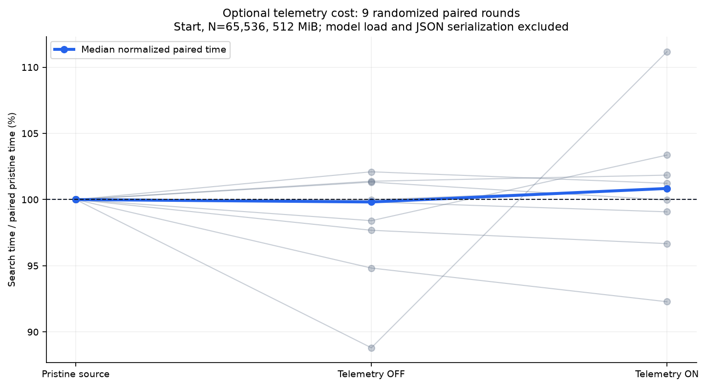

## UCI 동등성 및 실제 응답 지연

[별도 UCI 검증](validation-uci.json)에서 4개 위치의 배포 엔진/새 OFF/새 ON 전체 root 통계를 절대 오차 1e-8 이내에서 비교해 통과했다. ON/OFF는 정확히 일치했고 배포 엔진 비교의 미소 차이는 직렬화 정밀도 범위였다. stop/infinite 이후 후속 탐색도 통과했다.

UCI 응답 시간은 탐색 내부 시간에 JSON 직렬화·출력·수신 비용까지 더한 사용자 관측값이다. 아래는 별도 100ms 요청 각 3회다. 고정 N 네이티브 비용과 구분한다.

| 계측 | 반복 | 요청(ms) | bestmove 도착 중앙값(ms) | 범위(ms) | info 이후 bestmove 도착 지연 중앙값(ms) |
|---|---:|---:|---:|---|---:|
| OFF | 3 | 100 | 100.818 | 100.692–100.833 | 0.086 |
| ON | 3 | 100 | 105.696 | 105.327–106.978 | 4.485 |

ON은 탐색 종료 후 상세 telemetry JSON을 bestmove 앞에서 전송하므로 그 직렬화·전송 및 수신 비용이 응답 지연에 포함된다. 계측 기본값은 OFF다. 이번 네이티브 시간 비교는 JSON 직렬화·전송을 제외하므로 위 응답 시간과 같은 수치로 해석하지 않는다. 긴 실행일수록 스냅샷이 많아 상세 출력 크기도 달라진다.

## 원자료와 재현 가능한 표

- [전체 실행 지표](all-run-metrics.csv), [조건별 비교 표](comparison-summary.csv), [분석 요약 JSON](analysis-summary.json)
- [잎 깊이 원시 빈도](leaf-depth-histograms.csv), [깊이별 경로 방문](depth-path-visits.csv), [포화 전후 빈도](pre-post-failure-histograms.csv)
- [후보별 스냅샷](root-candidate-snapshots.csv), [깊이 시간 창](depth-windows.csv), [상위 5개 후보](top5-candidates.csv)
- [선택된 수와 전체 깊이 비교](selected-depth-comparison.csv)
- [원시 실행 JSONL](runs.jsonl), [실험 조건·해시](experiment-metadata.json), 개별 명령·표준출력은 `raw/`에 보존한다.
- [네이티브 성능 표](performance-summary.csv), [UCI 응답 표](uci-response-summary.csv), [UCI 동등성·프로토콜 검증](validation-uci.json)
- 그래프는 `graphs/`에 PNG와 SVG를 함께 저장했다. 원시 실험 JSONL은 분석 입력 파일과 개별 실행 로그를 보존한다.
