# CHROMATIC 메모리 포화 탐색 수정 비교

동일 모델로 기존 탐색과 메모리 회수 탐색을 다시 비교했다. 분석한 실행은 **208회**이며 시간 기준 144회, 동일 완료 N 기준 64회다. 각 시간 조건은 3회 반복한다. 표의 N·노드 수·실패·회수 횟수는 반복 중앙값, 잎 평균·중앙값은 반복 전체 잎을 합친 분포, 최대 깊이는 실행별 최대의 중앙값이다. 그래프의 10초 대표 실행은 해당 조건에서 N 중앙값에 가장 가까운 실제 한 실행이다.

표의 생성/확장/현재 노드는 각각 누적 노드 생성(루트 제외·재생성 포함), 성공한 합법 수 목록 확장(루트 제외), 최종 보존 노드(루트 포함)다.

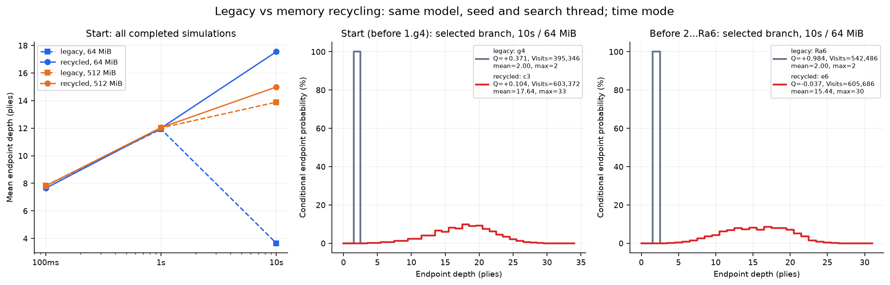

## 변경한 동작

기존 탐색은 노드 할당이 실패해도 임시 보드의 얕은 잎을 NN으로 평가하여 Q·Visits에 계속 백업했다. 수정본은 **공간을 확보하지 못한 attempt를 NN/backup 없이 폐기하고, 저방문 하위 가지를 정리·압축하여 기존 예약 슬롯을 재사용한 뒤 루트부터 다시 시도한다.** 루트·전체 루트 간선의 Policy/Q/Visits와 보존된 내부 통계는 유지한다. 일반적인 예산에서는 이미 생성한 루트 직계 자식도 보호한다. 제거된 하위 트리의 통계는 잃으므로 무제한 트리와 동일한 탐색이라고 부르지 않는다.

새로운 두 번째 트리 전체를 복사하지 않고 기존 Node/Edge 버퍼 안에서 압축한다. 바이트 예산과 `peak_memory_bytes`는 Node/Edge 예약 capacity 합계 기준이다. 초기 `vector::reserve` 재할당 중 일시적으로 공존하는 이전/새 할당이나 전체 프로세스 최대 메모리를 측정한 값은 아니다. 매핑·정렬용 임시 공간은 별도로 보고하며 이번 실행의 최대 algorithm scratch는 **3.464MiB**다. 선택 계측 자료와 출력 JSON 버퍼도 트리 예산 외의 메모리다. 전체 프로세스 메모리가 64MiB/512MiB라는 뜻은 아니다.

## 회계와 검증 결과

- 완료 N은 실제 백업을 마친 시뮬레이션만 센다. 실패 attempt는 Visits·잎 분포에 포함하지 않는다. 수정본의 `attempted = completed + aborted`와 `cumulative node creations + 1 − evicted nodes = resident nodes`를 검사했다.
- 동일 N 대조에서 요청한 N을 모두 완료했는가: **True**.
- 기존 버전의 미보존 잎 NN 호출 합계: **14,825,089**. 수정본: **0**.
- 기존 버전의 저장된 미확장 노드 NN 재평가 합계: **624,442**. 수정본: **0**. 노드 공간은 있으나 간선 목록을 저장하지 못한 경우에도 반복 평가가 생기므로 두 지표를 함께 본다. 이 두 값이 0이라는 것은 모든 동일 입력 NN 호출이 사라졌다는 뜻은 아니다. 정리된 하위 트리를 나중에 재생성하여 같은 체스 위치를 다시 평가할 수 있다.
- 회수 이벤트 314개에서 root before/after Policy·Q·Visits가 같고 메모리 상한을 지키는지 검사했다.
- 잎 합=N, 루트 수별 잎 합=그 수 Visits, 깊이별 경로 방문=잎 분포 꼬리합, 전후 분포와 스냅샷 window 분할, 정확한 평균·중앙값·최대를 재계산했다.

모델·시드 2026·스레드 1·CPU affinity 2·SIMD/sparse·CPuct 1.5·FPU 0·noise/temperature/proof 0을 동일하게 사용했다. MaxNodes도 두 메모리와 두 버전에서 1,000,000으로 맞춰 바이트 상한 효과를 비교했다. 기존 엔진·모델·앞선 계측 버전의 보존 해시는 [실험 메타데이터](experiment-metadata.json)에 있다.

## 시간 기준 비교

| 위치 | 시간 | MiB | 버전 | 완료 N | 탐색 ms | 잎 평균/중앙값/최대 | 생성/확장/현재 노드 | 실패/회수 | 미보존/미확장 반복 NN | 선택 |
|---|---:|---:|---|---:|---:|---|---:|---:|---:|---|
| 시작 위치 · 1.g4 직전 | 0.1s | 64 | 기존 | 6,717 | 100.39 | 7.81/8.0/16 | 6,717/6,717/6,718 | 0/0 | 0/0 | c3 / c3 / c3 |
| 시작 위치 · 1.g4 직전 | 0.1s | 64 | 수정 | 6,572 | 100.39 | 7.64/7.0/16 | 6,572/6,572/6,573 | 0/0 | 0/0 | c3 / c3 / c3 |
| 시작 위치 · 1.g4 직전 | 0.1s | 512 | 기존 | 6,654 | 100.33 | 7.82/8.0/16 | 6,654/6,654/6,655 | 0/0 | 0/0 | c3 / c3 / c3 |
| 시작 위치 · 1.g4 직전 | 0.1s | 512 | 수정 | 6,759 | 100.33 | 7.81/8.0/16 | 6,759/6,759/6,760 | 0/0 | 0/0 | c3 / c3 / c3 |
| 시작 위치 · 1.g4 직전 | 1s | 64 | 기존 | 65,486 | 1,002.53 | 11.93/12.0/26 | 64,504/64,336/64,505 | 0/0 | 0/0 | c3 / c3 / c3 |
| 시작 위치 · 1.g4 직전 | 1s | 64 | 수정 | 64,625 | 1,002.54 | 12.00/12.0/26 | 63,660/63,498/63,661 | 0/0 | 0/0 | c3 / c3 / c3 |
| 시작 위치 · 1.g4 직전 | 1s | 512 | 기존 | 65,348 | 1,002.54 | 12.02/12.0/26 | 64,366/64,198/64,367 | 0/0 | 0/0 | c3 / c3 / c3 |
| 시작 위치 · 1.g4 직전 | 1s | 512 | 수정 | 66,859 | 1,002.55 | 12.04/12.0/26 | 65,822/65,650/65,823 | 0/0 | 0/0 | c3 / c3 / c3 |
| 시작 위치 · 1.g4 직전 | 10s | 64 | 기존 | 772,471 | 10,002.74 | 3.65/2.0/26 | 65,535/65,363/65,536 | 705,866/0 | 705,860/0 | g4 / g4 / g4 |
| 시작 위치 · 1.g4 직전 | 10s | 64 | 수정 | 610,723 | 10,002.84 | 17.55/18.0/33 | 604,805/603,807/55,516 | 14/14 | 0/0 | c3 / c3 / c3 |
| 시작 위치 · 1.g4 직전 | 10s | 512 | 기존 | 649,009 | 10,017.61 | 13.89/14.0/34 | 524,287/523,502/524,288 | 120,273/0 | 120,270/0 | c3 / c3 / c3 |
| 시작 위치 · 1.g4 직전 | 10s | 512 | 수정 | 618,564 | 10,017.35 | 14.99/15.0/34 | 613,611/612,722/340,710 | 1/1 | 0/0 | c3 / c3 / c3 |
| 5.Rg1 직전 | 0.1s | 64 | 기존 | 6,650 | 100.35 | 6.87/7.0/14 | 6,565/6,544/6,566 | 0/0 | 0/0 | Rg1 / Rg1 / Rg1 |
| 5.Rg1 직전 | 0.1s | 64 | 수정 | 6,646 | 100.34 | 6.86/7.0/14 | 6,561/6,540/6,562 | 0/0 | 0/0 | Rg1 / Rg1 / Rg1 |
| 5.Rg1 직전 | 0.1s | 512 | 기존 | 6,474 | 100.35 | 6.87/7.0/14 | 6,389/6,368/6,390 | 0/0 | 0/0 | Rg1 / Rg1 / Rg1 |
| 5.Rg1 직전 | 0.1s | 512 | 수정 | 6,725 | 100.34 | 6.87/7.0/14 | 6,639/6,617/6,640 | 0/0 | 0/0 | Rg1 / Rg1 / Rg1 |
| 5.Rg1 직전 | 1s | 64 | 기존 | 65,779 | 1,002.82 | 9.54/9.0/24 | 65,192/65,084/65,193 | 0/0 | 0/0 | Rg1 / Rg1 / Rg1 |
| 5.Rg1 직전 | 1s | 64 | 수정 | 65,098 | 1,002.69 | 9.53/9.0/24 | 64,528/64,423/61,902 | 0/0 | 0/0 | Rg1 / Rg1 / Rg1 |
| 5.Rg1 직전 | 1s | 512 | 기존 | 61,772 | 1,002.42 | 9.51/9.0/24 | 61,252/61,152/61,253 | 0/0 | 0/0 | Rg1 / Rg1 / Rg1 |
| 5.Rg1 직전 | 1s | 512 | 수정 | 65,979 | 1,002.62 | 9.54/9.0/24 | 65,392/65,284/65,393 | 0/0 | 0/0 | Rg1 / Rg1 / Rg1 |
| 5.Rg1 직전 | 10s | 64 | 기존 | 788,666 | 10,002.87 | 2.66/2.0/24 | 65,535/65,229/65,536 | 722,726/0 | 722,458/70 | e5 / e5 / e5 |
| 5.Rg1 직전 | 10s | 64 | 수정 | 624,381 | 10,002.68 | 12.68/12.0/30 | 620,664/619,893/51,350 | 15/15 | 0/0 | Rg1 / Rg1 / Rg1 |
| 5.Rg1 직전 | 10s | 512 | 기존 | 648,176 | 10,018.80 | 10.28/11.0/25 | 522,544/519,310/522,545 | 122,632/0 | 0/120,345 | Rg1 / Rg1 / Rg1 |
| 5.Rg1 직전 | 10s | 512 | 수정 | 628,073 | 10,018.16 | 11.94/12.0/27 | 621,085/619,960/206,971 | 1/1 | 0/0 | Rg1 / Rg1 / Rg1 |
| 4.Rg1 직전(보조) | 0.1s | 64 | 기존 | 6,961 | 100.34 | 7.98/8.0/16 | 6,806/6,779/6,807 | 0/0 | 0/0 | e4 / e4 / e4 |
| 4.Rg1 직전(보조) | 0.1s | 64 | 수정 | 6,221 | 100.26 | 7.87/8.0/16 | 6,114/6,092/6,115 | 0/0 | 0/0 | e4 / e4 / e4 |
| 4.Rg1 직전(보조) | 0.1s | 512 | 기존 | 6,566 | 100.35 | 7.93/8.0/16 | 6,439/6,415/6,440 | 0/0 | 0/0 | e4 / e4 / e4 |
| 4.Rg1 직전(보조) | 0.1s | 512 | 수정 | 6,469 | 100.34 | 7.94/8.0/16 | 6,348/6,324/6,349 | 0/0 | 0/0 | e4 / e4 / e4 |
| 4.Rg1 직전(보조) | 1s | 64 | 기존 | 66,098 | 1,002.33 | 9.01/9.0/20 | 65,360/65,232/65,361 | 0/0 | 0/0 | Rg1 / Rg1 / Rg1 |
| 4.Rg1 직전(보조) | 1s | 64 | 수정 | 66,721 | 1,002.36 | 9.06/9.0/20 | 65,983/65,855/14,748 | 1/1 | 0/0 | Rg1 / Rg1 / Rg1 |
| 4.Rg1 직전(보조) | 1s | 512 | 기존 | 65,468 | 1,002.62 | 9.05/9.0/20 | 64,730/64,602/64,731 | 0/0 | 0/0 | Rg1 / Rg1 / Rg1 |
| 4.Rg1 직전(보조) | 1s | 512 | 수정 | 66,227 | 1,002.62 | 9.05/9.0/20 | 65,489/65,361/65,490 | 0/0 | 0/0 | Rg1 / Rg1 / Rg1 |
| 4.Rg1 직전(보조) | 10s | 64 | 기존 | 795,413 | 10,002.82 | 2.99/2.0/20 | 65,535/65,407/65,536 | 729,130/0 | 729,130/0 | g4 / g4 / g4 |
| 4.Rg1 직전(보조) | 10s | 64 | 수정 | 622,745 | 10,002.71 | 12.63/13.0/28 | 619,942/619,572/46,370 | 15/15 | 0/0 | Rg1 / Rg1 / Rg1 |
| 4.Rg1 직전(보조) | 10s | 512 | 기존 | 652,328 | 10,018.27 | 9.57/10.0/25 | 524,287/523,663/524,288 | 124,950/0 | 124,947/0 | Rg1 / Rg1 / Rg1 |
| 4.Rg1 직전(보조) | 10s | 512 | 수정 | 629,944 | 10,019.05 | 11.54/12.0/25 | 626,150/625,428/210,937 | 1/1 | 0/0 | Rg1 / Rg1 / Rg1 |
| 2...Ra6 직전 | 0.1s | 64 | 기존 | 6,828 | 100.35 | 7.18/7.0/16 | 6,828/6,828/6,829 | 0/0 | 0/0 | e6 / e6 / e6 |
| 2...Ra6 직전 | 0.1s | 64 | 수정 | 6,496 | 100.36 | 7.14/7.0/16 | 6,496/6,496/6,497 | 0/0 | 0/0 | e6 / e6 / e6 |
| 2...Ra6 직전 | 0.1s | 512 | 기존 | 6,914 | 100.34 | 7.03/7.0/16 | 6,914/6,914/6,915 | 0/0 | 0/0 | e6 / e6 / e6 |
| 2...Ra6 직전 | 0.1s | 512 | 수정 | 6,805 | 100.37 | 7.09/7.0/16 | 6,805/6,805/6,806 | 0/0 | 0/0 | e6 / e6 / e6 |
| 2...Ra6 직전 | 1s | 64 | 기존 | 64,456 | 1,002.73 | 9.36/9.0/21 | 64,441/64,436/64,442 | 0/0 | 0/0 | e6 / e6 / e6 |
| 2...Ra6 직전 | 1s | 64 | 수정 | 65,162 | 1,002.83 | 9.37/9.0/21 | 65,147/65,142/64,703 | 0/0 | 0/0 | e6 / e6 / e6 |
| 2...Ra6 직전 | 1s | 512 | 기존 | 63,093 | 1,002.49 | 9.37/9.0/21 | 63,078/63,073/63,079 | 0/0 | 0/0 | e6 / e6 / e6 |
| 2...Ra6 직전 | 1s | 512 | 수정 | 65,677 | 1,002.75 | 9.40/9.0/21 | 65,662/65,657/65,663 | 0/0 | 0/0 | e6 / e6 / e6 |
| 2...Ra6 직전 | 10s | 64 | 기존 | 750,760 | 10,002.60 | 3.25/2.0/21 | 65,535/65,530/65,536 | 685,210/0 | 685,210/0 | Ra6 / Ra6 / Ra6 |
| 2...Ra6 직전 | 10s | 64 | 수정 | 622,192 | 10,002.89 | 15.22/15.0/30 | 621,277/621,119/46,064 | 15/15 | 0/0 | e6 / e6 / e6 |
| 2...Ra6 직전 | 10s | 512 | 기존 | 639,083 | 10,019.99 | 11.70/12.0/26 | 524,287/524,168/524,288 | 114,262/0 | 114,262/0 | e6 / e6 / e6 |
| 2...Ra6 직전 | 10s | 512 | 수정 | 615,275 | 10,017.00 | 12.45/13.0/26 | 614,741/614,620/343,134 | 1/1 | 0/0 | e6 / e6 / e6 |

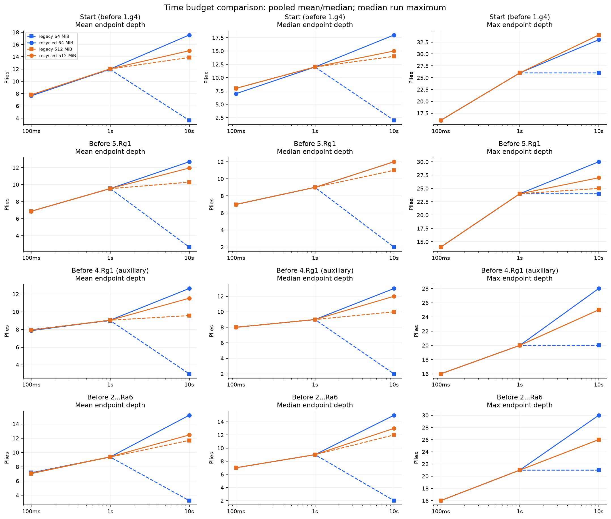

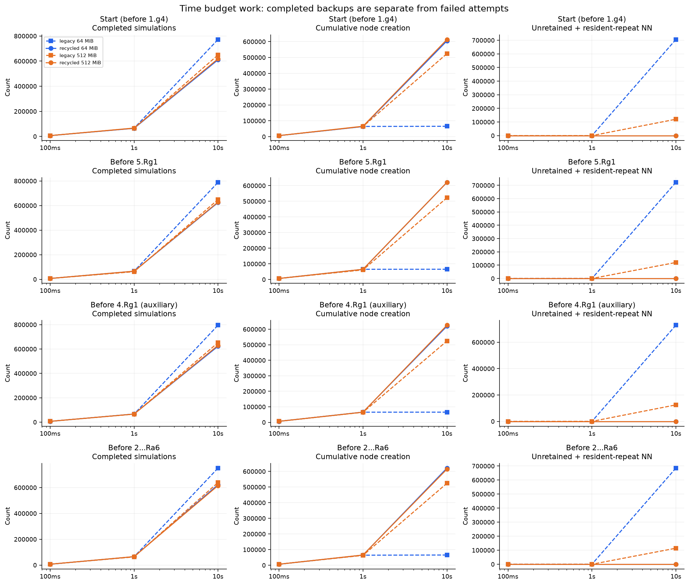

시간 모드의 N은 다르다. 기존 버전의 포화 뒤 얕은 미보존/미확장 반복 평가는 더 싸게 수행될 수 있으므로 단순 N/s 증가를 유효한 수읽기 증가로 해석하지 않는다. 수정본은 압축과 더 깊은 경로 탐색·실제 새 가지 확장의 비용을 부담한다. 서로 같은 작업량의 처리속도 비교가 아니므로 같은 시간의 방문수와 동일 N의 소요시간을 구분한다. 누적 회수 시간은 이벤트별 `duration_ms`의 합으로 따로 보존했으며 모든 소요시간 차이를 회수 비용으로 돌리지 않는다.

## 동일 완료 방문수 비교

고정 예산은 이전 계측의 64MiB 시간별 중앙 N 및 과거 관심 수가 나온 정확한 N을 사용한다. 두 버전·두 메모리에 동일하게 요청했다. 표에서 가까운 N이 두 번 나타나면 서로 다른 원자료 그룹이며 원시 로그의 `group`/`budget_label`로 구분한다.

| 위치 | 고정 N | MiB | 버전 | 완료 N | 탐색 ms | 잎 평균/중앙값/최대 | 생성/확장/현재 노드 | 실패/회수 | 미보존/미확장 반복 NN | 선택 |
|---|---:|---:|---|---:|---:|---|---:|---:|---:|---|
| 시작 위치 · 1.g4 직전 | 6,586 | 64 | 기존 | 6,586 | 99.11 | 7.82/8.0/16 | 6,586/6,586/6,587 | 0/0 | 0/0 | c3 |
| 시작 위치 · 1.g4 직전 | 6,586 | 64 | 수정 | 6,586 | 104.76 | 7.82/8.0/16 | 6,586/6,586/6,587 | 0/0 | 0/0 | c3 |
| 시작 위치 · 1.g4 직전 | 6,586 | 512 | 기존 | 6,586 | 99.90 | 7.82/8.0/16 | 6,586/6,586/6,587 | 0/0 | 0/0 | c3 |
| 시작 위치 · 1.g4 직전 | 6,586 | 512 | 수정 | 6,586 | 98.05 | 7.82/8.0/16 | 6,586/6,586/6,587 | 0/0 | 0/0 | c3 |
| 시작 위치 · 1.g4 직전 | 65,180 | 64 | 기존 | 65,180 | 956.63 | 12.01/12.0/26 | 64,202/64,036/64,203 | 0/0 | 0/0 | c3 |
| 시작 위치 · 1.g4 직전 | 65,180 | 64 | 수정 | 65,180 | 974.11 | 12.01/12.0/26 | 64,202/64,036/64,203 | 0/0 | 0/0 | c3 |
| 시작 위치 · 1.g4 직전 | 65,180 | 512 | 기존 | 65,180 | 951.43 | 12.01/12.0/26 | 64,202/64,036/64,203 | 0/0 | 0/0 | c3 |
| 시작 위치 · 1.g4 직전 | 65,180 | 512 | 수정 | 65,180 | 961.83 | 12.01/12.0/26 | 64,202/64,036/64,203 | 0/0 | 0/0 | c3 |
| 시작 위치 · 1.g4 직전 | 722,781 | 64 | 기존 | 722,781 | 9,530.46 | 3.76/3.0/26 | 65,535/65,363/65,536 | 656,176/0 | 656,170/0 | g4 |
| 시작 위치 · 1.g4 직전 | 722,781 | 64 | 수정 | 722,781 | 12,061.73 | 18.18/18.0/37 | 716,233/714,921/37,421 | 18/18 | 0/0 | c3 |
| 시작 위치 · 1.g4 직전 | 722,781 | 512 | 기존 | 722,781 | 11,322.65 | 13.44/14.0/34 | 524,287/523,502/524,288 | 194,043/0 | 194,040/0 | c3 |
| 시작 위치 · 1.g4 직전 | 722,781 | 512 | 수정 | 722,781 | 11,757.15 | 15.02/15.0/34 | 717,376/716,400/444,475 | 1/1 | 0/0 | c3 |
| 시작 위치 · 1.g4 직전 | 781,622 | 64 | 기존 | 781,622 | 10,000.83 | 3.63/2.0/26 | 65,535/65,363/65,536 | 715,017/0 | 715,011/0 | g4 |
| 시작 위치 · 1.g4 직전 | 781,622 | 64 | 수정 | 781,622 | 12,529.50 | 18.56/19.0/37 | 774,810/773,326/19,352 | 20/20 | 0/0 | c3 |
| 시작 위치 · 1.g4 직전 | 781,622 | 512 | 기존 | 781,622 | 12,216.41 | 12.95/14.0/34 | 524,287/523,502/524,288 | 252,884/0 | 252,881/0 | c3 |
| 시작 위치 · 1.g4 직전 | 781,622 | 512 | 수정 | 781,622 | 12,321.15 | 15.17/15.0/34 | 775,705/774,647/502,804 | 1/1 | 0/0 | c3 |
| 5.Rg1 직전 | 6,360 | 64 | 기존 | 6,360 | 100.31 | 6.88/7.0/14 | 6,275/6,254/6,276 | 0/0 | 0/0 | Rg1 |
| 5.Rg1 직전 | 6,360 | 64 | 수정 | 6,360 | 99.26 | 6.88/7.0/14 | 6,275/6,254/6,276 | 0/0 | 0/0 | Rg1 |
| 5.Rg1 직전 | 6,360 | 512 | 기존 | 6,360 | 93.46 | 6.88/7.0/14 | 6,275/6,254/6,276 | 0/0 | 0/0 | Rg1 |
| 5.Rg1 직전 | 6,360 | 512 | 수정 | 6,360 | 95.13 | 6.88/7.0/14 | 6,275/6,254/6,276 | 0/0 | 0/0 | Rg1 |
| 5.Rg1 직전 | 6,363 | 64 | 기존 | 6,363 | 132.02 | 6.88/7.0/14 | 6,278/6,257/6,279 | 0/0 | 0/0 | Rg1 |
| 5.Rg1 직전 | 6,363 | 64 | 수정 | 6,363 | 95.13 | 6.88/7.0/14 | 6,278/6,257/6,279 | 0/0 | 0/0 | Rg1 |
| 5.Rg1 직전 | 6,363 | 512 | 기존 | 6,363 | 100.68 | 6.88/7.0/14 | 6,278/6,257/6,279 | 0/0 | 0/0 | Rg1 |
| 5.Rg1 직전 | 6,363 | 512 | 수정 | 6,363 | 103.55 | 6.88/7.0/14 | 6,278/6,257/6,279 | 0/0 | 0/0 | Rg1 |
| 5.Rg1 직전 | 65,793 | 64 | 기존 | 65,793 | 1,068.41 | 9.54/9.0/24 | 65,206/65,098/65,207 | 0/0 | 0/0 | Rg1 |
| 5.Rg1 직전 | 65,793 | 64 | 수정 | 65,793 | 1,021.25 | 9.54/9.0/24 | 65,206/65,098/65,207 | 0/0 | 0/0 | Rg1 |
| 5.Rg1 직전 | 65,793 | 512 | 기존 | 65,793 | 1,090.13 | 9.54/9.0/24 | 65,206/65,098/65,207 | 0/0 | 0/0 | Rg1 |
| 5.Rg1 직전 | 65,793 | 512 | 수정 | 65,793 | 1,028.99 | 9.54/9.0/24 | 65,206/65,098/65,207 | 0/0 | 0/0 | Rg1 |
| 5.Rg1 직전 | 788,239 | 64 | 기존 | 788,239 | 10,219.43 | 2.66/2.0/24 | 65,535/65,229/65,536 | 722,299/0 | 722,031/70 | e5 |
| 5.Rg1 직전 | 788,239 | 64 | 수정 | 788,239 | 13,047.05 | 13.32/13.0/30 | 784,398/783,550/60,327 | 20/20 | 0/0 | Rg1 |
| 5.Rg1 직전 | 788,239 | 512 | 기존 | 788,239 | 12,149.95 | 8.99/10.0/25 | 522,564/519,310/522,565 | 262,695/0 | 0/260,388 | Nh4 |
| 5.Rg1 직전 | 788,239 | 512 | 수정 | 788,239 | 12,608.02 | 12.40/12.0/28 | 772,988/771,667/358,874 | 1/1 | 0/0 | Rg1 |
| 4.Rg1 직전(보조) | 6,712 | 64 | 기존 | 6,712 | 101.92 | 7.92/8.0/16 | 6,577/6,552/6,578 | 0/0 | 0/0 | e4 |
| 4.Rg1 직전(보조) | 6,712 | 64 | 수정 | 6,712 | 98.44 | 7.92/8.0/16 | 6,577/6,552/6,578 | 0/0 | 0/0 | e4 |
| 4.Rg1 직전(보조) | 6,712 | 512 | 기존 | 6,712 | 99.65 | 7.92/8.0/16 | 6,577/6,552/6,578 | 0/0 | 0/0 | e4 |
| 4.Rg1 직전(보조) | 6,712 | 512 | 수정 | 6,712 | 103.92 | 7.92/8.0/16 | 6,577/6,552/6,578 | 0/0 | 0/0 | e4 |
| 4.Rg1 직전(보조) | 52,995 | 64 | 기존 | 52,995 | 830.99 | 8.85/9.0/20 | 52,265/52,139/52,266 | 0/0 | 0/0 | Rg1 |
| 4.Rg1 직전(보조) | 52,995 | 64 | 수정 | 52,995 | 824.70 | 8.85/9.0/20 | 52,265/52,139/52,266 | 0/0 | 0/0 | Rg1 |
| 4.Rg1 직전(보조) | 52,995 | 512 | 기존 | 52,995 | 837.73 | 8.85/9.0/20 | 52,265/52,139/52,266 | 0/0 | 0/0 | Rg1 |
| 4.Rg1 직전(보조) | 52,995 | 512 | 수정 | 52,995 | 807.21 | 8.85/9.0/20 | 52,265/52,139/52,266 | 0/0 | 0/0 | Rg1 |
| 4.Rg1 직전(보조) | 62,675 | 64 | 기존 | 62,675 | 981.76 | 9.01/9.0/20 | 61,938/61,810/61,939 | 0/0 | 0/0 | Rg1 |
| 4.Rg1 직전(보조) | 62,675 | 64 | 수정 | 62,675 | 997.49 | 9.01/9.0/20 | 61,938/61,810/61,939 | 0/0 | 0/0 | Rg1 |
| 4.Rg1 직전(보조) | 62,675 | 512 | 기존 | 62,675 | 977.40 | 9.01/9.0/20 | 61,938/61,810/61,939 | 0/0 | 0/0 | Rg1 |
| 4.Rg1 직전(보조) | 62,675 | 512 | 수정 | 62,675 | 1,016.54 | 9.01/9.0/20 | 61,938/61,810/61,939 | 0/0 | 0/0 | Rg1 |
| 4.Rg1 직전(보조) | 779,510 | 64 | 기존 | 779,510 | 10,368.64 | 3.01/2.0/20 | 65,535/65,407/65,536 | 713,227/0 | 713,227/0 | g4 |
| 4.Rg1 직전(보조) | 779,510 | 64 | 수정 | 779,510 | 13,083.43 | 13.20/13.0/28 | 776,600/776,170/41,758 | 20/20 | 0/0 | Rg1 |
| 4.Rg1 직전(보조) | 779,510 | 512 | 기존 | 779,510 | 12,170.05 | 8.31/9.0/25 | 524,287/523,663/524,288 | 252,132/0 | 252,129/0 | Rg1 |
| 4.Rg1 직전(보조) | 779,510 | 512 | 수정 | 779,510 | 12,581.48 | 12.53/12.0/31 | 775,301/774,519/360,088 | 1/1 | 0/0 | Rg1 |
| 2...Ra6 직전 | 6,702 | 64 | 기존 | 6,702 | 97.53 | 7.19/7.0/16 | 6,702/6,702/6,703 | 0/0 | 0/0 | e6 |
| 2...Ra6 직전 | 6,702 | 64 | 수정 | 6,702 | 106.70 | 7.19/7.0/16 | 6,702/6,702/6,703 | 0/0 | 0/0 | e6 |
| 2...Ra6 직전 | 6,702 | 512 | 기존 | 6,702 | 107.14 | 7.19/7.0/16 | 6,702/6,702/6,703 | 0/0 | 0/0 | e6 |
| 2...Ra6 직전 | 6,702 | 512 | 수정 | 6,702 | 105.58 | 7.19/7.0/16 | 6,702/6,702/6,703 | 0/0 | 0/0 | e6 |
| 2...Ra6 직전 | 59,351 | 64 | 기존 | 59,351 | 983.25 | 9.46/9.0/21 | 59,336/59,331/59,337 | 0/0 | 0/0 | e6 |
| 2...Ra6 직전 | 59,351 | 64 | 수정 | 59,351 | 977.96 | 9.46/9.0/21 | 59,336/59,331/59,337 | 0/0 | 0/0 | e6 |
| 2...Ra6 직전 | 59,351 | 512 | 기존 | 59,351 | 936.41 | 9.46/9.0/21 | 59,336/59,331/59,337 | 0/0 | 0/0 | e6 |
| 2...Ra6 직전 | 59,351 | 512 | 수정 | 59,351 | 931.59 | 9.46/9.0/21 | 59,336/59,331/59,337 | 0/0 | 0/0 | e6 |
| 2...Ra6 직전 | 717,076 | 64 | 기존 | 717,076 | 9,553.05 | 3.30/2.0/21 | 65,535/65,530/65,536 | 651,526/0 | 651,526/0 | Ra6 |
| 2...Ra6 직전 | 717,076 | 64 | 수정 | 717,076 | 11,705.65 | 15.40/16.0/30 | 716,106/715,929/62,185 | 17/17 | 0/0 | e6 |
| 2...Ra6 직전 | 717,076 | 512 | 기존 | 717,076 | 10,930.56 | 10.93/11.0/26 | 524,287/524,168/524,288 | 192,255/0 | 192,255/0 | e6 |
| 2...Ra6 직전 | 717,076 | 512 | 수정 | 717,076 | 11,600.59 | 12.63/13.0/26 | 716,527/716,402/444,920 | 1/1 | 0/0 | e6 |
| 2...Ra6 직전 | 751,040 | 64 | 기존 | 751,040 | 10,228.61 | 3.24/2.0/21 | 65,535/65,530/65,536 | 685,490/0 | 685,490/0 | Ra6 |
| 2...Ra6 직전 | 751,040 | 64 | 수정 | 751,040 | 12,509.35 | 15.43/16.0/30 | 750,022/749,827/59,540 | 18/18 | 0/0 | e6 |
| 2...Ra6 직전 | 751,040 | 512 | 기존 | 751,040 | 11,936.51 | 10.62/11.0/26 | 524,287/524,168/524,288 | 226,219/0 | 226,219/0 | e6 |
| 2...Ra6 직전 | 751,040 | 512 | 수정 | 751,040 | 12,595.86 | 12.68/13.0/26 | 750,476/750,346/478,869 | 1/1 | 0/0 | e6 |

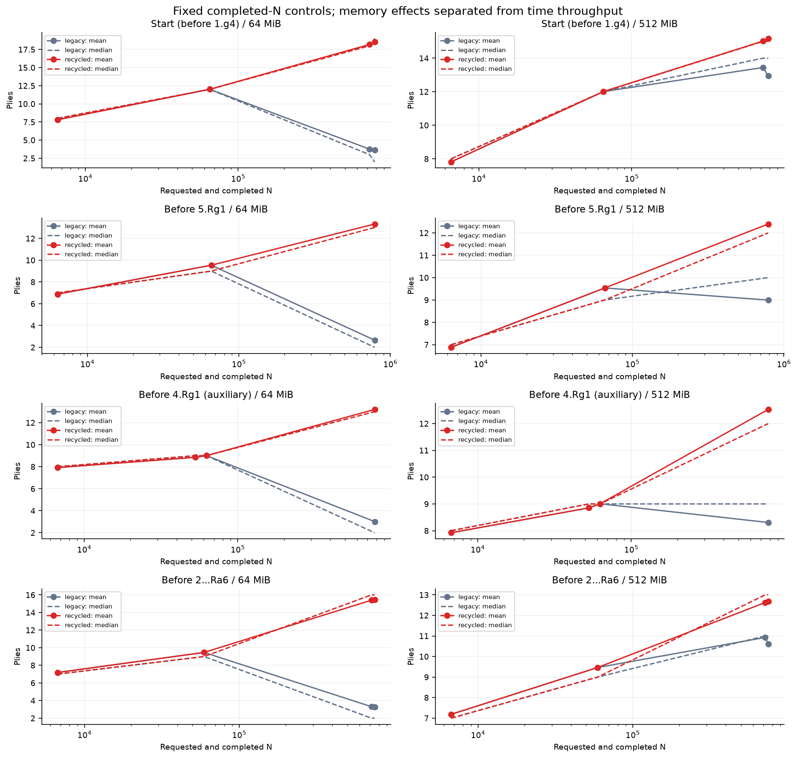

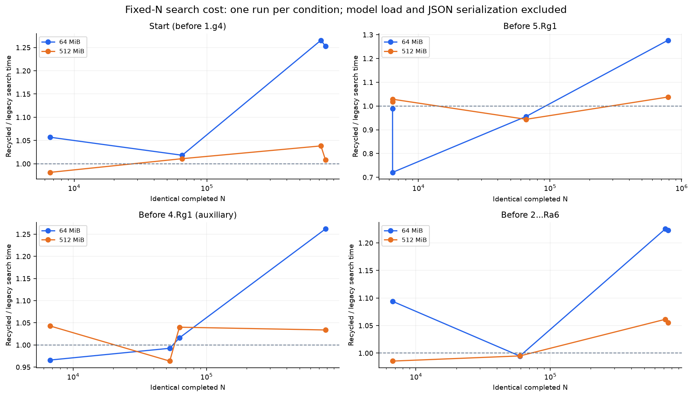

고정 N 소요시간은 조건당 1회이므로 실행 잡음을 포함한다. 시간비는 해당 동일 N 쌍의 탐색 소요시간을 나눈 값으로, 전체 하드웨어나 모든 위치의 일정한 성능 비용으로 일반화하지 않는다. 탐색 시간은 모델 로드·워밍업·JSON 직렬화를 제외하고 회수·정리 비용을 포함한다. 프로세스 전체 시간은 원시 지표에 별도 보존했다.

## 포화 뒤 깊이와 메모리 재사용

첫 포화 경계는 실제 할당 실패다. 수정본에서 그 attempt는 완료 N에 포함되지 않으므로 첫 실패의 `simulation`이 완료 N+1일 수 있다. 재시도 전에 시간이 끝나면 post-failure 분포가 비어 있을 수도 있다. 회수 스냅샷은 완료 N이 증가하지 않으며 잎 표본이 없는 window를 깊이 0으로 그리지 않고 제외했다.

아래는 수정본 10초 대표 실행의 회수 비용이다.

| 위치 | MiB | 완료 N | 최초 실패 ms | 회수/폐기 attempt | 누적 회수 ms | 탐색 시간 중 회수 비중 | algorithm scratch MiB |
|---|---:|---:|---:|---:|---:|---:|---:|
| 시작 위치 · 1.g4 직전 | 64 | 610,723 | 1,030.35 | 14/14 | 257.40 | 2.573% | 0.436 |
| 시작 위치 · 1.g4 직전 | 512 | 618,564 | 8,442.92 | 1/1 | 102.40 | 1.021% | 3.459 |
| 5.Rg1 직전 | 64 | 624,381 | 1,003.65 | 15/15 | 284.08 | 2.840% | 0.422 |
| 5.Rg1 직전 | 512 | 628,073 | 8,332.37 | 1/1 | 91.61 | 0.914% | 2.886 |
| 4.Rg1 직전(보조) | 64 | 622,745 | 1,017.74 | 15/15 | 273.69 | 2.736% | 0.435 |
| 4.Rg1 직전(보조) | 512 | 629,944 | 8,313.41 | 1/1 | 98.13 | 0.979% | 2.916 |
| 2...Ra6 직전 | 64 | 622,192 | 1,015.20 | 15/15 | 265.09 | 2.650% | 0.431 |
| 2...Ra6 직전 | 512 | 615,275 | 8,515.05 | 1/1 | 97.46 | 0.973% | 3.464 |

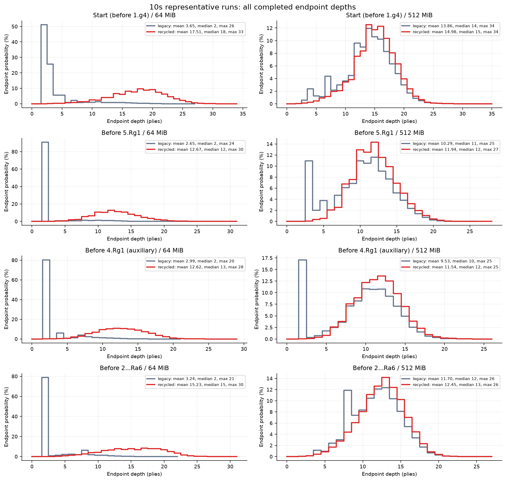

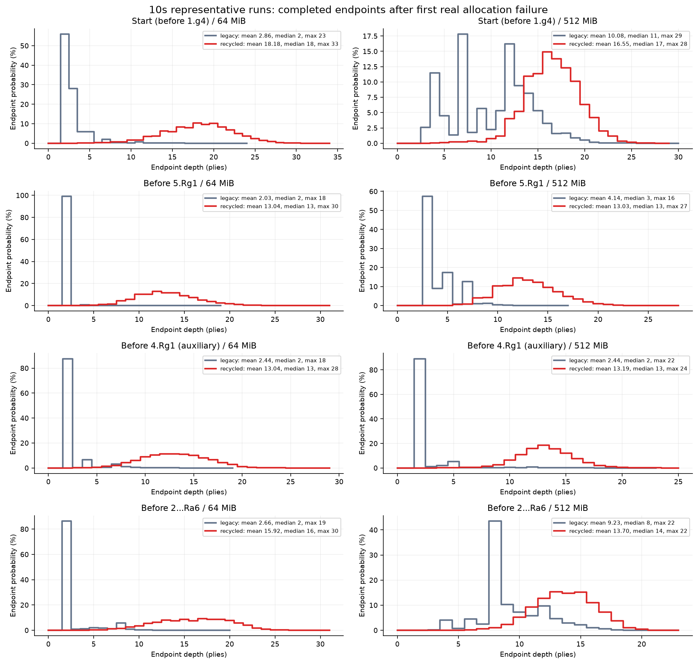

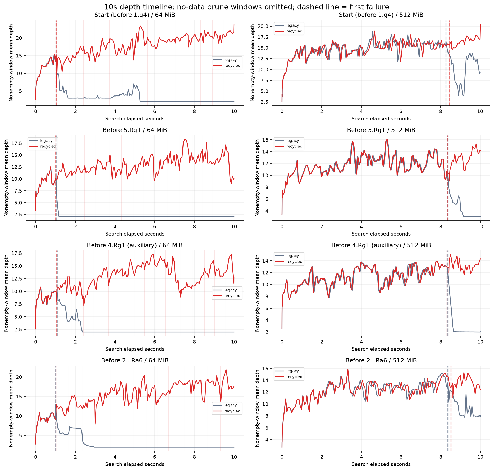

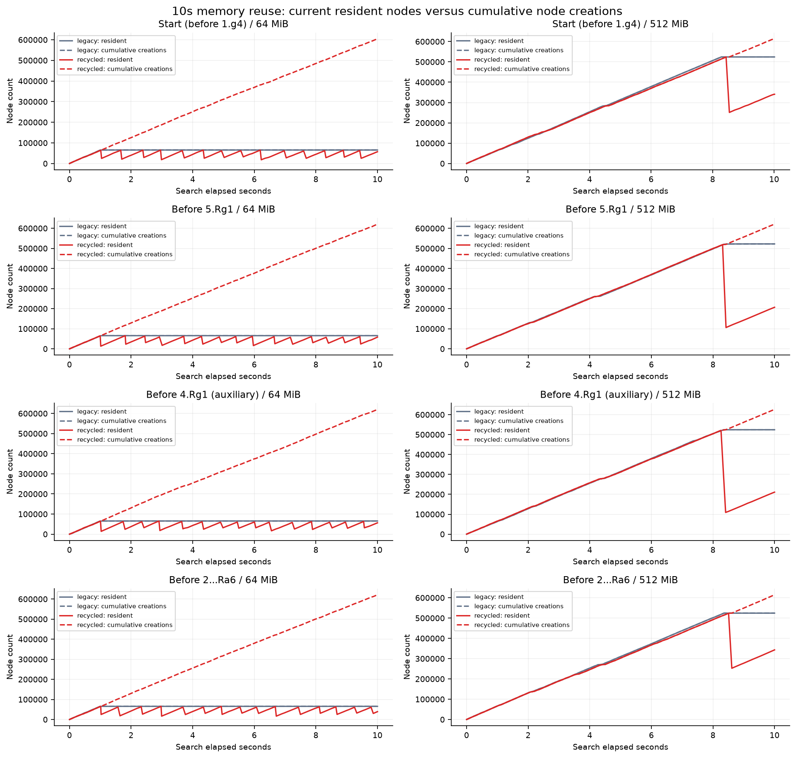

`node_creations`는 **누적 실제 노드 생성(재생성 포함)**이다. 슬롯이 재사용될 때 새로 보존한 노드도 다시 센다. 간선 공간 부족이 뒤이어 발생하면 노드는 생성됐어도 해당 attempt의 백업은 없을 수 있다. 실제 합법 수 목록 확장 성공은 `legal_expansions`로 따로 센다. 서로 다른 체스 포지션의 총 개수가 아니다. `non_retained_neural_evaluations`도 기존 버전에서 정확히 같은 NN 입력이 몇 번 반복되었는지를 뜻하지 않는다. `resident_unexpanded_repeat`는 이미 NN을 호출했지만 간선 목록을 보존하지 못한 상주 노드를 다시 평가한 횟수다. 수정본은 두 종류 모두 막지만, 퇴거된 위치의 정상적인 재생성·재평가는 허용한다.

## g4·Rg1·Ra6 선택 분석

다음 설명은 과거 N을 고정한 대조를 우선 사용한다. 전체 최대 깊이와 그 수의 조건부 잎 분포를 구분한다. Q는 모델 W−L의 백업 평균이며 객관적 승률이나 센티폰이 아니다. 수정본에서 관심 수가 다시 선택되거나 더 나빠 보이는 수를 선택해도 원자료 그대로 기록한다.

### 시작 위치 · 1.g4 직전
- 기존 64MiB, N=722,781: 선택 `g4`, 관심 수 `g4` Policy=0.18569%, Q=+0.37145, Visits=345,656. 관심 수의 잎 깊이 평균/중앙값/최대=2.00/2.0/2, 깊이 2 이하 비중=100.0000%다. 완료된 전체 분포는 3.76/3/26다.
  실제 첫 할당 실패 N=66,573, 1092.93ms; 회수 0회, 폐기 attempt 0회, 미보존 NN=656,170, 저장된 미확장 노드 재평가=0.
- 수정 64MiB, N=722,781: 선택 `c3`, 관심 수 `g4` Policy=0.18569%, Q=-0.09741, Visits=13. 관심 수의 잎 깊이 평균/중앙값/최대=2.38/2.0/3, 깊이 2 이하 비중=53.8462%다. 완료된 전체 분포는 18.18/18/37다.
  실제 첫 할당 실패 N=66,573, 1027.49ms; 회수 18회, 폐기 attempt 18회, 미보존 NN=0, 저장된 미확장 노드 재평가=0.
- 기존 512MiB, N=722,781: 선택 `c3`, 관심 수 `g4` Policy=0.18569%, Q=-0.12653, Visits=12. 관심 수의 잎 깊이 평균/중앙값/최대=2.42/2.5/3, 깊이 2 이하 비중=50.0000%다. 완료된 전체 분포는 13.44/14/34다.
  실제 첫 할당 실패 N=528,715, 8538.96ms; 회수 0회, 폐기 attempt 0회, 미보존 NN=194,040, 저장된 미확장 노드 재평가=0.
- 수정 512MiB, N=722,781: 선택 `c3`, 관심 수 `g4` Policy=0.18569%, Q=-0.12653, Visits=12. 관심 수의 잎 깊이 평균/중앙값/최대=2.42/2.5/3, 깊이 2 이하 비중=50.0000%다. 완료된 전체 분포는 15.02/15/34다.
  실제 첫 할당 실패 N=528,715, 8440.88ms; 회수 1회, 폐기 attempt 1회, 미보존 NN=0, 저장된 미확장 노드 재평가=0.
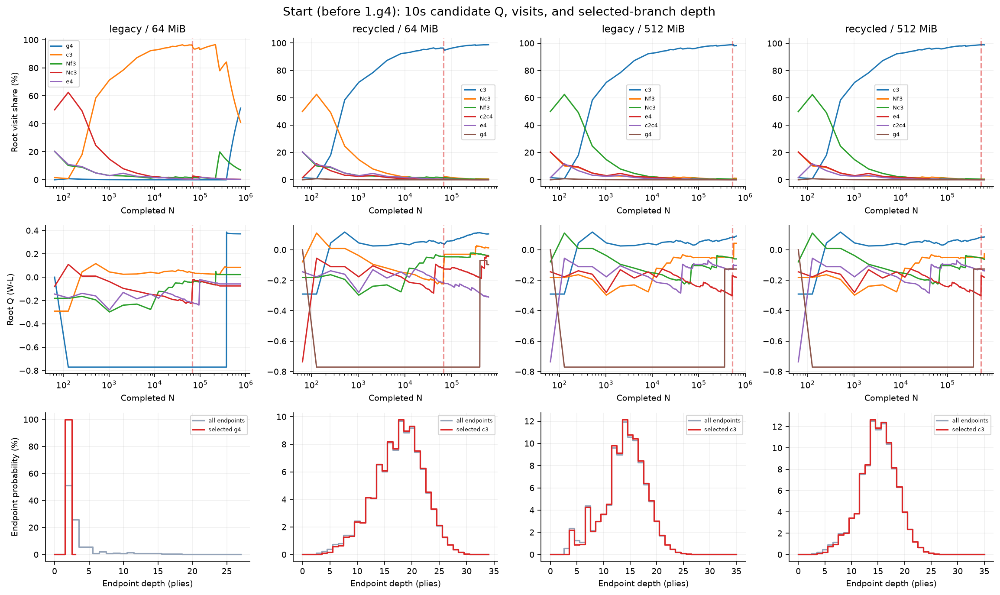
### 5.Rg1 직전
- 기존 64MiB, N=6,363: 선택 `Rg1`, 관심 수 `Rg1` Policy=0.00139%, Q=+0.14081, Visits=5,859. 관심 수의 잎 깊이 평균/중앙값/최대=7.03/7.0/14, 깊이 2 이하 비중=0.5120%다. 완료된 전체 분포는 6.88/7/14다.
  실제 첫 할당 실패 없음; 회수 0회, 폐기 attempt 0회, 미보존 NN=0, 저장된 미확장 노드 재평가=0.
- 수정 64MiB, N=6,363: 선택 `Rg1`, 관심 수 `Rg1` Policy=0.00139%, Q=+0.14081, Visits=5,859. 관심 수의 잎 깊이 평균/중앙값/최대=7.03/7.0/14, 깊이 2 이하 비중=0.5120%다. 완료된 전체 분포는 6.88/7/14다.
  실제 첫 할당 실패 없음; 회수 0회, 폐기 attempt 0회, 미보존 NN=0, 저장된 미확장 노드 재평가=0.
- 기존 512MiB, N=6,363: 선택 `Rg1`, 관심 수 `Rg1` Policy=0.00139%, Q=+0.14081, Visits=5,859. 관심 수의 잎 깊이 평균/중앙값/최대=7.03/7.0/14, 깊이 2 이하 비중=0.5120%다. 완료된 전체 분포는 6.88/7/14다.
  실제 첫 할당 실패 없음; 회수 0회, 폐기 attempt 0회, 미보존 NN=0, 저장된 미확장 노드 재평가=0.
- 수정 512MiB, N=6,363: 선택 `Rg1`, 관심 수 `Rg1` Policy=0.00139%, Q=+0.14081, Visits=5,859. 관심 수의 잎 깊이 평균/중앙값/최대=7.03/7.0/14, 깊이 2 이하 비중=0.5120%다. 완료된 전체 분포는 6.88/7/14다.
  실제 첫 할당 실패 없음; 회수 0회, 폐기 attempt 0회, 미보존 NN=0, 저장된 미확장 노드 재평가=0.
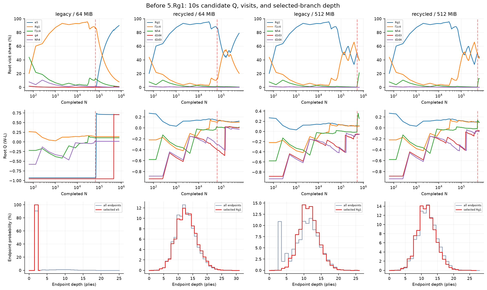
### 4.Rg1 직전(보조)
- 기존 64MiB, N=52,995: 선택 `Rg1`, 관심 수 `Rg1` Policy=0.00185%, Q=+0.10718, Visits=34,784. 관심 수의 잎 깊이 평균/중앙값/최대=8.53/8.0/18, 깊이 2 이하 비중=0.0834%다. 완료된 전체 분포는 8.85/9/20다.
  실제 첫 할당 실패 없음; 회수 0회, 폐기 attempt 0회, 미보존 NN=0, 저장된 미확장 노드 재평가=0.
- 수정 64MiB, N=52,995: 선택 `Rg1`, 관심 수 `Rg1` Policy=0.00185%, Q=+0.10718, Visits=34,784. 관심 수의 잎 깊이 평균/중앙값/최대=8.53/8.0/18, 깊이 2 이하 비중=0.0834%다. 완료된 전체 분포는 8.85/9/20다.
  실제 첫 할당 실패 없음; 회수 0회, 폐기 attempt 0회, 미보존 NN=0, 저장된 미확장 노드 재평가=0.
- 기존 512MiB, N=52,995: 선택 `Rg1`, 관심 수 `Rg1` Policy=0.00185%, Q=+0.10718, Visits=34,784. 관심 수의 잎 깊이 평균/중앙값/최대=8.53/8.0/18, 깊이 2 이하 비중=0.0834%다. 완료된 전체 분포는 8.85/9/20다.
  실제 첫 할당 실패 없음; 회수 0회, 폐기 attempt 0회, 미보존 NN=0, 저장된 미확장 노드 재평가=0.
- 수정 512MiB, N=52,995: 선택 `Rg1`, 관심 수 `Rg1` Policy=0.00185%, Q=+0.10718, Visits=34,784. 관심 수의 잎 깊이 평균/중앙값/최대=8.53/8.0/18, 깊이 2 이하 비중=0.0834%다. 완료된 전체 분포는 8.85/9/20다.
  실제 첫 할당 실패 없음; 회수 0회, 폐기 attempt 0회, 미보존 NN=0, 저장된 미확장 노드 재평가=0.
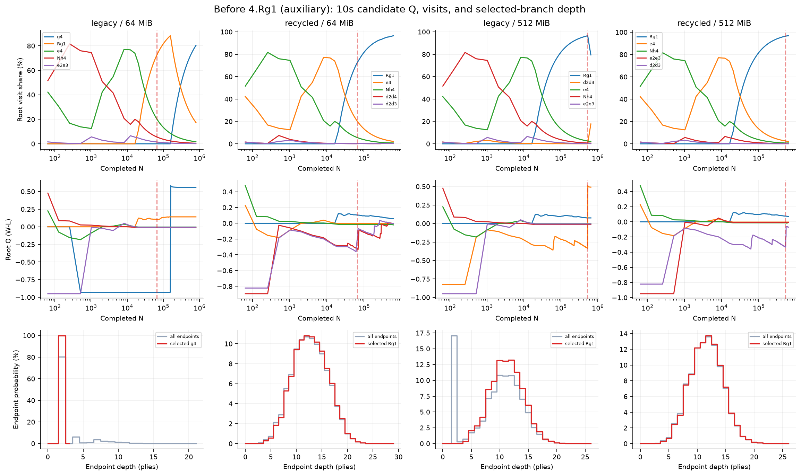
### 2...Ra6 직전
- 기존 64MiB, N=717,076: 선택 `Ra6`, 관심 수 `Ra6` Policy=0.23906%, Q=+0.98393, Visits=508,802. 관심 수의 잎 깊이 평균/중앙값/최대=2.00/2.0/2, 깊이 2 이하 비중=100.0000%다. 완료된 전체 분포는 3.30/2/21다.
  실제 첫 할당 실패 N=65,551, 1014.66ms; 회수 0회, 폐기 attempt 0회, 미보존 NN=651,526, 저장된 미확장 노드 재평가=0.
- 수정 64MiB, N=717,076: 선택 `e6`, 관심 수 `Ra6` Policy=0.23906%, Q=-0.19426, Visits=20. 관심 수의 잎 깊이 평균/중앙값/최대=2.50/3.0/3, 깊이 2 이하 비중=45.0000%다. 완료된 전체 분포는 15.40/16/30다.
  실제 첫 할당 실패 N=65,551, 1002.57ms; 회수 17회, 폐기 attempt 17회, 미보존 NN=0, 저장된 미확장 노드 재평가=0.
- 기존 512MiB, N=717,076: 선택 `e6`, 관심 수 `Ra6` Policy=0.23906%, Q=-0.21655, Visits=18. 관심 수의 잎 깊이 평균/중앙값/최대=2.50/3.0/3, 깊이 2 이하 비중=44.4444%다. 완료된 전체 분포는 10.93/11/26다.
  실제 첫 할당 실패 N=524,822, 8181.88ms; 회수 0회, 폐기 attempt 0회, 미보존 NN=192,255, 저장된 미확장 노드 재평가=0.
- 수정 512MiB, N=717,076: 선택 `e6`, 관심 수 `Ra6` Policy=0.23906%, Q=-0.21655, Visits=18. 관심 수의 잎 깊이 평균/중앙값/최대=2.50/3.0/3, 깊이 2 이하 비중=44.4444%다. 완료된 전체 분포는 12.63/13/26다.
  실제 첫 할당 실패 N=524,822, 8467.52ms; 회수 1회, 폐기 attempt 1회, 미보존 NN=0, 저장된 미확장 노드 재평가=0.
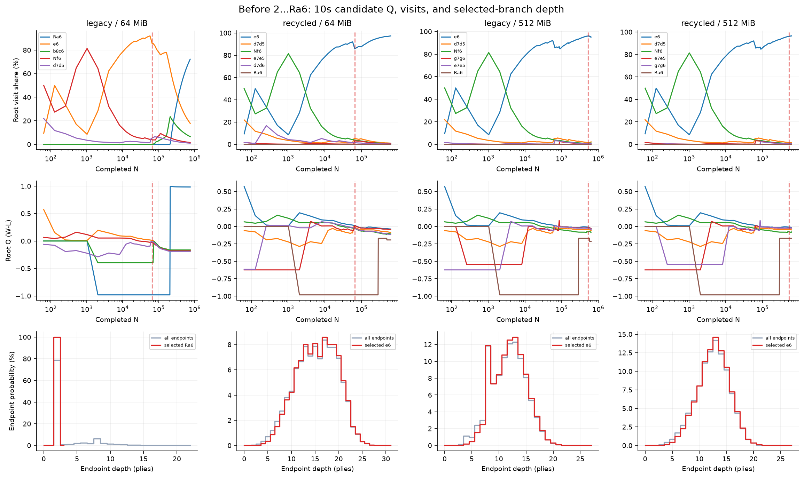

## 상위 5개 후보

각 실행의 전체 후보 표는 [top5-candidates.csv](top5-candidates.csv)에 있다. 아래는 10초 대표 실행의 상위 5개이며 ★가 최종 선택이다.

### 시작 위치 · 1.g4 직전 · 10초 대표 실행
| 버전 | MiB | 순위 | 수 | Policy | Q | Visits | 조건부 잎 평균/중앙값/최대 |
|---|---:|---:|---|---:|---:|---:|---|
| 기존 | 64 | 1 | `g4` ★ | 0.18569% | +0.37133 | 395,346 | 2.00/2.0/2 |
| 기존 | 64 | 2 | `c3`  | 4.49670% | +0.08415 | 317,407 | 5.79/4.0/26 |
| 기존 | 64 | 3 | `Nf3`  | 22.48018% | +0.02260 | 53,911 | 3.15/3.0/9 |
| 기존 | 64 | 4 | `Nc3`  | 27.12535% | -0.07511 | 2,098 | 4.04/4.0/9 |
| 기존 | 64 | 5 | `e4`  | 21.15616% | -0.05809 | 1,969 | 3.84/4.0/7 |
| 수정 | 64 | 1 | `c3` ★ | 4.49670% | +0.10402 | 603,372 | 17.64/18.0/33 |
| 수정 | 64 | 2 | `Nc3`  | 27.12535% | +0.01238 | 3,470 | 9.36/9.0/19 |
| 수정 | 64 | 3 | `Nf3`  | 22.48018% | -0.03830 | 1,851 | 5.99/6.0/13 |
| 수정 | 64 | 4 | `c2c4`  | 11.56475% | -0.04439 | 914 | 5.90/6.0/10 |
| 수정 | 64 | 5 | `e4`  | 21.15616% | -0.31102 | 599 | 5.09/5.0/9 |
| 기존 | 512 | 1 | `c3` ★ | 4.49670% | +0.09020 | 637,682 | 14.01/14.0/34 |
| 기존 | 512 | 2 | `Nf3`  | 22.48018% | +0.04222 | 6,769 | 4.36/4.0/13 |
| 기존 | 512 | 3 | `Nc3`  | 27.12535% | -0.06015 | 2,217 | 6.61/7.0/16 |
| 기존 | 512 | 4 | `e4`  | 21.15616% | -0.18052 | 944 | 6.48/6.0/15 |
| 기존 | 512 | 5 | `c2c4`  | 11.56475% | -0.10309 | 724 | 5.19/5.0/10 |
| 수정 | 512 | 1 | `c3` ★ | 4.49670% | +0.08393 | 611,820 | 15.08/15.0/34 |
| 수정 | 512 | 2 | `Nf3`  | 22.48018% | -0.02511 | 2,433 | 6.44/6.0/16 |
| 수정 | 512 | 3 | `Nc3`  | 27.12535% | -0.06215 | 2,195 | 6.62/7.0/16 |
| 수정 | 512 | 4 | `e4`  | 21.15616% | -0.18042 | 943 | 6.48/6.0/15 |
| 수정 | 512 | 5 | `c2c4`  | 11.56475% | -0.13853 | 613 | 5.34/5.0/10 |
### 5.Rg1 직전 · 10초 대표 실행
| 버전 | MiB | 순위 | 수 | Policy | Q | Visits | 조건부 잎 평균/중앙값/최대 |
|---|---:|---:|---|---:|---:|---:|---|
| 기존 | 64 | 1 | `e5` ★ | 0.52856% | +0.70804 | 710,225 | 2.00/2.0/2 |
| 기존 | 64 | 2 | `Rg1`  | 0.00139% | +0.13796 | 62,841 | 9.15/9.0/24 |
| 기존 | 64 | 3 | `f1c4`  | 56.90378% | +0.10738 | 8,503 | 9.21/9.0/19 |
| 기존 | 64 | 4 | `g4`  | 0.32970% | +0.70729 | 5,783 | 2.00/2.0/2 |
| 기존 | 64 | 5 | `Nh4`  | 27.92290% | +0.01631 | 931 | 7.92/8.0/15 |
| 수정 | 64 | 1 | `Rg1` ★ | 0.00139% | +0.12270 | 492,667 | 12.91/13.0/30 |
| 수정 | 64 | 2 | `f1c4`  | 56.90378% | +0.10364 | 127,379 | 11.89/12.0/25 |
| 수정 | 64 | 3 | `Nh4`  | 27.92290% | +0.01469 | 3,066 | 9.59/10.0/19 |
| 수정 | 64 | 4 | `d2d4`  | 6.67477% | +0.00353 | 664 | 6.55/7.0/12 |
| 수정 | 64 | 5 | `d2d3`  | 6.67953% | -0.02660 | 533 | 5.51/6.0/11 |
| 기존 | 512 | 1 | `Rg1` ★ | 0.00139% | +0.10956 | 257,146 | 11.38/11.0/25 |
| 기존 | 512 | 2 | `f1c4`  | 56.90378% | +0.10567 | 253,124 | 12.21/12.0/24 |
| 기존 | 512 | 3 | `Nh4`  | 27.92290% | +0.25604 | 136,994 | 4.72/3.0/19 |
| 기존 | 512 | 4 | `d2d3`  | 6.67953% | -0.05400 | 442 | 5.60/5.0/15 |
| 기존 | 512 | 5 | `d2d4`  | 6.67477% | -0.06129 | 420 | 5.61/5.0/14 |
| 수정 | 512 | 1 | `Rg1` ★ | 0.00139% | +0.10555 | 279,273 | 11.54/11.0/26 |
| 수정 | 512 | 2 | `f1c4`  | 56.90378% | +0.10304 | 269,054 | 12.40/12.0/27 |
| 수정 | 512 | 3 | `Nh4`  | 27.92290% | +0.10133 | 78,725 | 11.85/12.0/24 |
| 수정 | 512 | 4 | `d2d3`  | 6.67953% | -0.04935 | 515 | 5.81/6.0/15 |
| 수정 | 512 | 5 | `d2d4`  | 6.67477% | -0.06873 | 455 | 5.73/6.0/14 |
### 4.Rg1 직전(보조) · 10초 대표 실행
| 버전 | MiB | 순위 | 수 | Policy | Q | Visits | 조건부 잎 평균/중앙값/최대 |
|---|---:|---:|---|---:|---:|---:|---|
| 기존 | 64 | 1 | `g4` ★ | 0.35977% | +0.55730 | 638,547 | 2.00/2.0/2 |
| 기존 | 64 | 2 | `Rg1`  | 0.00185% | +0.14090 | 138,538 | 6.72/7.0/18 |
| 기존 | 64 | 3 | `e4`  | 48.76870% | -0.00363 | 13,403 | 9.80/10.0/20 |
| 기존 | 64 | 4 | `Nh4`  | 30.73626% | -0.01306 | 3,702 | 9.00/9.0/18 |
| 기존 | 64 | 5 | `e2e3`  | 4.64367% | -0.00613 | 969 | 7.72/8.0/16 |
| 수정 | 64 | 1 | `Rg1` ★ | 0.00185% | +0.05933 | 600,976 | 12.75/13.0/28 |
| 수정 | 64 | 2 | `e4`  | 48.76870% | -0.00363 | 13,403 | 9.80/10.0/20 |
| 수정 | 64 | 3 | `Nh4`  | 30.73626% | -0.02007 | 4,582 | 9.04/9.0/18 |
| 수정 | 64 | 4 | `d2d4`  | 7.84519% | -0.00296 | 1,498 | 5.79/6.0/10 |
| 수정 | 64 | 5 | `d2d3`  | 6.69565% | -0.00466 | 1,243 | 5.95/6.0/10 |
| 기존 | 512 | 1 | `Rg1` ★ | 0.00185% | +0.07557 | 518,296 | 11.20/11.0/25 |
| 기존 | 512 | 2 | `d2d3`  | 6.69565% | +0.49146 | 115,553 | 2.06/2.0/7 |
| 기존 | 512 | 3 | `e4`  | 48.76870% | -0.00363 | 13,403 | 9.80/10.0/20 |
| 기존 | 512 | 4 | `Nh4`  | 30.73626% | -0.01405 | 3,778 | 9.00/9.0/18 |
| 기존 | 512 | 5 | `e2e3`  | 4.64367% | -0.00613 | 969 | 7.72/8.0/16 |
| 수정 | 512 | 1 | `Rg1` ★ | 0.00185% | +0.06998 | 609,904 | 11.61/12.0/25 |
| 수정 | 512 | 2 | `e4`  | 48.76870% | -0.00363 | 13,403 | 9.80/10.0/20 |
| 수정 | 512 | 3 | `Nh4`  | 30.73626% | -0.00692 | 4,758 | 9.58/9.0/19 |
| 수정 | 512 | 4 | `e2e3`  | 4.64367% | -0.00613 | 969 | 7.72/8.0/16 |
| 수정 | 512 | 5 | `d2d3`  | 6.69565% | -0.07032 | 569 | 5.36/5.0/10 |
### 2...Ra6 직전 · 10초 대표 실행
| 버전 | MiB | 순위 | 수 | Policy | Q | Visits | 조건부 잎 평균/중앙값/최대 |
|---|---:|---:|---|---:|---:|---:|---|
| 기존 | 64 | 1 | `Ra6` ★ | 0.23906% | +0.98386 | 542,486 | 2.00/2.0/2 |
| 기존 | 64 | 2 | `e6`  | 16.41637% | -0.16436 | 133,484 | 8.40/8.0/21 |
| 기존 | 64 | 3 | `b8c6`  | 0.20426% | -0.16354 | 49,014 | 2.00/2.0/2 |
| 기존 | 64 | 4 | `Nf6`  | 28.87816% | -0.18093 | 11,365 | 4.89/4.0/14 |
| 기존 | 64 | 5 | `d7d5`  | 25.39307% | -0.18802 | 7,097 | 5.65/5.0/16 |
| 수정 | 64 | 1 | `e6` ★ | 16.41637% | -0.03746 | 605,686 | 15.44/16.0/30 |
| 수정 | 64 | 2 | `d7d5`  | 25.39307% | -0.08521 | 6,260 | 8.38/8.0/19 |
| 수정 | 64 | 3 | `Nf6`  | 28.87816% | -0.10775 | 4,845 | 7.24/7.0/16 |
| 수정 | 64 | 4 | `e7e5`  | 2.12373% | -0.04660 | 2,840 | 7.04/7.0/17 |
| 수정 | 64 | 5 | `d7d6`  | 8.99622% | -0.11870 | 1,313 | 6.35/6.0/12 |
| 기존 | 512 | 1 | `e6` ★ | 16.41637% | -0.03345 | 607,782 | 11.95/12.0/26 |
| 기존 | 512 | 2 | `d7d5`  | 25.39307% | -0.05607 | 13,279 | 7.11/7.0/19 |
| 기존 | 512 | 3 | `Nf6`  | 28.87816% | -0.08210 | 7,070 | 7.01/7.0/14 |
| 기존 | 512 | 4 | `g7g6`  | 0.87524% | -0.03557 | 4,357 | 6.62/6.0/14 |
| 기존 | 512 | 5 | `e7e5`  | 2.12373% | -0.04257 | 2,745 | 7.03/7.0/16 |
| 수정 | 512 | 1 | `e6` ★ | 16.41637% | -0.01395 | 593,799 | 12.63/13.0/26 |
| 수정 | 512 | 2 | `d7d5`  | 25.39307% | -0.04988 | 8,259 | 8.74/9.0/19 |
| 수정 | 512 | 3 | `Nf6`  | 28.87816% | -0.07985 | 5,131 | 7.45/7.0/16 |
| 수정 | 512 | 4 | `e7e5`  | 2.12373% | -0.02539 | 2,596 | 7.03/7.0/16 |
| 수정 | 512 | 5 | `g7g6`  | 0.87524% | -0.02206 | 2,269 | 6.70/7.0/14 |

## 해석 범위

이 수정은 포화 뒤 저장하지 못한 얕은 평가가 끝없이 백업되는 동작을 제거하고, 같은 메모리 예약 안에서 실제 저장하며 새 확장을 이어가는 동작을 검증한다. 모델 가중치·학습 데이터·정책·가치를 변경하지 않았다. 기존 버전과의 통계 동등성은 포화 전 구간에 대해 검사하며 포화 뒤 결과 변화는 의도한 변경이다. 제거된 하위 통계를 잃는 근사 탐색이므로 수 선택이 바뀌거나 깊이 통계가 좋아진 것만으로 Elo 향상을 주장하지 않는다. 평균 깊이 증가 자체도 탐색의 폭·모델 정확도를 대체하지 않는다. **수정본 64MiB의 평균 깊이가 512MiB보다 높더라도 64MiB가 더 강하다는 증거는 아니다.** 더 자주 낮은 방문 후손을 제거하며 탐색 분포가 집중되는 서로 다른 경로를 만들 수 있다. 기존 가치 함수의 일반화·일관성 문제는 남아 있다. 객관적인 강도 평가는 별도 대국이 필요하다.

## 원자료

- [전체 실행 지표](all-run-metrics.csv), [시간 비교](time-comparison.csv), [동일 N 비교](fixed-simulation-comparison.csv), [요약 JSON](analysis-summary.json)
- [관심 수 비교](interest-move-comparison.csv), [상위 5개 후보](top5-candidates.csv), [후보 스냅샷](root-candidate-snapshots.csv)
- [잎 깊이 빈도](leaf-depth-histograms.csv), [깊이별 경로 방문](depth-path-visits.csv), [포화 전후 빈도](pre-post-failure-histograms.csv), [빈 window를 포함한 원시 시간 창](depth-windows.csv)
- [회수 이벤트](prune-events.csv), [실험 JSONL](runs.jsonl), [조건·해시](experiment-metadata.json), 개별 명령과 stdout은 `raw/`
- 모든 그래프는 `graphs/`에 PNG와 SVG로 저장했다. 완성 전 부분 로그를 분석했다면 실행 수가 208보다 작을 수 있으며 보고서의 실제 실행 수를 기준으로 한다.

## 원본 보존·엔진 검증 자료

실험 종료 해시 검사에서 기존 릴리스 225개 파일과 이전 계측 버전 38개 파일의 변경은 각각 0개, 0개였다. 모델 SHA-256은 `f6a00902c23e7f32f96b028ac36464cc9012cd8774d5e6b0dee5e1c94e1c03c9`다.

- [Native 테스트 로그](native-tests.log): 통과한 CTest 기록 5개
- [AddressSanitizer 테스트 로그](asan-tests.log): 통과한 CTest 기록 5개
- [UCI·포화 전 통계 동등성·포화 뒤 완료 N 검증](validation-uci.json)

이 검증은 규칙·메모리 접근·회계·실행 동작을 확인하며 수의 객관적 우수성이나 Elo를 측정하지 않는다.
