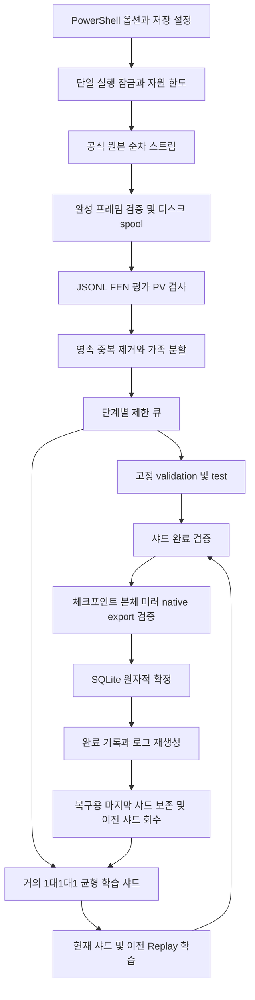

# CHROMATIC Shard Trainer 설계와 복구 계약

이 문서는 현재 구현의 동작을 설명한다. 진입점은 `chromatic-train.ps1`과 `python -m shardtrain.run`이며, 기존 엔진과 분리된 이 폴더 안의 Python 학습 도구만 실행한다. 학습은 CPU PyTorch 1스레드이고, 기존 네트워크 구조·인코딩·ZERO0001 파일 형식을 `vendor/zero` 사본으로 재사용한다.

## 구성요소와 처리 순서

| 파일 | 책임 |
|---|---|
| `chromatic-train.ps1` | PowerShell 옵션 매핑, Python 선택, Resume의 명시 옵션만 전달 |
| `shardtrain/run.py` | 설정 검사·자동 복원, 공식 원본 허용 목록, 보정·앵커 로딩 |
| `streaming.py` | JSONL/Zstandard 순차 디코드, HTTP 재시도·정체성 검사·cursor |
| `quality.py` | FEN·평가·PV 검증, Policy/WDL 부분 라벨, 정규화 identity |
| `calibration.py` | 실제 결과 기반 독립 CP→WDL 보정과 NLL/Brier/ECE |
| `anchors.py` | 공식 오프닝 이력을 가진 약한 Policy 앵커와 시작 위치 보장 |
| `shards.py` | 균형 큐, 고정 세트, 샤드 파일·완료 후 삭제와 재개 |
| `model_adapter.py` | 기존 인코딩·PolicyWDL 모델, 신뢰도 가중 loss |
| `pipeline.py` | Optimizer·Scheduler·학습·Replay·검증·확정 저장 |
| `durable.py` | 불변 체크포인트 묶음, 검증·미러·rollback·보관 정리 |
| `storage.py` | SQLite ledger, 원자적 파일 저장, 자원 검사·로그 생성 |
| `memory_limit.py` | Windows Job Object 프로세스 committed-memory 한도 |
| `recover.py` | 학습 없는 체크포인트 검사 및 선택적 head 복구 |
| `evaluate.py` | 고정 데이터·네이티브 엔진 비교, 보존 검사·수동 승격 판단 |

## 원본 정체성, 스트리밍과 상한

온라인 학습의 허용 URL은 `https://database.lichess.org/lichess_db_eval.jsonl.zst` 하나다. 로컬 JSONL 또는 JSONL/Zstandard에는 `<파일명>.source.json`이 필요하며, 공식 URL·`CC0-1.0`·실제 로컬 파일 SHA-256을 검사한다. sidecar와 실제 source cursor에는 원본 URL, 버전/ETag, Last-Modified 등 정체성, 처리한 물리적 줄 수와 prefix SHA-256을 보관한다. 검증용 보조 원본은 별도 공식 CC0 PGN·오프닝·퍼즐이다.

기본 production 스트림은 전체 압축 파일을 받거나 전체 디코드 프레임을 RAM에 올리지 않는다. 프레임을 64KiB 이하 출력 청크로 디스크 spool에 디코드하고, 끝까지 완성되어 체크섬·프레이밍 검사가 성공한 뒤 그 프레임의 행을 노출한다. 잘린 프레임은 그 프레임의 행을 production에 전달하지 않는다. 한 JSONL 행은 여러 프레임에 걸쳐 있을 수 있다.

| 제한 | CLI 실행에 적용되는 값 |
|---|---|
| 압축/입력 범위 | `MaxDownloadMB × 1024²`바이트, 기본 128MiB |
| 전체 디코드량 | `max(128, MaxDownloadMB × 16)`MiB |
| 프레임별 디코드 spool | 128MiB |
| Zstandard window | 헤더에서 직접 확인, 128MiB |
| JSONL 한 줄 | 1MiB |
| HTTP 연결 timeout | 20초 |
| 네트워크 재시도 | 최대 4회 |
| 학습 샤드 | 최대 100,000개 포지션 |
| 미니배치 | 최대 4,096개, 실제 가능한 크기는 메모리에 의존 |

`MaxDownloadMB`를 늘려도 프레임·window·한 줄 한도는 유지된다. 임의의 큰 프레임을 무조건 처리하지 않고 한도 초과로 중단한다. 압축 입력 바이트 예산과 총 네트워크 재전송량은 다르다. 재연결·재개로 반복 전송이 발생할 수 있다.

동일 프로세스의 네트워크 단절은 현재 decoder 상태를 유지하고 정확한 압축 offset부터 재연결한다. 206의 Content-Range 시작과 원본 정체성이 맞아야 한다. 서버가 Range를 무시해 200을 반환하면 이미 처리한 압축 prefix를 버린 뒤 이어 붙인다. 새 프로세스는 byte 0부터 다시 디코드하고 저장된 물리 행 번호까지 rolling prefix SHA-256을 검증한다. 저장한 압축 offset은 진단 정보이며 임의의 offset에서 독립 압축 스트림을 시작하는 용도로 쓰지 않는다.

따라서 재개는 정확성을 우선하며 원본을 오래 처리한 실행에서는 prefix 재독 비용이 증가한다. 프레임 색인을 이용한 프로세스 간 즉시 재개, 전체 파일의 영구 다운로드 캐시는 현재 구현하지 않았다. 원본 ETag·정체성·prefix가 달라지면 변경된 데이터를 조용히 연결하지 않고 중단한다.

검증에 사용한 로컬 평가 fixture는 공식 원본의 **완성된 첫 2개 프레임**을 검증한 뒤 그 중 60,000개 행을 재압축한 것이다. 원본 압축 입력 11,506,841바이트, 디코드 64MiB를 소비했고, 로컬 파일은 checksum을 포함한다. 이는 소비한 프레임의 검증이며 아직 읽지 않은 전체 데이터베이스의 무결성을 증명하지 않는다. [원시 검증 결과](../reports/official-frame-verification.json)와 fixture sidecar가 근거다. 기타 일부 prefix로만 수집한 자료의 원본 프레임 체크섬 미확인 여부도 provenance에 별도로 남긴다.

## 데이터 정규화와 라벨

현재 모델 입력은 20×64 = 1,280개이며 절대 보드 좌표를 사용한다. 12개 기물 plane, 차례, 4개 캐슬링 권리, en passant, 50수 카운터, 반복 횟수 특징을 기존 인코딩과 동일하게 구성한다. Policy는 4,672개 action logit이며 일반 from/to 4,096개와 언더프로모션 영역을 사용한다. WDL은 현재 차례 관점의 승·무·패 logit이다. 내보내기는 `ZERO0001` 헤더와 little-endian FP32 Linear 가중치·bias를 사용한다.

평가 JSONL의 FEN은 실제로 4필드인 경우가 많다. 부족한 시계 값은 파싱용 placeholder로 보완하고, 반복 이력을 알 수 없음을 `history_known=False`와 정규화 필드에 명시한다. 그 값을 실제 첫 수순이나 실제 50수 정보로 오인하지 않는다. 합법적인 en passant가 없는 target은 identity 계산에서 정규화한다.

평가 항목은 기본 깊이 12 이상, 10 kilo-nodes 이상을 요구한다. PV는 최대 16개, 각 256플라이까지 허용하고 모든 제공된 PV 수를 합법성 검사한다. 중복 첫 수, 불법 수, 비유한 CP, 모순된 cp/mate, 잘못된 FEN 등은 거부 이유를 센다. 깊이·노드 수·PV 수 순으로 가장 좋은 유효 평가를 고른다. 더 깊은 평가가 잘못됐고 낮은 깊이의 유효 평가를 썼다면 거부 사유도 기록한다.

Lichess CP와 mate의 원래 관점은 백이다. 흑 차례에서는 부호/순서를 반전하여 현재 차례 기준으로 정규화한다. 캐슬링의 king-to-rook UCI 표기는 python-chess로 정상화한 뒤 기존 action 인코딩을 적용한다.

- **Policy:** 관측된 PV 첫 수의 평가를 CP 온도 100으로 softmax한 부분 모방 분포다. 단일 PV는 특히 작은 가중치를 쓴다. 관측하지 않은 합법수가 나쁘다고 증명하지 않으며, MCTS 방문 분포라고 표시하지 않는다.
- **CP Value:** 독립 결과 보정이 `accepted`일 때만 사용한다. 미수용 보정에서는 `value_weight=0`으로 완전히 마스킹한다. placeholder `[0,1,0]`은 관측 무승부가 아니다.
- **mate Value:** 부호로 승·패를 정하고 작은 가중치의 교사 라벨로 사용한다. 비종료 위치의 mate 0은 부호를 복원할 수 없어 거부한다. CHROMATIC 자체가 메이트를 증명한 값은 아니다.
- **신뢰도:** 깊이·노드·부분 PV 범위·알 수 없는 이력을 반영해 Policy와 Value의 독립 가중치를 낮춘다. 학습 목적 함수는 전체 미니배치에 대해 `(policy_weight × policy_loss + value_weight × wdl_loss)`의 평균이다. 보고하는 개별 검증 loss는 해당 가중치 합으로 나눈 별도 지표다.

독립 보정은 공식 완료 PGN의 CP 주석과 실제 Result를 사용한다. 게임 ID 단위로 fit/validation/test를 나누고 동일 게임의 총 가중치는 1이다. 양의 scale과 음이 아닌 draw margin을 가진 대칭 ordinal logistic 모델을 fit에 맞추며 validation NLL로 선택한다. test는 선택에 사용하지 않고 NLL, 3클래스 Brier, ECE를 보고한다. 최소 holdout 게임 수·fit의 세 결과 존재·상수 prior 대비 validation 조건을 통과해야 수용한다.

보정용 모든 위치 가족과 퍼즐 전술 위치 가족은 신경망 학습에서 제외한다. 첫 12플라이 오프닝 가족과 겹치는 보정 게임도 fit 이전에 게임 전체를 제외한다. 자세한 식·근거는 [라벨 및 보정 문서](LABELS_AND_CALIBRATION.md)에 있다.

## 시작 위치, 균형과 고정 세트

공식 평가 FEN의 fullmove placeholder로 초반을 판정하지 않는다. 기물 수와 기물 가중치로 `opening/middlegame/endgame`을 구분하며 `phase_basis=material_proxy_not_game_ply`로 명시한다. 이 분류는 각 샤드와 고정 세트에 거의 1/3씩 할당한다. 필요한 단계가 없으면 다른 단계로 몰래 채우거나 중복해서 목표 수를 맞추지 않고 `InsufficientData`로 중단한다.

진짜 초기 수순은 commit이 고정된 Lichess CC0 오프닝 TSV에서 만든다. root와 0~12플라이의 실제 합법 이력을 가진 행을 순환 선택한다. 앵커는 초기 모델의 추측을 정답으로 쓰지 않고 카탈로그의 다음 수 빈도를 약한 Policy로 사용한다. Policy 가중치는 0.15, Value 가중치는 0이다. 요청 앵커 수는 `min(2000, max(13, Positions // 5))`이며 이후 중복·유사성·분할 필터를 적용한다. 시작 위치는 가장 먼저 삽입하고 학습에 남았는지 확인한다.

분할은 서로 다른 세 키로 관리한다.

| 키 | 구성 | 목적 |
|---|---|---|
| `identity` | 법적 위치를 정하는 FEN 앞 4필드 SHA-256 | 동일 위치 중복 제거, clock 변형 제거 |
| `family` | 기물 배치만의 SHA-256 | 차례·캐슬링·clock 변형 간 분할 누수 감사 |
| `similarity_bucket` | 양측 기물 수와 폰 bitboard의 SHA-256 | 비슷한 구조를 함께 분할하고 과다 집중 제한 |

`SHA256(seed:similarity_bucket) mod 100`으로 train/validation/test를 80/10/10 범위에 배정한다. 시작 위치와 같은 구조의 bucket은 train으로 고정한다. 이는 개별 포지션의 정확한 80/10/10 개수 보장이 아닌 그룹 배정이다. `seen_families`가 이미 수용한 가족의 split을 영속적으로 확인한다. 같은 bucket의 검토 identity 수를 전역 기본 50으로 제한하며, 제외·초과로 버린 identity도 `seen`에 남겨 뒤에서 다시 들어오지 못하게 한다.

validation/test는 각각 `max(16, min(1000, Positions // 10))`개다. 학습 전 최초 한 번 선택해 JSONL·멤버 ID·파일 SHA-256을 고정하고 재개 때 검증한다. 고정 세트는 Replay에 들어가지 않는다. 학습량이 다른 실행의 자체 holdout 크기·멤버가 같다고 가정하지 않으며, 단계 비교 도구는 같은 공통 holdout을 모든 모델에 다시 적용한다.

## SQLite ledger와 제한 큐

ledger는 WAL, `synchronous=FULL`, 8MiB 캐시, 제한된 WAL 자동 checkpoint 설정을 사용한다. 메모리 안의 진행 표시나 디렉터리의 가장 최근 파일명은 commit의 기준이 아니다.

| 테이블 | 영속 상태 |
|---|---|
| `meta` | 설정·설정 서명, 원본 정체성/cursor, 고정 세트, 현재 manifest·단계 |
| `seen` | 검토한 identity와 유사 그룹·단계·split |
| `seen_families` | 수용한 가족의 영구 split 기록 |
| `records` | 순차 번호, 정규화 JSON payload, split·단계·할당 샤드 |
| `shards` | 샤드 ID·파일·SHA·행 수·상태·완료 checkpoint |
| `checkpoints` | 확정된 checkpoint 순서와 manifest, 단계·진행 요약 |
| `events` | 확정된 학습 로그 이벤트 |

입력은 최대 128개 물리 행씩 하나의 SQLite 트랜잭션에서 처리한다. 정상 행·중복/거부 판단·정규화 payload·원본 cursor와 prefix 해시를 함께 commit한다. payload를 남기지 않은 채 cursor만 전진시키지 않는다. 트랜잭션 실패 시 해당 chunk를 rollback하고 프로세스 재개에서 다시 읽는다. 잘못된 JSON은 품질 카운터로 남기며, 압축 손상이나 자원 오류는 원인과 함께 중단한다.

학습 대기 큐는 각 단계당 최대 `2 × ShardSize`개다. validation/test 큐도 필요한 고정 할당량까지만 둔다. 큐가 가득 찬 행은 overflow 카운터에 남기고 검토 identity를 유지한다. 따라서 원본 전체를 보관하지 않고 순차 균형 샘플을 얻지만 원본 전체의 균등 무작위 표본이라고 주장하지 않는다.

샤드는 선택한 ID 순서로 `.jsonl.tmp`를 쓰고 flush/fsync 후 원자적으로 rename한다. 내용 SHA를 구한 다음 파일·행 수·레코드 할당을 SQLite에 기록한다. 재개는 준비된 동일 ID 샤드를 먼저 재사용한다. 파일이 없지만 모든 정규화 행이 남았으면 같은 SHA로만 재구성한다. 반대로 파일은 정상이고 SQLite payload 일부가 없으면 파일로 전체 할당 순서를 복원한다. 파일 손상은 덮어쓰거나 삭제하지 않고 검사 대상으로 남긴다.

`seen`과 가족 이력은 오래된 샤드 payload를 지운 뒤에도 남는다. 따라서 RAM과 큐는 제한되지만 중복 감사 DB가 학습량에 비례해 커지며, 무한한 데이터를 고정 크기 디스크에서 처리한다는 보장은 없다.

## 학습 상태, Replay와 첫 실행

새 실행은 초기 checkpoint의 모델 구조와 가중치만 계승한다. 초기 checkpoint의 Optimizer·Scheduler·과거 step을 이어 쓰지 않는다. 이 도구의 AdamW는 `weight_decay=1e-4`, 설정 초기 학습률을 사용한다. LambdaLR 배율은 `max(0.05, 0.999 ** step)`이며 step마다 갱신한다. gradient norm을 1로 clip하고 loss·gradient·가중치·Optimizer 텐서의 NaN/Inf를 검사한다.

학습 단계는 시드 고정한 `torch.Generator`로 샤드별 Epoch 순열을 만든다. 순열 자체와 다음 offset을 저장하므로 재개가 다른 순서의 배치를 선택하지 않는다. 미니배치는 보관 Replay가 있으면 대략 20%를 Replay에 배정하고 나머지를 현재 샤드에서 가져온다. 신규 Positions는 현재 샤드 완료 시에만 더한다.

Replay는 split이 train인 행만 받고 단계별 대표를 SHA 순서로 결정적으로 선택한다. 기본 최대 512개이며 시작 위치가 들어오면 유지한다. Replay의 정규화 payload 전체를 checkpoint에 저장하므로 오래된 샤드 파일이나 SQL payload가 삭제돼도 다음 학습과 복구에 사용할 수 있다. 최신 샤드의 검증이 실패하면 완료 상태나 Replay 갱신을 commit하지 않는다.

## 체크포인트 commit 프로토콜

각 저장은 UUID가 다른 불변 묶음을 만든다. 한 묶음은 `.pt`, 동일 내용 `.mirror.pt`, 네이티브 `.zero`, 파일 경로·크기·SHA-256·진행 요약을 담은 `.manifest.json`으로 구성된다.

1. 임시 저장 공간을 예약하고 원자적으로 `.pt`를 저장한 뒤 다시 읽어 검증한다.
2. 동일 상태의 미러를 flush/fsync·rename하고 본체와 SHA 일치를 확인한다.
3. 같은 모델을 `.zero`로 내보내고 체크포인트 텐서로 계산한 native 직렬화 SHA·헤더·크기를 대조한다.
4. manifest를 원자적으로 기록하고 묶음 전체의 shape·finite·step·진행·해시를 검증한다.
5. **SQLite 한 트랜잭션**에서 checkpoint 목록, 현재 head, 단계, 완료 receipt와 로그 이벤트를 commit한다.
6. 그 후 status/log를 갱신하고 오래된 자체 checkpoint 파일을 정리한다.

저장 상태에는 모델·Optimizer·Scheduler·Python/NumPy/PyTorch RNG·배치용 Generator, step, Epoch·순열·offset, 완료/활성 샤드, Positions 진행, Replay, 설정·서명, holdout digest, 원본 cursor와 경과 시간이 포함된다. 파일을 먼저 완성해도 SQLite가 가리키지 않으면 확정 학습이 아니다.

샤드 완료는 검증 loss가 유한하고 저장·native export 검증까지 성공한 경우에만 같은 head commit에서 기록한다. 학습 loss가 개선됐다는 별도 품질 판정과는 구별한다. 체크포인트의 완료 receipt는 소프트웨어 처리 성공 기록이며 모델 승격 승인서가 아니다.

### 종료 시점별 재개

| 중단 시점 | 재개할 상태와 처리 |
|---|---|
| 초기 원본 처리 중 첫 모델 commit 이전 | 확정된 입력 staging을 재사용하고 초기 모델에서 시작 |
| 입력 chunk의 SQL commit 이전 | chunk 전체 rollback, 저장 cursor부터 재독 |
| checkpoint 파일 기록 후 head commit 이전 | 이전 head를 사용, 미확정 파일은 소유 파일 정리 대상 |
| head commit 이후 status/log 갱신 이전 | 새 head를 사용, 로그를 ledger에서 다시 생성 |
| 샤드 완료 commit 이후 삭제 이전 | 완료 학습을 반복하지 않고 삭제 정책만 적용 |
| 오래된 샤드 unlink 이후 SQL payload 삭제 이전 | 완료 receipt를 기준으로 나머지 정리를 안전하게 반복 |
| 최신 `.pt` 손상 | 같은 manifest의 검증 가능한 `.mirror.pt` 사용 |
| 본체·미러 또는 native export/manifest 손상 | 보관된 이전 commit을 검증하고 필요한 샤드가 있을 때 rollback |

본체를 미러로 읽을 수 있다는 사실과 손상된 파일을 몰래 덮어써 복구하는 것은 다르다. 정상 사본을 선택해 재개하며 새 저장부터 새 UUID 묶음을 만든다. fallback 시 checkpoint 진행에 맞춰 샤드 상태를 다시 맞추고 이후 이벤트·commit을 되돌린다. 확정된 입력 staging과 전역 중복 키는 원본 cursor와 함께 유지하므로 앞으로 준비된 행을 다시 수집할 필요가 없다.

CSV/JSONL은 ledger의 확정 이벤트를 순서대로 원자적으로 재생성한다. 단순 append로 같은 이벤트를 중복 쓰지 않으며 rollback 뒤의 버린 학습 이벤트도 제거된다. `status.json`은 상태 표시용이고 head의 권위가 아니다.

## 보관·삭제와 복구 범위

체크포인트는 최신 두 commit과 최신 두 샤드 경계 checkpoint의 합집합, 현재 head를 보관한다. 경계 상태는 `active=None`인 저장이다. 모든 과거 모델을 보관하는 기능은 아니다. 보관한 manifest가 손상돼도 같은 UUID의 사본을 청소로 삭제하지 않는다.

기본 샤드 회수는 마지막 완료 샤드를 남기고 그보다 오래된 완료 샤드만 대상으로 한다. checkpoint의 완료 목록과 ledger receipt가 일치해야 한다. 마지막 샤드는 한 단계 이전 경계로 rollback했을 때 다시 학습할 수 있는 근거다. `KeepShards`는 모든 완료 샤드와 SQL payload를 유지하며 디스크 요구량이 커진다.

삭제 직전 경로를 다시 resolve해 관리 shard 폴더의 직접 자식인지, `shard-<8자리 ID>.jsonl`이 ledger ID와 정확히 맞는지 확인한다. 내용 SHA가 달라졌으면 보존하며 중단한다. 디렉터리 symlink를 거부하고 임의 경로·일반 사용자 파일을 삭제하지 않는다. 전용 임시 파일의 orphan 회수도 run lock을 잡은 뒤 정확한 파일명 패턴만 적용한다. 미완료 샤드는 실패 때문에 삭제하지 않는다.

복구 가능한 checkpoint가 있어도 그 상태가 요구하는 미완료·rollback 샤드가 없으면 중단한다. 복수 세대의 저장 파일·SQLite·원본이 동시에 손상됐을 때까지 무제한 rollback을 보장하지 않는다. DB 전체의 재해 복구는 정지 상태에서 데이터와 checkpoint 디렉터리를 함께 백업하는 별도 작업이다.

## 설정, 경로와 동시 실행

`trainer.lock`은 DataDirectory의 단일 writer를 보장한다. CheckpointDirectory에는 별도 owner token을 결합해 다른 ledger가 같은 폴더를 공유하거나 그 파일을 정리하지 못하게 한다. 챔피언 폴더와 기존 engine output 폴더를 학습 쓰기 대상으로 지정하는 설정도 거부한다.

재개 시 저장된 runtime 설정을 먼저 불러온 뒤 명시 옵션만 덮는다. 학습 결과와 분할을 바꿀 설정·source·초기 모델·보정 SHA·경로는 설정 서명으로 검사한다. Disk/Memory/입력 예산과 KeepShards는 운영 한도라 재개에서 조정할 수 있다. `--no-keep-shards`도 Python CLI에서 지원한다.

원본·초기 모델·보정·오프닝·출력 위치는 절대 경로로 기록한다. 폴더 이사 후 경로 변환·다른 PC로의 실행 이주는 구현하지 않았다. 동일 경로로 복원하는 백업 재개를 지원한다. 배포된 완료 실험 사본은 증거 자료로 읽을 수 있지만 다른 경로에서 그대로 Resume할 수 있다는 의미는 아니다.

## 자원 한도와 실패 처리

`ResourceGuard`는 데이터 및 체크포인트 root의 실제 파일 사용량을 합산한다. 중첩 root는 한 번만 세고 symlink 파일은 합산에서 제외한다. 출력 전 임시 사본·manifest·체크포인트·spool 비용을 예약하고 작은 여유 공간도 남긴다. SQLite page/index/WAL 비용은 payload보다 크게 추정해 검사하며 완료 시 WAL 정리를 시도한다. 외부 프로세스가 같은 디스크를 동시에 채우는 상황까지 운영체제 quota로 막는 구조는 아니다.

Windows는 Torch 로딩 전 Job Object에 현재 Python 프로세스를 넣고 `MaxMemoryGB`의 committed-memory 한도를 설정한다. 동시에 RSS 검사를 실행한다. 지원하지 않는 플랫폼은 RSS 검사만 하며 `resource-policy.json`에 적용 방식을 남긴다. 메모리 하드 한도, 디스크 예산, 소스 한도, 손상 또는 NaN/Inf 실패는 미확정 작업을 완료로 기록하지 않는다. 오류는 콘솔과 status에 남고 마지막 확정 상태가 재개의 기준이다.

## 독립 평가와 모델 승격

학습 종료는 후보 생성이다. 평가는 read-only ledger와 검증된 head를 사용하고, 전후 엔진·챔피언·후보 파일 해시를 대조한다. 일반 `evaluate_candidate.py`는 `--engine`을 필수로 받는다. 이번 검증 엔진은 `../project-chromatic-memory/dist/chromatic-memory.exe`이며 기존 바이너리를 변경하지 않았다.

Policy/WDL soft teacher loss와 독립 실제 결과의 ECE/Brier는 구별한다. 시작 위치의 20개 자식을 직접 평가하고 부모·자식 관점 반전 잔차를 측정한다. 전술은 공식 퍼즐 공개 첫 응수 일치율이며 다른 합법 수가 이기는 가능성도 인정한다. 대국은 동일 검색 옵션·스레드·시간과 색상 교환 조건을 사용한다. 미완료를 무승부로 넣지 않는다.

현재 gate는 각 고정 세트 최소 1,000개, loss 비악화·독립 보정·outcome 보정 비악화·소비 원본 프레임 검증·새 학습 가족 누수 감사·안정된 head·전술 오류 없음/정확도 비악화·완료 대국 최소 64개·오류 없는 완료 대국·점수의 95% 하한 0.5 초과 등을 요구한다. 모두 충족해도 `eligible`만 표시하며 `performed=False`, `automatic_overwrite=False`다. 이 도구에는 챔피언을 교체하는 쓰기 경로가 없다.

공식 100/1,000/10,000개 실행과 복구·native 추론 일치 결과는 [실험 보고서](../reports/EXPERIMENTS.md)에 연결되어 있다. 강제 종료 3지점 및 mirror/previous 복구 테스트는 모델·Optimizer·Scheduler·RNG·진행·Replay를 중단 없는 기준 실행과 정확히 비교했다. 이것은 구현의 재현성과 복구 근거이며, 작은 표본이나 loss 감소만으로 체스 실력·Elo 개선을 입증하지 않는다.
