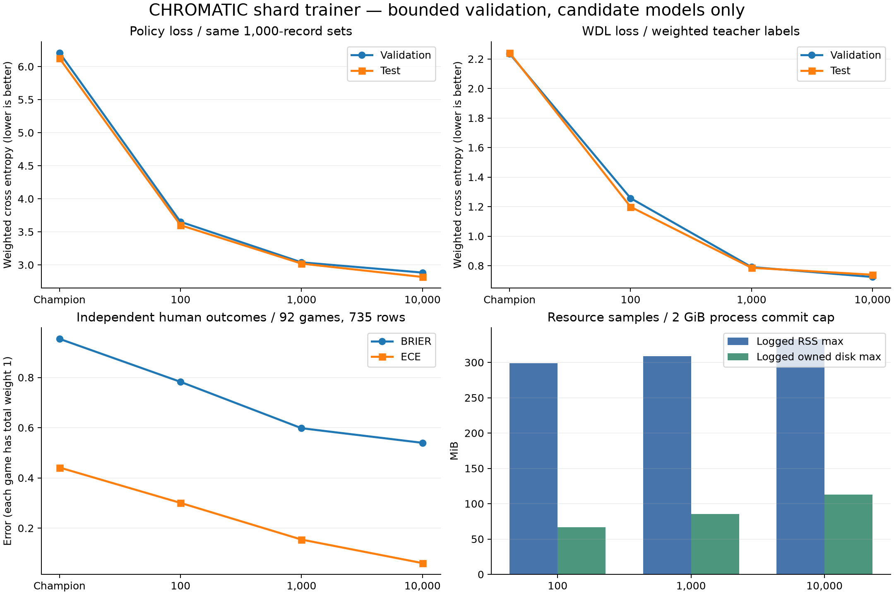
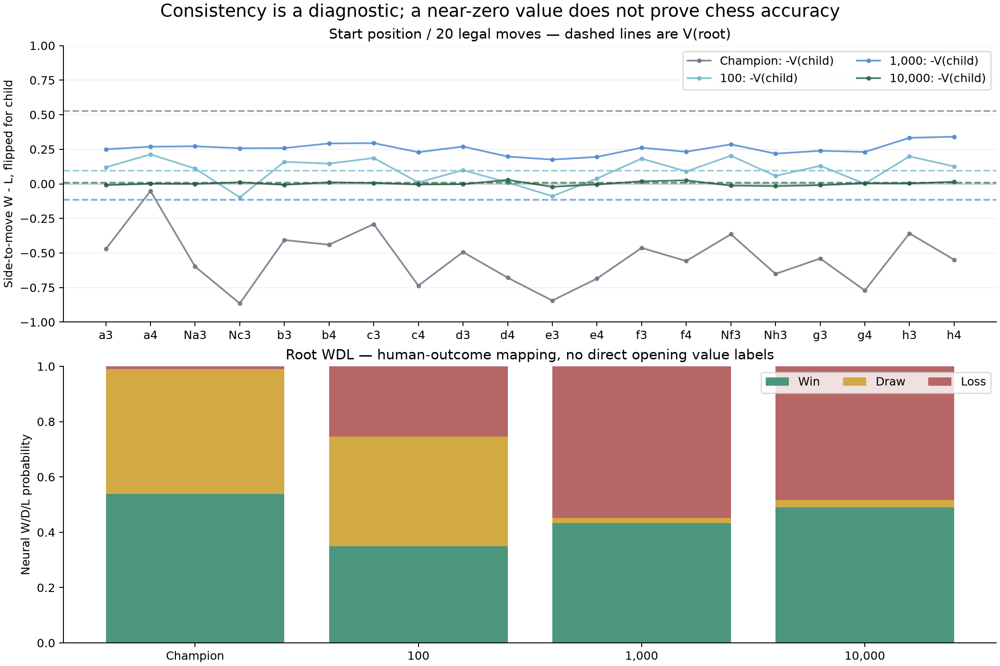

# CHROMATIC Lichess 회전 샤드 학습 — 실험 결과

2026-10-24, Windows 11 / Python 3.12.14 / PyTorch 2.14.1+cpu. 새 학습 도구를 별도 디렉터리에 구현하고 100·1,000·10,000개 실제 학습을 완료했다. 기존 엔진과 챔피언 파일을 보존했으며 모든 새 모델은 **후보**다. 큰 원본 전체 다운로드나 100,000개 학습은 실행하지 않았다.

## 실행 조건과 시간

모두 같은 챔피언 가중치에서 독립적으로 시작했다. 각 새 실험은 새 Optimizer를 만들며, 중단 재개에서는 저장한 Optimizer·Scheduler·RNG를 복구한다. CPU 스레드 1, seed 2026, BatchSize 32, LearningRate 0.001, Epochs 3, Replay 256개, gradient clip 1.0, 메모리 2GiB, 생성 데이터/체크포인트 디스크 한도 0.5GiB다. GPU는 사용하지 않았다.

|새 학습 포지션|샤드 크기 / 개수|학습 업데이트|전체 프로세스 시간|기록된 최대 RSS|기록된 최대 관리 디스크|
|---:|---:|---:|---:|---:|---:|
|100|25 / 4|12|15.39초|298.6MiB|66.9MiB|
|1,000|250 / 4|114|24.83초|309.0MiB|85.4MiB|
|10,000|1,000 / 10|1,149|132.57초|332.5MiB|112.8MiB|

시간은 로컬 공식 샘플을 읽어 파싱·품질 검사·고정 세트 구성·학습·검증·내보내기·체크포인트 검증을 마친 프로세스 실측이다. 최초 온라인 수집, 별도 CP 보정 및 후속 전술/대국 평가는 제외한다. 따라서 **이 환경에서 포지션 100개 × 3에폭은 약 15초**였다. 다른 하드웨어·원격 데이터·샤드 크기의 일반 예상 시간으로 단순 외삽할 수 없다. RSS와 디스크는 커밋 시 기록한 표본 최대값이며 모든 순간의 최고점은 아니다. Windows Job Object는 프로세스의 committed memory를 실제 2GiB로 제한했다. 입력 샘플·Python 환경·기존 엔진은 관리 디스크 합계에 포함되지 않는다.

## 동일한 고정 세트 비교

공정한 설명용 비교를 위해 10,000개 실행의 검증 1,000개 / 테스트 1,000개를 **모든 모델에 똑같이** 적용했다. 각 후보가 이 세트의 family를 새 학습 데이터로 사용하지 않았음을 영구 seen_families 기록에서 확인했다. 이전 챔피언의 과거 학습 이력은 재구성하지 않았으므로 그 전체 이력에 대한 누수 부재를 주장하지 않는다. 실험마다 데이터량과 업데이트 수가 함께 늘었으므로 원인을 분리한 통제 실험도 아니다.

|모델|검증 Policy loss|검증 WDL loss|테스트 Policy loss|테스트 WDL loss|
|---|---:|---:|---:|---:|
|Champion|6.2090|2.2359|6.1230|2.2420|
|100|3.6510|1.2574|3.5998|1.1986|
|1,000|3.0381|0.7910|3.0190|0.7860|
|10,000|2.8832|0.7237|2.8166|0.7390|

위 손실은 관측된 PV 정책 및 보정된 약한 교사 WDL 라벨에 대한 confidence 가중 교차 엔트로피다. 확정 정답 분포 또는 엔진 승률로 해석하지 않는다. 각 소규모 실행 자체의 고정 세트 크기는 16·100·1,000개였으며, 교차 모델 표에는 같은 1,000개 세트를 별도로 사용했다. 새 학습 전체에서 정확히 같은 FEN은 한 번만 수용하고, 배치 학습은 지정한 에폭과 Replay로 반복한다.

## 실제 게임 결과에 대한 독립 보정

공식 게임 PGN 5,000개에서 평가 주석과 완료 결과를 함께 가진 483게임, 3,831행을 구성했다. 한 게임 최대 8행, 13플라이 이후만 사용했다. 게임 ID별 fit 284 / dev 107 / test 92게임으로 분리했고 test는 735행이다. 5,605개 초반 family를 별도 예약해 약한 오프닝 앵커와 보정 자료의 겹침을 피했다. 보정에 사용한 모든 3,830개 family와 퍼즐 100개 family를 새 신경망 학습에서 제외했다.

CP→WDL 보정기의 독립 test 결과는 NLL 0.6553, Brier 0.4085, ECE 0.0472였다. 이는 인간의 실제 대국 결과를 추정하는 작은 표본 보정이며, 최선의 플레이 WDL은 아니다. 다음은 보정기 자체가 아니라 **신경망**의 별도 결과다. 게임별 총 가중치를 1로 맞췄다.

|모델|실제 결과 Brier|실제 결과 ECE|실제 결과 NLL|
|---|---:|---:|---:|
|Champion|0.9537|0.4413|3.0237|
|100|0.7826|0.3004|1.4344|
|1,000|0.5979|0.1544|0.8829|
|10,000|0.5397|0.0606|0.8148|

## 시작 위치와 초기 20개 합법수

시작 위치와 0~12플라이 공식 오프닝 이력을 약한 정책 앵커로 포함했다. 앵커의 Value 가중치는 0이며 임의의 무승부 정답을 주지 않았다. 평가값 V는 현재 차례의 W−L이고, 자식은 부호를 바꿔 부모 관점으로 비교한다. 모든 합법수가 같은 가치를 가져야 한다는 조건은 없으므로 평균 차이는 진단 지표다. Bellman 차이는 V(root)와 max(−V(child)) 사이의 절댓값이다.

|모델|시작 W / D / L|V(root)|20개 평균 부모·자식 차이|Bellman 차이|
|---|---|---:|---:|---:|
|Champion|0.5381 / 0.4516 / 0.0103|0.5278|1.0686|0.5801|
|100|0.3491 / 0.3964 / 0.2545|0.0945|0.0739|0.1185|
|1,000|0.4325 / 0.0185 / 0.5490|-0.1166|0.3716|0.4572|
|10,000|0.4900 / 0.0273 / 0.4827|0.0073|0.0119|0.0209|

10,000개 후보의 초기 값 모순은 줄었으나 무승부 확률은 2.7%에 불과하다. 시작 위치에는 직접적인 Value 교사 라벨이 없고, CP 보정 자료는 인간 대국 결과다. 1,000개 후보에서 일관성이 다시 나빠진 점도 보이므로 작은 데이터에서의 loss 감소나 V≈0을 정확한 체스 이해로 판단할 수 없다.

## 전술과 고정 시간 대국

동일한 메모리 회수 개선 엔진 바이너리에 모델만 바꿨다. 1스레드, TreeMemoryMB 64, 같은 실행 옵션과 CPU affinity를 적용했다. 전술은 공식 퍼즐 20개, 수당 25ms에서 공개된 첫 정답 응수와의 정확 일치다. 다른 수 역시 이길 수 있어 완전한 전술 능력 평가가 아니다. 대국은 같은 두 오프닝을 색을 바꿔 2쌍/4판, 수당 10ms, 최대 128플라이로 제한했다.

|모델|전술 정답 / 20|후보의 대국 승 / 무 / 패|상한 도달 미완료|
|---|---:|---:|---:|
|Champion|5 / 20|각 후보의 비교 상대|—|
|100|5 / 20|0 / 0 / 0|4|
|1,000|5 / 20|0 / 1 / 0|3|
|10,000|7 / 20|2 / 0 / 0|2|

미완료는 `*`로 기록했고 무승부나 점수로 바꾸지 않았다. 후보 승격에는 최소 64개의 완료된 색상 교환 대국, 95% 점수 하한 > 0.5, 고정 검증·테스트 및 독립 보정/전술 기준 통과 등이 필요하다. 세 후보 모두 근거가 부족해 승격하지 않았다. Elo는 계산하지 않았다. 이 제한 대국은 실행 연결 검증의 성격이 크며 1초·10초 기력 검증을 대신하지 않는다.

## 중단·손상·추론 검증

일반 자동 테스트 58개와 20개 subtest가 통과했다. 기본 실행에서 생략되는 실제 프로세스 테스트 6개는 별도로 실행하여 모두 통과했다. `checkpoint_written`, `ledger_committed`, `before_delete`에서 자식 프로세스를 강제 종료하고 Resume했다. 기준 실행과 모델, Optimizer, Scheduler, Python/NumPy/Torch/local-generator RNG, 순열·에폭·배치 offset, Replay, 진행 위치, 고정 세트, 소스 cursor가 정확히 일치했다. 완료 후 Resume는 새 학습·새 커밋을 만들지 않았다. 설정 불일치는 기존 head를 보존하며 거부했다. Windows PowerShell 5.1에서도 기본 옵션 DryRun과 완료된 100개 실행 Resume가 성공했고 단계 12·head가 그대로였다.

최신 PT 본체 손상은 동일 바이트 미러로, 본체와 미러 모두 손상된 경우에는 이전 정상 체크포인트와 보존 샤드로 복구했다. 6개 통합 시험의 최종 내보내기 SHA는 모두 `9d53e807e9dd9829f0b9fa9aad23272a914a7f1cc99d56a65c4f248ed9b28b42`였다. 자동 복구는 보유한 정상 복사본과 샤드 범위까지만 가능하며 모든 백업이 소실된 경우를 복구한다고 주장하지 않는다.

실제 C++ SIMD/sparse-policy 추론을 PyTorch와 비교한 40개 조합(같은 테스트 위치 10개 × 챔피언과 후보 3개)이 모두 통과했다. 최대 Policy logit 오차 2.91e−6, WDL 확률 오차 5.67e−7로 허용치 2e−5 이내였다. 독립 recovery CLI에서 10,000개 head(step 1,149)를 정상 검증했고 읽기 전용 데이터 감사에서 train/validation/test family 교집합은 모두 0이었다.

## 출처 무결성과 보존

공식 Evaluation Database 원본의 처음 두 압축 프레임(압축 11,506,841바이트 / 해제 64MiB)을 프레임 끝까지 읽어 체크섬을 검증했다. 그중 60,000 JSONL행을 별도 Zstandard 샘플로 저장했고 실제 학습은 최대 25,728 원본 행을 검토했다. 공식 게임 원본도 처음 한 프레임(압축 4,692,881바이트 / 해제 32MiB)의 체크섬을 확인했다. 보지 않은 전체 원본에 대한 검증은 하지 않았다. 실제 HTTP Range 요청 두 건은 206으로 응답했지만 중간 압축 바이트를 독립 스트림으로 취급하지 않는다. 새 프로세스의 소스 복구는 바이트 0부터 재생하여 줄 prefix SHA를 맞추므로 긴 실행일수록 재시작 시간이 늘 수 있다.

원본 CHROMATIC과 이전 계측·메모리 회수 개선 버전의 파일 303개 SHA를 기록된 기준과 대조했고 모두 일치했다. Muyeong은 접근하거나 수정하지 않았다. 새 데이터 출처는 공식 CC0이며, 상속한 기존 챔피언의 과거 학습 데이터까지 CC0였다고 주장하지 않는다. [출처 상세](../docs/SOURCES.md), [모델/라벨 상세](../docs/MODEL_LABELS.md)를 참고한다.

## 원시 기록과 재현 파일

- [전체 실행 조건·명령·시간](../../chromatic-shard-validation/validation-results.json)
- [동일 고정 세트 JSON](../../chromatic-shard-validation/common-holdout.json) / [CSV](../../chromatic-shard-validation/common-holdout.csv)
- [비교 지표 CSV](metrics.csv), [자원·환경](resources.json), [환경](environment.json)
- [10,000개 콘솔 원시 로그](../../chromatic-shard-validation/positions-10000/training.stdout.log), [학습 CSV](../../chromatic-shard-validation/positions-10000/candidate/logs/training.csv), [학습 JSONL](../../chromatic-shard-validation/positions-10000/candidate/logs/training.jsonl)
- [10,000개 독립 평가](../../chromatic-shard-validation/positions-10000/candidate/evaluation-report.json), 해당 candidate/evaluations 아래의 버전별 대국 PGN 및 JSON
- [실제 강제 종료·복구 결과](pipeline-tests.json), [복구 원시 로그 목록](recovery-logs.json)
- [일반 자동 테스트 XML](unit-tests.xml), [통합 검증 요약](verification-summary.json), [추론 일치](inference-parity.json)
- [데이터 누수·품질 감사](data-quality-10000.json), [보존 SHA 전체](preservation.json)
- [공식 HTTP 조사](http-probe.json), [평가 프레임 검증](official-frame-verification.json), [게임 프레임 검증](game-frame-verification.json)

원래 경로에서 모든 실행 상태와 체크포인트 체인을 유지했다. 압축 배포본은 새 위치에서 새 실험을 시작할 수 있지만 기존 ledger·manifest에 절대 경로와 소스 정체성이 들어 있으므로 압축 해제 위치를 바꾼 뒤 과거 실행을 그대로 Resume하는 기능은 제공하지 않는다. 이동 후 학습은 새 DataDirectory에서 후보 PT를 InitialCheckpoint로 지정해 새 실험으로 시작한다. 기존 스케줄과 처리 위치를 이어가려면 원래 경로의 상태를 사용한다.
