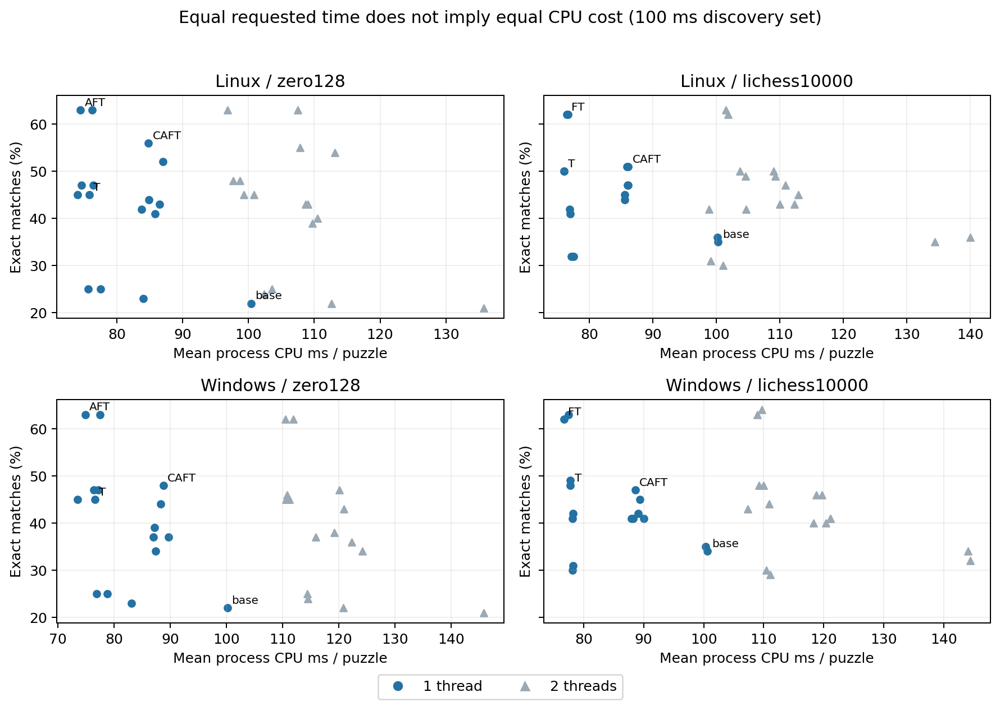

# 계산 비용 및 실행 예산

원시 자료와 재현 절차: [research/README.md](research/README.md), [분석 manifest](reports/factorial/analysis/analysis-manifest.json). C=반례, A=적응형, F=강제 수순, T=전술, P=2스레드. P 없는 구성은 1스레드다. 정확 응수 일치율은 Elo가 아니다.

## 예산과 단계 완료

사전 [EXPERIMENT_PLAN.md](research/EXPERIMENT_PLAN.md)에 단계별 예산을
고정했다. OS당 active wall 상한5,400초, CI 별도120분 상한이다.
1차 전수, 후속은 선택된 구성/고정 대조군에 제한했다.

- Linux: pipeline 완료 `True`, active wall `3466.1`초, 미완료 셀 메타데이터 0개.
- Windows: pipeline 완료 `True`, active wall `3683.8`초, 미완료 셀 메타데이터 0개.

| OS | 단계 | 사전 nominal/상한 초 | 완료 셀 | 문제 실행 | 실제 셀 wall초 |
|---|---|---|---|---|---|
| Linux | scalar_fixed | 진단 | 16 | 384 | 21.2 |
| Linux | screen | 1280 | 128 | 12800 | 1090.5 |
| Linux | legacy_proof | 40 | 4 | 400 | 34.6 |
| Linux | anchors | 160 | 16 | 1600 | 138.8 |
| Linux | one_second | 768 | 32 | 768 | 625.7 |
| Linux | five_seconds | 640 | 8 | 128 | 519.2 |
| Linux | ten_seconds | 240 | 6 | 24 | 199.1 |
| Linux | fixed_nodes | 240 | 128 | 3072 | 56.6 |
| Linux | fixed_nn | 240 | 128 | 3072 | 39.7 |
| Linux | holdout | 480 | 24 | 4800 | 413.0 |
| Windows | scalar_fixed | 진단 | 16 | 384 | 25.7 |
| Windows | screen | 1280 | 128 | 12800 | 1109.6 |
| Windows | legacy_proof | 40 | 4 | 400 | 34.7 |
| Windows | anchors | 160 | 16 | 1600 | 140.5 |
| Windows | one_second | 768 | 32 | 768 | 625.9 |
| Windows | five_seconds | 640 | 8 | 128 | 519.4 |
| Windows | ten_seconds | 240 | 6 | 24 | 199.1 |
| Windows | fixed_nodes | 240 | 128 | 3072 | 84.0 |
| Windows | fixed_nn | 240 | 128 | 3072 | 60.2 |
| Windows | holdout | 480 | 24 | 4800 | 420.4 |

고정 작업량 두 모드의 사전 추정은 합계120–480초이며, 표에서는 각240초로 예산 배분을 표시했다. 셀 wall은 프로세스 시작·모델 확인·warmup·압축 포함, stage 사이 대기·전체 게임 시간은 포함하지 않는다. pipeline active wall이 전체 경과다. 각 실제 호출의 requested budget, search_ns, CPU 및 driver wall은 원시 행에 있다. 10초 문제는 실패/획득 사례를 고른 진단이다.

## 시간·작업량·비용

| OS | 모드 | 모델 | 구성 | 정답 | CPU ms | wall ms | 완료 방문 | 새 노드 | edge-list 확장 | 전체 NN | 회수 |
|---|---|---|---|---|---|---|---|---|---|---|---|
| Linux | screen | zero128 | base | 22/100 | 100.4 | 100.6 | 65436 | 3956 | 3948 | 3948 | 0.00 |
| Linux | screen | zero128 | T | 45/100 | 75.8 | 76.1 | 47360 | 3042 | 3036 | 3063 | 0.00 |
| Linux | screen | zero128 | AFT | 63/100 | 74.5 | 74.8 | 46908 | 2945 | 2939 | 2990 | 0.00 |
| Linux | screen | zero128 | CAFT | 56/100 | 84.8 | 85.2 | 47710 | 2958 | 2952 | 3488 | 0.00 |
| Linux | screen | lichess10000 | base | 35/100 | 100.3 | 100.6 | 79200 | 3765 | 3760 | 3760 | 0.00 |
| Linux | screen | lichess10000 | T | 50/100 | 76.0 | 76.3 | 56617 | 2870 | 2866 | 2901 | 0.00 |
| Linux | screen | lichess10000 | FT | 62/100 | 76.5 | 76.9 | 53709 | 2826 | 2823 | 2886 | 0.00 |
| Linux | screen | lichess10000 | CAFT | 51/100 | 86.1 | 86.4 | 53586 | 2889 | 2884 | 3389 | 0.00 |
| Linux | fixed_nodes | zero128 | base | 6/24 | 9.2 | 9.9 | 512 | 425 | 425 | 425 | 0.00 |
| Linux | fixed_nodes | zero128 | T | 12/24 | 10.0 | 10.5 | 512 | 425 | 425 | 456 | 0.00 |
| Linux | fixed_nodes | zero128 | AFT | 12/24 | 10.8 | 11.1 | 512 | 425 | 426 | 475 | 0.00 |
| Linux | fixed_nodes | zero128 | CAFT | 11/24 | 23.3 | 23.5 | 512 | 425 | 426 | 1058 | 0.00 |
| Linux | fixed_nodes | lichess10000 | base | 5/24 | 9.6 | 10.3 | 512 | 462 | 461 | 461 | 0.00 |
| Linux | fixed_nodes | lichess10000 | T | 10/24 | 10.4 | 11.1 | 512 | 462 | 461 | 496 | 0.00 |
| Linux | fixed_nodes | lichess10000 | FT | 13/24 | 11.7 | 11.9 | 512 | 462 | 461 | 520 | 0.00 |
| Linux | fixed_nodes | lichess10000 | CAFT | 11/24 | 22.5 | 22.8 | 512 | 459 | 459 | 1026 | 0.00 |
| Linux | fixed_nn | zero128 | base | 6/24 | 10.0 | 10.5 | 1802 | 450 | 450 | 450 | 0.00 |
| Linux | fixed_nn | zero128 | T | 12/24 | 7.5 | 8.6 | 1694 | 343 | 343 | 373 | 0.00 |
| Linux | fixed_nn | zero128 | AFT | 12/24 | 9.2 | 9.1 | 1693 | 343 | 343 | 389 | 0.00 |
| Linux | fixed_nn | zero128 | CAFT | 6/24 | 10.0 | 10.4 | 1693 | 343 | 343 | 450 | 0.00 |
| Linux | fixed_nn | lichess10000 | base | 5/24 | 9.6 | 10.7 | 1474 | 471 | 470 | 470 | 0.00 |
| Linux | fixed_nn | lichess10000 | T | 10/24 | 9.2 | 9.4 | 1361 | 359 | 358 | 392 | 0.00 |
| Linux | fixed_nn | lichess10000 | FT | 13/24 | 9.2 | 9.6 | 1361 | 359 | 358 | 415 | 0.00 |
| Linux | fixed_nn | lichess10000 | CAFT | 7/24 | 10.4 | 10.6 | 1361 | 359 | 359 | 465 | 0.00 |
| Windows | screen | zero128 | base | 22/100 | 100.2 | 101.0 | 41407 | 2950 | 2944 | 2944 | 0.00 |
| Windows | screen | zero128 | T | 45/100 | 76.6 | 76.6 | 30098 | 2249 | 2245 | 2271 | 0.00 |
| Windows | screen | zero128 | AFT | 63/100 | 74.8 | 75.5 | 30437 | 2186 | 2182 | 2233 | 0.00 |
| Windows | screen | zero128 | CAFT | 48/100 | 88.8 | 88.6 | 30506 | 2191 | 2187 | 2686 | 0.00 |
| Windows | screen | lichess10000 | base | 34/100 | 100.6 | 100.7 | 50674 | 2828 | 2824 | 2824 | 0.00 |
| Windows | screen | lichess10000 | T | 48/100 | 77.8 | 76.9 | 36353 | 2131 | 2128 | 2163 | 0.00 |
| Windows | screen | lichess10000 | FT | 62/100 | 76.7 | 77.7 | 36234 | 2138 | 2135 | 2198 | 0.00 |
| Windows | screen | lichess10000 | CAFT | 47/100 | 88.6 | 89.1 | 34564 | 2167 | 2164 | 2619 | 0.00 |
| Windows | fixed_nodes | zero128 | base | 6/24 | 11.7 | 13.5 | 512 | 425 | 425 | 425 | 0.00 |
| Windows | fixed_nodes | zero128 | T | 12/24 | 13.7 | 14.6 | 512 | 425 | 425 | 456 | 0.00 |
| Windows | fixed_nodes | zero128 | AFT | 12/24 | 16.3 | 14.9 | 512 | 425 | 426 | 475 | 0.00 |
| Windows | fixed_nodes | zero128 | CAFT | 11/24 | 33.2 | 31.9 | 512 | 425 | 426 | 1058 | 0.00 |
| Windows | fixed_nodes | lichess10000 | base | 5/24 | 14.3 | 14.5 | 512 | 462 | 461 | 461 | 0.00 |
| Windows | fixed_nodes | lichess10000 | T | 10/24 | 15.0 | 15.6 | 512 | 462 | 461 | 496 | 0.00 |
| Windows | fixed_nodes | lichess10000 | FT | 13/24 | 16.9 | 16.4 | 512 | 462 | 461 | 520 | 0.00 |
| Windows | fixed_nodes | lichess10000 | CAFT | 11/24 | 29.9 | 31.2 | 512 | 459 | 459 | 1026 | 0.00 |
| Windows | fixed_nn | zero128 | base | 6/24 | 13.7 | 14.5 | 1802 | 450 | 450 | 450 | 0.00 |
| Windows | fixed_nn | zero128 | T | 12/24 | 11.7 | 12.6 | 1694 | 343 | 343 | 373 | 0.00 |
| Windows | fixed_nn | zero128 | AFT | 12/24 | 10.4 | 12.9 | 1693 | 343 | 343 | 389 | 0.00 |
| Windows | fixed_nn | zero128 | CAFT | 6/24 | 15.0 | 14.6 | 1693 | 343 | 343 | 450 | 0.00 |
| Windows | fixed_nn | lichess10000 | base | 5/24 | 15.0 | 15.1 | 1474 | 471 | 470 | 470 | 0.00 |
| Windows | fixed_nn | lichess10000 | T | 10/24 | 12.4 | 13.0 | 1361 | 359 | 358 | 392 | 0.00 |
| Windows | fixed_nn | lichess10000 | FT | 13/24 | 15.0 | 13.5 | 1361 | 359 | 358 | 415 | 0.00 |
| Windows | fixed_nn | lichess10000 | CAFT | 7/24 | 15.0 | 15.0 | 1361 | 359 | 359 | 465 | 0.00 |

전체 평균·중앙값·최대 깊이, 방문 깊이 pooled 통계, 노드/평가/호출/시간·메모리 필드는 [matrix.csv](reports/factorial/analysis/matrix.csv)에 있다. [pareto.csv](reports/factorial/analysis/pareto.csv)는 정확도 대 CPU/wall/NN/방문 비용의 기술적 Pareto 전선을 제공한다. 추정 오차를 반영한 최적 구성 증명은 아니다. 고정 NN에서는 실제 상한 미사용과 후보 미완료도 비용과 함께 해석해야 한다. 고정 방문과 고정 NN 모두 동일 CPU 명령 수를 뜻하지 않는다.

## 계측 비용과 해석

| 구성 | 동일 작업 metrics ON/OFF 시간비 중앙값 | 최소/최대 |
|---|---|---|
| base | 0.9988 | 0.9228 / 1.1788 |
| CAFT | 1.0049 | 0.9117 / 1.2119 |
| P | 1.0281 | 0.7920 / 2.1901 |
| CAFTP | 1.0002 | 0.9228 / 1.1360 |

동일512방문·96개 짝 비교다. 병렬 시간 분산과 이상치가 있어 이 비율을 일정한 보정계수로 적용하지 않았다. 계측 ON/OFF와 과거 바이너리의 고정 작업량 결과128개 비교는 일치했다. 시간제어 결과는 계측 ON 연구 바이너리의 결과이며 계측 OFF 배포 엔진의 정답 수로 그대로 주장하지 않는다. 계측은 기본 OFF다.

NN 시간은 MCTS/검증 내부에 있고 병렬 worker 시간은 겹칠 수 있다. F/T 공통 입장 검사 및 NN/물질/정온/반례 exclusive 시간을 분리하되 겹친 시간을 합산하지 않는다. CPU는 OS 계정 해상도 영향이 있으므로 문제당 작은 값보다 셀 합계를 비교한다. RSS는 탐색 후 샘플이며 순간 최대 RSS가 아니다.

## 중단·재개 및 제한

문제마다 JSONL flush+fsync, 완료 시 압축·종료 모델/바이너리 재확인·해시, host/CPU/runner/C++/모델/문제 동일성에 묶인 재개, 동시 writer 거부, 손상된 마지막 행의 보존·복구를 구현하고 검사했다. 중간 손상은 실패 처리한다. 완료된 셀만 분석에 포함하며 `.meta.json`과 압축 해시를 다시 검증했다. 프로세스 강제 종료가 압축 파일과 메타데이터의 여러 파일 갱신 사이에 발생하는 드문 경우는 자동 완결이 보장되지 않는다. 기존 증거를 보존해 별도 실행으로 복구해야 한다.

완료 방문은 신규 계산 위치 수가 아니다. 새 MCTS NN 평가를 뺀 `non_nn_completed_endpoints`에는 캐시된 terminal/depth-limit 값으로 끝난 방문도 있다. `nn_completed_leaf_visits`는 root와 discarded 평가를 제외한다. NN/검색초 및 NN/CPU초는 셀 전체 평가 합계÷시간 합계로 계산해 제공한다. 방문 증가만으로 성능 또는 새 계산량 증가를 주장하지 않는다.
