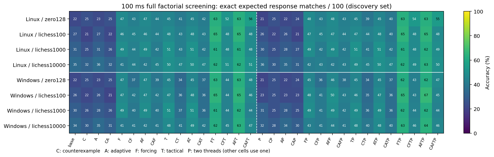
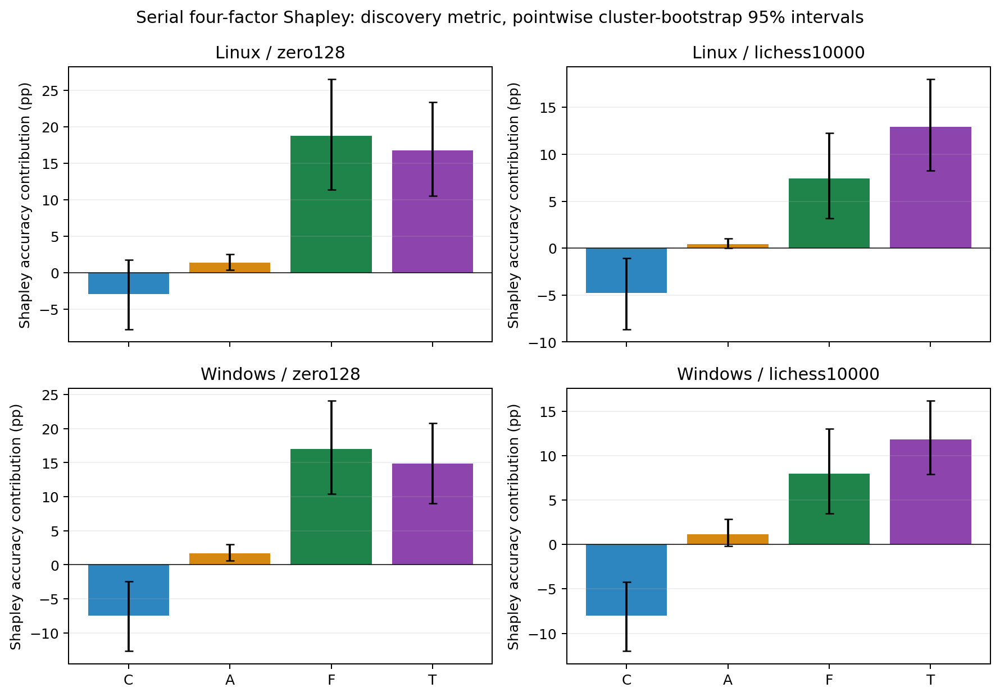

# 탐색 전수 조합 분석

원시 자료와 재현 절차: [research/README.md](research/README.md), [분석 manifest](reports/factorial/analysis/analysis-manifest.json). C=반례, A=적응형, F=강제 수순, T=전술, P=2스레드. P 없는 구성은 1스레드다. 정확 응수 일치율은 Elo가 아니다.

## 통제와 실제 구현

네 Boolean 기능 16조합에 P 자원 요인을 교차해 모델당32조합을 측정했다.
네 모델·두 OS의 스크리닝은 총25,600회다. AEGIS는 없으며, SANABI/Laugh
Tale은 외부 구현을 가져온 것이 아닌 이 저장소의 신규 설계다.
정확한 조건·순서·의존성·계측 의미는 [MODULE_AUDIT.md](research/MODULE_AUDIT.md)에 있다.
SharedTree=false 앙상블은 검증 모듈과 양립하지 않아 제외했다.
MateProofNodes=0을 고정했고 기존 기본256은 별도 대조군으로 보존했다.
나머지32조합은 모두 유효하다.

시드1, SIMD, sparse policy, CPuct1.5, FPU0, 64MiB, MaxNodes100000,
검증2048노드/깊이4/후보4다. 각 호스트의 같은 두 CPU ID로 엔진을 제한하고
한 번에 한 셀을 실행했다. P는 두 스레드·예약 배치 스케줄을 함께 바꾸므로
무료 알고리즘 효과로 계산하지 않는다.

## 100ms 스크리닝 전체

### Linux

| mask | 구성 | zero128 | lichess100 | lichess1000 | lichess10000 |
|---|---|---|---|---|---|
| 0 | base | 22/100 | 27/100 | 31/100 | 35/100 |
| 1 | C | 25/100 | 21/100 | 25/100 | 32/100 |
| 2 | A | 23/100 | 27/100 | 31/100 | 36/100 |
| 3 | CA | 25/100 | 22/100 | 26/100 | 32/100 |
| 4 | F | 47/100 | 46/100 | 49/100 | 41/100 |
| 5 | CF | 43/100 | 45/100 | 44/100 | 44/100 |
| 6 | AF | 47/100 | 46/100 | 49/100 | 42/100 |
| 7 | CAF | 44/100 | 44/100 | 42/100 | 45/100 |
| 8 | T | 45/100 | 48/100 | 51/100 | 50/100 |
| 9 | CT | 41/100 | 43/100 | 43/100 | 47/100 |
| 10 | AT | 45/100 | 48/100 | 51/100 | 50/100 |
| 11 | CAT | 42/100 | 43/100 | 42/100 | 47/100 |
| 12 | FT | 63/100 | 65/100 | 61/100 | 62/100 |
| 13 | CFT | 52/100 | 48/100 | 48/100 | 51/100 |
| 14 | AFT | 63/100 | 65/100 | 61/100 | 62/100 |
| 15 | CAFT | 56/100 | 48/100 | 48/100 | 51/100 |
| 16 | P | 21/100 | 26/100 | 30/100 | 36/100 |
| 17 | CP | 25/100 | 22/100 | 25/100 | 30/100 |
| 18 | AP | 22/100 | 26/100 | 29/100 | 35/100 |
| 19 | CAP | 24/100 | 21/100 | 27/100 | 31/100 |
| 20 | FP | 48/100 | 47/100 | 49/100 | 42/100 |
| 21 | CFP | 43/100 | 45/100 | 42/100 | 43/100 |
| 22 | AFP | 48/100 | 47/100 | 49/100 | 42/100 |
| 23 | CAFP | 43/100 | 44/100 | 42/100 | 43/100 |
| 24 | TP | 45/100 | 47/100 | 51/100 | 49/100 |
| 25 | CTP | 39/100 | 44/100 | 41/100 | 45/100 |
| 26 | ATP | 45/100 | 48/100 | 51/100 | 50/100 |
| 27 | CATP | 40/100 | 40/100 | 42/100 | 47/100 |
| 28 | FTP | 63/100 | 65/100 | 61/100 | 62/100 |
| 29 | CFTP | 54/100 | 48/100 | 48/100 | 49/100 |
| 30 | AFTP | 63/100 | 65/100 | 62/100 | 63/100 |
| 31 | CAFTP | 55/100 | 48/100 | 49/100 | 50/100 |

### Windows

| mask | 구성 | zero128 | lichess100 | lichess1000 | lichess10000 |
|---|---|---|---|---|---|
| 0 | base | 22/100 | 26/100 | 30/100 | 34/100 |
| 1 | C | 25/100 | 22/100 | 26/100 | 30/100 |
| 2 | A | 23/100 | 26/100 | 29/100 | 35/100 |
| 3 | CA | 25/100 | 21/100 | 26/100 | 31/100 |
| 4 | F | 47/100 | 47/100 | 49/100 | 41/100 |
| 5 | CF | 37/100 | 42/100 | 40/100 | 41/100 |
| 6 | AF | 47/100 | 47/100 | 49/100 | 42/100 |
| 7 | CAF | 39/100 | 42/100 | 40/100 | 41/100 |
| 8 | T | 45/100 | 47/100 | 51/100 | 48/100 |
| 9 | CT | 34/100 | 36/100 | 37/100 | 41/100 |
| 10 | AT | 45/100 | 48/100 | 51/100 | 49/100 |
| 11 | CAT | 37/100 | 36/100 | 36/100 | 42/100 |
| 12 | FT | 63/100 | 65/100 | 61/100 | 62/100 |
| 13 | CFT | 44/100 | 44/100 | 44/100 | 45/100 |
| 14 | AFT | 63/100 | 65/100 | 62/100 | 63/100 |
| 15 | CAFT | 48/100 | 46/100 | 44/100 | 47/100 |
| 16 | P | 21/100 | 23/100 | 31/100 | 32/100 |
| 17 | CP | 25/100 | 25/100 | 25/100 | 29/100 |
| 18 | AP | 22/100 | 23/100 | 29/100 | 34/100 |
| 19 | CAP | 24/100 | 23/100 | 25/100 | 30/100 |
| 20 | FP | 45/100 | 48/100 | 49/100 | 43/100 |
| 21 | CFP | 36/100 | 41/100 | 41/100 | 41/100 |
| 22 | AFP | 46/100 | 50/100 | 49/100 | 44/100 |
| 23 | CAFP | 38/100 | 43/100 | 42/100 | 41/100 |
| 24 | TP | 45/100 | 46/100 | 49/100 | 48/100 |
| 25 | CTP | 34/100 | 35/100 | 36/100 | 40/100 |
| 26 | ATP | 45/100 | 47/100 | 49/100 | 48/100 |
| 27 | CATP | 37/100 | 36/100 | 36/100 | 40/100 |
| 28 | FTP | 62/100 | 65/100 | 62/100 | 63/100 |
| 29 | CFTP | 43/100 | 43/100 | 44/100 | 46/100 |
| 30 | AFTP | 62/100 | 67/100 | 62/100 | 64/100 |
| 31 | CAFTP | 47/100 | 45/100 | 44/100 | 46/100 |

## 단독 효과와 전체에서 제거한 효과

모든 차이는 퍼센트포인트(pp), 대괄호는 소스 게임 단위 5,000회 짝지은 부트스트랩의 점별 95% 구간이다. 기존 100문제는 선택에 사용한 탐색 자료이며 확정 검증으로 취급하지 않는다. 같은 문제의 반복 실행은 독립 표본으로 세지 않는다.

| OS | 모델 | 기능 | 단독 pp | 전체−제거 pp | Shapley pp [95%] | CPU Shapley ms | 방문 Shapley |
|---|---|---|---|---|---|---|---|
| Linux | lichess100 | C | -6.0 | -17.0 | -8.7 [-12.7, -5.1] | -0.9 | -6159 |
| Linux | lichess100 | A | 0.0 | 0.0 | 0.0 [-0.3, 0.3] | -0.3 | -1326 |
| Linux | lichess100 | F | 19.0 | 5.0 | 14.7 [8.0, 21.8] | -5.9 | -5877 |
| Linux | lichess100 | T | 21.0 | 4.0 | 15.0 [9.3, 20.8] | -6.5 | -5773 |
| Linux | lichess1000 | C | -6.0 | -13.0 | -8.7 [-12.9, -4.7] | -1.3 | -6606 |
| Linux | lichess1000 | A | 0.0 | 0.0 | -0.2 [-0.5, 0.2] | -0.1 | -2992 |
| Linux | lichess1000 | F | 18.0 | 6.0 | 12.5 [7.2, 18.4] | -6.5 | -7229 |
| Linux | lichess1000 | T | 20.0 | 6.0 | 13.3 [7.7, 19.1] | -6.5 | -7539 |
| Linux | lichess10000 | C | -3.0 | -11.0 | -4.8 [-8.7, -1.1] | -1.4 | -7188 |
| Linux | lichess10000 | A | 1.0 | 0.0 | 0.4 [0.0, 1.0] | 0.0 | -3927 |
| Linux | lichess10000 | F | 6.0 | 4.0 | 7.4 [3.2, 12.3] | -6.3 | -7171 |
| Linux | lichess10000 | T | 15.0 | 6.0 | 12.9 [8.2, 18.0] | -6.6 | -7329 |
| Linux | zero128 | C | 3.0 | -7.0 | -2.9 [-7.8, 1.8] | 0.4 | -5014 |
| Linux | zero128 | A | 1.0 | 4.0 | 1.4 [0.4, 2.6] | -5.6 | -1030 |
| Linux | zero128 | F | 25.0 | 14.0 | 18.8 [11.4, 26.5] | -4.8 | -5906 |
| Linux | zero128 | T | 23.0 | 12.0 | 16.8 [10.5, 23.3] | -5.6 | -5775 |
| Windows | lichess100 | C | -4.0 | -19.0 | -10.7 [-15.4, -6.3] | 0.8 | -4249 |
| Windows | lichess100 | A | 0.0 | 2.0 | 0.5 [-0.4, 1.8] | -0.4 | -736 |
| Windows | lichess100 | F | 21.0 | 10.0 | 16.5 [9.9, 23.6] | -5.5 | -4367 |
| Windows | lichess100 | T | 21.0 | 4.0 | 13.7 [8.2, 19.2] | -6.3 | -4166 |
| Windows | lichess1000 | C | -4.0 | -18.0 | -11.1 [-15.7, -6.9] | 0.3 | -4722 |
| Windows | lichess1000 | A | -1.0 | 0.0 | -0.2 [-0.9, 0.2] | -0.5 | -2348 |
| Windows | lichess1000 | F | 19.0 | 8.0 | 13.1 [7.6, 19.0] | -6.3 | -4903 |
| Windows | lichess1000 | T | 21.0 | 4.0 | 12.2 [7.2, 17.5] | -5.7 | -4752 |
| Windows | lichess10000 | C | -4.0 | -16.0 | -8.0 [-12.0, -4.2] | -0.0 | -4901 |
| Windows | lichess10000 | A | 1.0 | 2.0 | 1.2 [-0.2, 2.8] | -0.3 | -1760 |
| Windows | lichess10000 | F | 7.0 | 5.0 | 8.0 [3.5, 13.0] | -6.1 | -4812 |
| Windows | lichess10000 | T | 14.0 | 6.0 | 11.8 [7.9, 16.2] | -5.6 | -4638 |
| Windows | zero128 | C | 3.0 | -15.0 | -7.5 [-12.7, -2.4] | 2.5 | -3506 |
| Windows | zero128 | A | 1.0 | 4.0 | 1.7 [0.6, 3.0] | -5.1 | -862 |
| Windows | zero128 | F | 25.0 | 11.0 | 17.0 [10.4, 24.1] | -3.8 | -3383 |
| Windows | zero128 | T | 23.0 | 9.0 | 14.8 [9.0, 20.8] | -5.0 | -3151 |

Shapley는 이 지표·문제·시간·요인 집합에 조건부인 기여도다. 알고리즘의 절대적 가치가 아니다. [shapley.csv](reports/factorial/analysis/shapley.csv)에는 5요인, 직렬4요인, 병렬 조건부4요인 및 고정 작업량 결과가 모두 있다. 각 표본에서 기여도 합이 전체−기본과 일치하는지 검사했다. [context-marginals.csv](reports/factorial/analysis/context-marginals.csv)는 모든 배경 구성에서의 추가 효과·새 정답·정답 손실·방문 및 CPU 손익을 제공한다. 단독 효과를 전체 맥락의 기여도와 혼용하지 않는다.

## 선택 고정과 독립 자료

Linux 스크리닝만으로 직렬 선택을 `{'zero128': 14, 'lichess100': 12, 'lichess1000': 14, 'lichess10000': 12}`, 주 검증 쌍을 `CF`로 고정했다. Windows와 새 자료를 보기 전에 [selection-plan.json](research/selection-plan.json)을 커밋했다.

| OS | 모델 | 기본 /200 | 전체 직렬 /200 | 고정 선택 | 선택 /200 |
|---|---|---|---|---|---|
| Linux | zero128 | 47/200 | 106/200 | AFT | 131/200 |
| Linux | lichess100 | 59/200 | 101/200 | FT | 124/200 |
| Linux | lichess1000 | 72/200 | 112/200 | AFT | 137/200 |
| Linux | lichess10000 | 90/200 | 114/200 | FT | 129/200 |
| Windows | zero128 | 48/200 | 96/200 | AFT | 130/200 |
| Windows | lichess100 | 59/200 | 90/200 | FT | 126/200 |
| Windows | lichess1000 | 70/200 | 101/200 | AFT | 136/200 |
| Windows | lichess10000 | 90/200 | 106/200 | FT | 127/200 |

공식 CC0 자료에서 첫200개 유효한 다른 게임·다른 위치를 동결했다. 기존100문제와 사용 가능한 학습 입력60k 및 초기교사128의 동일 정규화 FEN을 제외했다. 이는 무작위 대국 표본이 아니며, 알려지지 않은 다른 학습 자료와의 중복까지 배제한 것은 아니다. [출처](research/fixtures/holdout.source.json)에는 HTTPS prefix 해시와 원격 전체 프레임 체크섬을 확립하지 못한 범위가 명시돼 있다.

## 시간 반복과 장시간 단계

| OS | 모델 | 구성 | 3회 정답/100 | 3회 평균 방문 |
|---|---|---|---|---|
| Linux | zero128 | base | 22/22/22 | 65436/65722/65333 |
| Linux | zero128 | T | 45/45/45 | 47360/46501/47519 |
| Linux | zero128 | AFT | 63/63/63 | 46908/48212/48367 |
| Linux | zero128 | CAFT | 56/56/56 | 47710/47820/48135 |
| Linux | lichess10000 | base | 35/35/35 | 79200/78505/78262 |
| Linux | lichess10000 | T | 50/50/50 | 56617/55634/55312 |
| Linux | lichess10000 | FT | 62/62/62 | 53709/56333/56819 |
| Linux | lichess10000 | CAFT | 51/51/51 | 53586/52204/53451 |
| Windows | zero128 | base | 22/22/22 | 41407/41892/41958 |
| Windows | zero128 | T | 45/45/45 | 30098/30278/30235 |
| Windows | zero128 | AFT | 63/63/63 | 30437/30319/30342 |
| Windows | zero128 | CAFT | 48/48/48 | 30506/30194/30402 |
| Windows | lichess10000 | base | 34/34/34 | 50674/50824/50947 |
| Windows | lichess10000 | T | 48/48/48 | 36353/35787/36105 |
| Windows | lichess10000 | FT | 62/62/62 | 36234/36440/36132 |
| Windows | lichess10000 | CAFT | 47/47/47 | 34564/34124/34180 |

[repeats.json](reports/factorial/analysis/repeats.json)과 [repeat-puzzles.csv](reports/factorial/analysis/repeat-puzzles.csv)는 문제별 정오답·선택 수 변동, 실행 점수 표준편차, 퍼즐별 반복 평균의 게임 단위 구간을 제공한다. 반복 수3은 표본 수100을300으로 늘리지 않는다.

1초는 층화24문제, 5초는 층화16문제, 10초는 사전 규칙으로 고른 정답 획득·손실4사례에 한정했다. 분모가 다른 단계의 점수를 직접 비교하지 않는다. 10초 결과는 진단용으로 일반 정답률로 해석하지 않는다. 모든 단계의 [matrix.csv](reports/factorial/analysis/matrix.csv), 문제별 정오답·선택 수·PV·호출/시간/비용의 [per-puzzle.csv](reports/factorial/analysis/per-puzzle.csv), 각 원시 셀 JSONL.gz를 보존했다.

## 공유된 메이트 한 수 입장 검사의 기여

이 절은 결과 확인 후 추가한 진단이며 주 지표나 구성 선택을 바꾸지 않았다. F/T의 공통 루트 메이트 검사가 깊은 강제 수순 탐색의 효과로 집계되지 않도록 분리했다. `기대 수 M1`은 원래 기대 응수가 즉시 체크메이트인 문제, `공통 M1 증명`은 입장 검사에서 정확히 증명한 횟수다. `동등 M1 허용`은 기대 수도 M1이고 선택 수도 다른 합법 M1일 때만 추가 인정한 민감도 지표다. 다른 장기 승리 수의 정당성은 판정하지 못한다.

| OS | 자료 | 모델 | 구성 | 기대 수 M1 | 공통 M1 증명 | 정확 응수 | 동등 M1 허용 |
|---|---|---|---|---|---|---|---|
| Linux | screen | zero128 | F | 16 | 16 | 47 | 48 |
| Linux | screen | zero128 | T | 16 | 16 | 45 | 46 |
| Linux | screen | zero128 | AFT | 16 | 16 | 63 | 64 |
| Linux | screen | zero128 | CAFT | 16 | 16 | 56 | 57 |
| Linux | screen | lichess10000 | F | 16 | 16 | 41 | 42 |
| Linux | screen | lichess10000 | T | 16 | 16 | 50 | 51 |
| Linux | screen | lichess10000 | FT | 16 | 16 | 62 | 63 |
| Linux | screen | lichess10000 | CAFT | 16 | 16 | 51 | 52 |
| Linux | holdout | zero128 | F | 37 | 37 | 104 | 105 |
| Linux | holdout | zero128 | AFT | 37 | 37 | 131 | 132 |
| Linux | holdout | zero128 | CAFT | 37 | 37 | 106 | 107 |
| Linux | holdout | lichess10000 | F | 37 | 37 | 104 | 105 |
| Linux | holdout | lichess10000 | FT | 37 | 37 | 129 | 130 |
| Linux | holdout | lichess10000 | CAFT | 37 | 37 | 114 | 115 |
| Windows | screen | zero128 | F | 16 | 16 | 47 | 48 |
| Windows | screen | zero128 | T | 16 | 16 | 45 | 46 |
| Windows | screen | zero128 | AFT | 16 | 16 | 63 | 64 |
| Windows | screen | zero128 | CAFT | 16 | 16 | 48 | 49 |
| Windows | screen | lichess10000 | F | 16 | 16 | 41 | 42 |
| Windows | screen | lichess10000 | T | 16 | 16 | 48 | 49 |
| Windows | screen | lichess10000 | FT | 16 | 16 | 62 | 63 |
| Windows | screen | lichess10000 | CAFT | 16 | 16 | 47 | 48 |
| Windows | holdout | zero128 | F | 37 | 37 | 104 | 105 |
| Windows | holdout | zero128 | AFT | 37 | 37 | 130 | 131 |
| Windows | holdout | zero128 | CAFT | 37 | 37 | 96 | 97 |
| Windows | holdout | lichess10000 | F | 37 | 37 | 104 | 105 |
| Windows | holdout | lichess10000 | FT | 37 | 37 | 127 | 128 |
| Windows | holdout | lichess10000 | CAFT | 37 | 37 | 106 | 107 |

[paired-contrasts.csv](reports/factorial/analysis/paired-contrasts.csv)는 새 정답/손실을 기대 수 M1과 기타 문제로 나눈다. 검증기 내부의 재귀 메이트 발견과 공통 루트 스캔은 별개이며, 입장 검사 호출 시간만으로 전체 F/T 인과 비용을 정할 수 없다.

## 독립 자료에서 가능한 단일 옵션 추가 대조

고정한 구성 집합에 존재하는 모든 한 비트 차이를 포함했다. 아래의 각 차이는 동일200문제에서 짝지었으며, OS×모델의 모든 가용 edge를 한 보조 가족으로 Holm 보정했다. 이 자료에 없는 구성은 추정해 채우지 않았다. 주 시너지 확인과는 별개인 보조 분석이다.

| OS | 모델 | 배경 | 추가 기능 | 변화 pp [점별95%] | 획득/손실 | 보조 edge Holm p |
|---|---|---|---|---|---|---|
| Linux | zero128 | base | C | 1.5 [-2.5, 5.5] | 10/7 | 1 |
| Linux | zero128 | F | C | -4.0 [-9.0, 0.5] | 9/17 | 1 |
| Linux | zero128 | AFT | C | -12.5 [-17.5, -7.5] | 3/28 | 0.000121 |
| Linux | zero128 | base | F | 28.5 [21.5, 36.0] | 64/7 | 5.04e-11 |
| Linux | zero128 | C | F | 23.0 [16.0, 30.0] | 53/7 | 2.92e-08 |
| Linux | lichess100 | base | C | -2.0 [-7.0, 3.0] | 11/15 | 1 |
| Linux | lichess100 | F | C | -5.5 [-11.0, -0.5] | 10/21 | 0.991 |
| Linux | lichess100 | base | F | 20.0 [13.0, 27.0] | 49/9 | 2.87e-06 |
| Linux | lichess100 | C | F | 16.5 [10.0, 23.5] | 43/10 | 0.000133 |
| Linux | lichess100 | F | T | 12.5 [6.5, 18.0] | 31/6 | 0.000949 |
| Linux | lichess1000 | base | C | -3.0 [-8.0, 2.0] | 11/17 | 1 |
| Linux | lichess1000 | F | C | -2.5 [-7.0, 2.0] | 8/13 | 1 |
| Linux | lichess1000 | AFT | C | -12.5 [-18.0, -7.0] | 3/28 | 0.000121 |
| Linux | lichess1000 | base | F | 19.5 [13.0, 26.0] | 45/6 | 6.05e-07 |
| Linux | lichess1000 | C | F | 20.0 [13.5, 26.5] | 46/6 | 3.61e-07 |
| Linux | lichess10000 | base | C | -3.5 [-8.0, 1.0] | 7/14 | 1 |
| Linux | lichess10000 | F | C | -2.5 [-7.0, 2.0] | 8/13 | 1 |
| Linux | lichess10000 | base | F | 7.0 [1.5, 12.5] | 25/11 | 0.49 |
| Linux | lichess10000 | C | F | 8.0 [3.0, 13.0] | 23/7 | 0.0992 |
| Linux | lichess10000 | F | T | 12.5 [6.5, 18.5] | 33/8 | 0.00247 |
| Windows | zero128 | base | C | 1.0 [-3.0, 5.0] | 9/7 | 1 |
| Windows | zero128 | F | C | -8.5 [-13.5, -3.5] | 5/22 | 0.0303 |
| Windows | zero128 | AFT | C | -17.0 [-22.5, -11.5] | 2/36 | 1.94e-07 |
| Windows | zero128 | base | F | 28.0 [21.0, 35.5] | 64/8 | 2.25e-10 |
| Windows | zero128 | C | F | 18.5 [12.0, 25.5] | 45/8 | 7.34e-06 |
| Windows | lichess100 | base | C | -3.5 [-8.0, 1.5] | 8/15 | 1 |
| Windows | lichess100 | F | C | -5.5 [-11.5, 0.0] | 11/22 | 1 |
| Windows | lichess100 | base | F | 19.5 [12.5, 26.5] | 49/10 | 8.12e-06 |
| Windows | lichess100 | C | F | 17.5 [11.0, 24.0] | 42/7 | 1.05e-05 |
| Windows | lichess100 | F | T | 14.0 [8.0, 19.5] | 33/5 | 0.000115 |
| Windows | lichess1000 | base | C | -1.5 [-7.0, 4.0] | 13/16 | 1 |
| Windows | lichess1000 | F | C | -5.5 [-10.5, -1.0] | 6/17 | 0.537 |
| Windows | lichess1000 | AFT | C | -17.5 [-23.5, -11.5] | 3/38 | 3.61e-07 |
| Windows | lichess1000 | base | F | 20.5 [14.0, 27.0] | 46/5 | 8.61e-08 |
| Windows | lichess1000 | C | F | 16.5 [10.0, 23.0] | 41/8 | 5.5e-05 |
| Windows | lichess10000 | base | C | -3.5 [-8.0, 1.0] | 7/14 | 1 |
| Windows | lichess10000 | F | C | -3.0 [-8.0, 2.0] | 9/15 | 1 |
| Windows | lichess10000 | base | F | 7.0 [1.0, 13.0] | 26/12 | 0.537 |
| Windows | lichess10000 | C | F | 7.5 [2.5, 12.5] | 22/7 | 0.146 |
| Windows | lichess10000 | F | T | 11.5 [5.5, 17.5] | 31/8 | 0.00618 |
